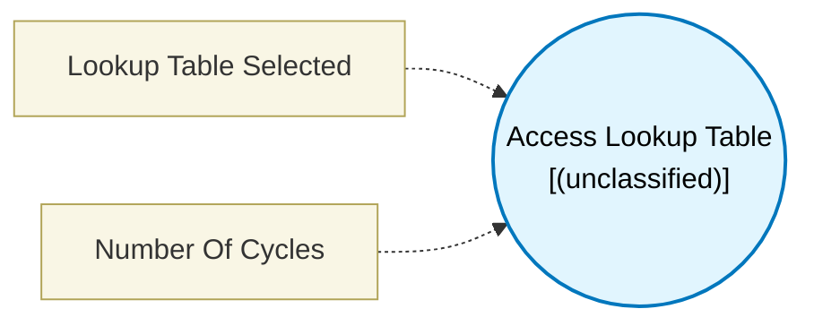

# Access Lookup Table (`access_look_up_table`) — Design Document

> Generated by `build_block_docs.js` from `.metadata/sysconfig/.meta/pru_blocks/utils/access_look_up_table.syscfg.js`. Do not edit by hand; re-run `node build_block_docs.js`.

## Purpose


## Access Lookup Table Block

### Purpose
Reads data from a lookup table stored in PRU Data Memory (DMEM) using an index value.

### How It Works
1. **Input**: Receives an index value (0 to tableSize-1) from the connected block
2. **Process**: Generates assembly code to read from the selected Lookup Table at that index position
3. **Output**: Sends the retrieved data value to the next block

### Configuration Steps
1. A Lookup Table block is automatically created and nested below — configure it with your table data
2. If multiple Lookup Table blocks exist, use the "Lookup Table Selected" field to choose which one to read from
3. Connect an index value to the "index" input port
4. The output data size automatically matches the referenced table's data type (byte/ushort/uint)

### Technical Details (Additional Information)
**Generated Assembly**:
- LDI32   TEMP_REG1, `LUT_BASE_ADDRESS`    ; Load table base address (2 cycles)
- byte table: LBBO &result, TEMP_REG1, index, 1  ; Load data from PRU DRAM (3 cycles)
- ushort/uint table: the index counts entries, so it is scaled to a byte offset first:
  LSL TEMP_REG2, index, 1 (ushort) or 2 (uint) ; 1 cycle
  ADD TEMP_REG1, TEMP_REG1, TEMP_REG2          ; 1 cycle
  LBBO &result, TEMP_REG1, 0, 2 or 4           ; 3 cycles

**Performance** (assuming word-aligned access to PRU DRAM)
- byte table: 5 PRU cycles (LDI32 2 + LBBO 3)
- ushort/uint table: 7 PRU cycles (LDI32 2 + LSL 1 + ADD 1 + LBBO 3)
- LBBO: 3 cycles (2 + N where N=1 for reading ≤4 bytes)

Note: Add +1 cycle if index results in non-word-aligned address

**Terminology**:
- **LBBO**: Load Byte Burst from Offset - reads 1/2/4 bytes from memory
- **DMEM**: PRU Data Memory - 8KB local RAM in each PRU core
- **Index**: Zero-based position in the table (must be less than table size)

---

## Block Diagram




## Classification

- **Block id:** `access_look_up_table`
- **Category:** Utilities
- **Execution model (inferred):** `(unclassified)`
- **Macro / opcode:** `m_lookup_table`
- **Data ports:** 1 in / 1 out · **Cycles:** `1`

## Parameter schema

| Parameter | Display name | Default | Options |
|---|---|---|---|
| `lutReference` | Lookup Table Selected | `` | — |
| `noOfCycles` | Number Of Cycles | `1` | — |

## Ports

| Port | Type |
|---|---|
| `input1` | `input32` |
| `prev` | `PREV` |
| `next` | `NEXT` |
| `output1` | `output32` |

## Validation rules

- Please select a lookup table to access
- LUT index <value> is negative. Valid range is [0, <value>]
- LUT index <value> is out of bounds. Valid range is [0, <value>]

## Generated macro (`.xdt` equivalent)

```asm
m_lookup_table	.macro  result, index, lutAddress, byteSize
	; Parameters:
	;   result      - Destination register to store the looked-up value
	;   index       - Index register containing table position (0 to tableSize-1)
	;   lutAddress  - Base address of the lookup table in memory
	;   byteSize    - Size of each table entry in bytes (1, 2, or 4)
    LDI32   TEMP_REG1, lutAddress
    .if byteSize == 1
    LBBO    &result, TEMP_REG1, index, byteSize
    .else
    .if byteSize == 2
    LSL     TEMP_REG2, index, 1
    .else
    LSL     TEMP_REG2, index, 2
    .endif
    ADD     TEMP_REG1, TEMP_REG1, TEMP_REG2
    LBBO    &result, TEMP_REG1, 0, byteSize
    .endif
 .endm
```

## Device portability

> **Source of truth:** `.metadata/sysconfig/.meta/pru_blocks/common/pru_device_caps.js` (TRM SPRUIM2J §6.4.1.1 / SPRUJB6 §7.3.1.1). Regenerated by `node build_block_docs.js` — do not edit by hand.

- **Required widget(s):** _(none)_
- **Validator:** `pru_blocks_static_module` raises a SysConfig **ERROR** naming both widget and device when a required widget is absent.

| Device (SoC) | Supported |
|---|---|
| `am243x` | ✅ |
| `am261x` | ✅ |
| `am263px` | ✅ |
| `am263x` | ✅ |
| `am64x` | ✅ |

## Outstanding TODO / VERIFY items

- None flagged in source.
