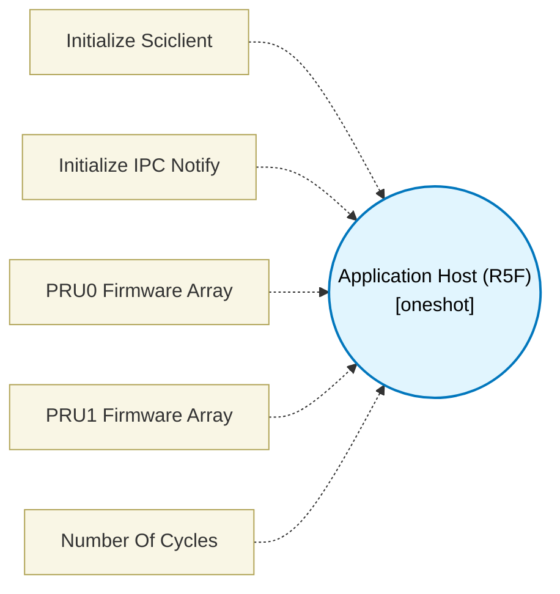

# Application Host (R5F) (`application_host_block`) — Design Document

> Generated by `build_block_docs.js` on 2026-10-21 from `.metadata/sysconfig/.meta/pru_blocks/application_specific/application_host_block.syscfg.js`. Do not edit by hand; re-run `node build_block_docs.js`.

## Purpose

Creates a main.c for the R5F core that initializes the Sciclient, loads PRU firmware, and reads shared memory for encoder positions.

## Block Diagram

## Classification

- **Block id:** `application_host_block`
- **Category:** Application-Specific
- **Execution model (inferred):** `oneshot`
- **Macro / opcode:** `m_host_app_none`
- **Data ports:** 0 in / 0 out · **Cycles:** `0`

## Parameter schema

| Parameter | Display name | Default | Options |
|---|---|---|---|
| `enableSciclient` | Initialize Sciclient | `true` | — |
| `enableIpcNotify` | Initialize IPC Notify | `true` | — |
| `pru0FirmwareName` | PRU0 Firmware Array | `TXPRU0Firmware_0` | — |
| `pru1FirmwareName` | PRU1 Firmware Array | `TXPRU1Firmware_0` | — |
| `noOfCycles` | Number Of Cycles | `0` | — |

## Ports

| Port | Type |
|---|---|
| `prev` | `IO_PREV` |
| `next` | `IO_NEXT` |

## Validation rules

- _(no explicit validate() rules)_

## Generated macro (`.xdt` equivalent)

_(host-code template; intentionally emits no PRU instruction)_

## Device portability

> **Source of truth:** `.metadata/sysconfig/.meta/pru_blocks/common/pru_device_caps.js` (TRM SPRUIM2J §6.4.1.1 / SPRUJB6 §7.3.1.1). Regenerated by `node build_block_docs.js` — do not edit by hand.

- **Required widget(s):** _(none)_
- **Validator:** `pru_blocks_static_module` raises a SysConfig **ERROR** naming both widget and device when a required widget is absent.

| Device (SoC) | Supported |
|---|---|
| `am243x` | ✅ |
| `am261x` | ✅ |
| `am263px` | ✅ |
| `am263x` | ✅ |
| `am64x` | ✅ |

## Outstanding TODO / VERIFY items

- None flagged in source.
