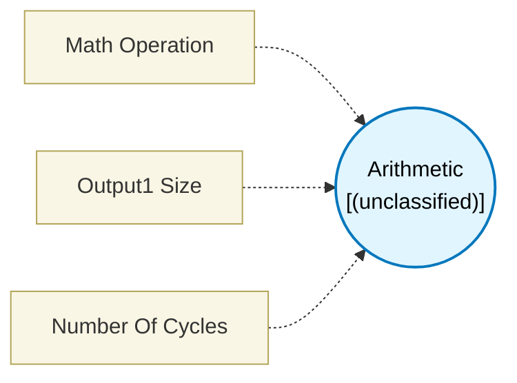

# Arithmetic (`arithmetic_block`) — Design Document

> Generated by `build_block_docs.js` from `.metadata/sysconfig/.meta/pru_blocks/data_handling/arithmetic_block.syscfg.js`. Do not edit by hand; re-run `node build_block_docs.js`.

## Purpose

## Arithmetic Block

### Purpose
Performs mathematical operations on two input values and outputs the result. Supports addition and subtraction with optional carry/borrow handling.

### How It Works
1. **Connect Inputs**: Connect two data sources to input1 and input2
2. **Select Operation**: Choose the arithmetic operation (ADD, ADC, SUB, SUC)
3. **Execute**: Generates the corresponding PRU arithmetic instruction
4. **Output**: Provides the calculation result to the next block

### Available Operations

**ADDITION**
- Standard add operation: result = input1 + input2
- Ignores carry flag

**ADDITION_WITH_CARRY**
- Includes carry from previous operation: result = input1 + input2 + carry
- Useful for multi-precision arithmetic (adding numbers larger than 32 bits)

**SUBTRACT**
- Standard subtract: result = input1 - input2
- Ignores borrow flag

**SUBTRACT_WITH_BORROW** (note: displays as "SUBTRACT_WITH_BARROW" in UI)
- Includes borrow from previous operation: result = input1 - input2 - borrow
- Useful for multi-precision subtraction

### Configuration
- **Math Operation**: Select ADD, ADC, SUB, or SUC
- **Output Size**: Choose result size
- **Maximum of Inputs**: Auto-size based on largest input (recommended)
- **One byte**: Force 8-bit result
- **Two bytes**: Force 16-bit result
- **Four bytes**: Force 32-bit result

### Technical Details (Additional Information)
**Generated Assembly**:
- ADD result, input1, input2     ; Addition (1 cycle)
- ADC result, input1, input2     ; Addition with carry (1 cycle)
- SUB result, input1, input2     ; Subtraction (1 cycle)
- SUC result, input1, input2     ; Subtract with borrow (1 cycle)

**Performance**: 1 PRU cycle for all operations

### Carry/Borrow Flags
- PRU maintains a carry flag that is set/cleared by arithmetic operations
- ADC/SUC instructions use this flag for extended precision arithmetic
- Example: Adding two 64-bit numbers requires two ADC operations

### Usage Notes
- Both inputs must be connected
- Output size should accommodate the expected result range
- Overflow is not detected - wraps around modulo 2^(output_size)

### Terminology
- **Carry**: Overflow bit from addition, used in multi-word operations
- **Borrow**: Underflow bit from subtraction, used in multi-word operations
- **Multi-precision**: Arithmetic on numbers larger than register size

## Block Diagram

## Classification

- **Block id:** `arithmetic_block`
- **Category:** Data Handling
- **Execution model (inferred):** `(unclassified)`
- **Macro / opcode:** `ADC`
- **Data ports:** 0 in / 0 out · **Cycles:** `1`

## Parameter schema

| Parameter | Display name | Default | Options |
|---|---|---|---|
| `opCode` | Math Operation | `ADC` | `ADC`, `ADD`, `SUC`, `SUB` |
| `output1Size` | Output1 Size | `maxOfInputs` | `maxOfInputs`, `1`, `2`, `4` |
| `noOfCycles` | Number Of Cycles | `1` | — |

## Ports

| Port | Type |
|---|---|
| `prev` | `PREV` |
| `next` | `NEXT` |

## Validation rules

- _(no explicit validate() rules)_

## Generated macro (`.xdt` equivalent)

_(inline opcode `ADC` emitted by the shared generator)_

## Device portability

> **Source of truth:** `.metadata/sysconfig/.meta/pru_blocks/common/pru_device_caps.js` (TRM SPRUIM2J §6.4.1.1 / SPRUJB6 §7.3.1.1). Regenerated by `node build_block_docs.js` — do not edit by hand.

- **Required widget(s):** _(none)_
- **Validator:** `pru_blocks_static_module` raises a SysConfig **ERROR** naming both widget and device when a required widget is absent.

| Device (SoC) | Supported |
|---|---|
| `am243x` | ✅ |
| `am261x` | ✅ |
| `am263px` | ✅ |
| `am263x` | ✅ |
| `am64x` | ✅ |

## Outstanding TODO / VERIFY items

- None flagged in source.
