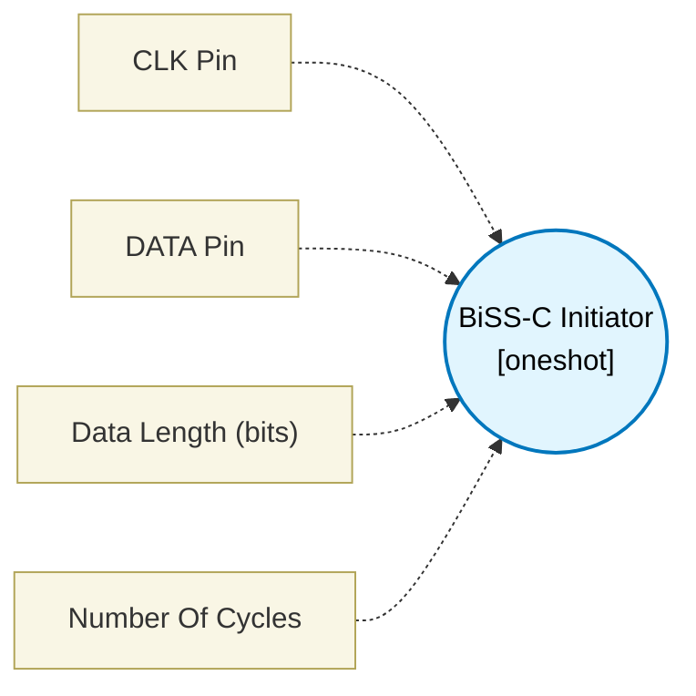

# BiSS-C Initiator (`biss_c_initiator_block`) — Design Document

> Generated by `build_block_docs.js` from `.metadata/sysconfig/.meta/pru_blocks/application_specific/biss_c_initiator_block.syscfg.js`. Do not edit by hand; re-run `node build_block_docs.js`.

## Purpose

Interfaces with the BiSS-C encoder. It is a shift register only: clock spacing is a fixed NOP (the clock frequency is not configurable), and there is no CRC, start/ACK or timeout handling. TI pru-simulator measures an 8-cycle bit period with changing input data. Exact 5 MHz physical timing and propagation delay are not implemented.

## Block Diagram




## Classification

- **Block id:** `biss_c_initiator_block`
- **Category:** Application-Specific
- **Execution model (inferred):** `oneshot`
- **Macro / opcode:** `m_biss_c_read`
- **Data ports:** 0 in / 1 out · **Cycles:** `500`

## Parameter schema

| Parameter | Display name | Default | Options |
|---|---|---|---|
| `clkPin` | CLK Pin | `0` | — |
| `dataPin` | DATA Pin | `1` | — |
| `dataLen` | Data Length (bits) | `32` | — |
| `noOfCycles` | Number Of Cycles | `500` | — |

## Ports

| Port | Type |
|---|---|
| `prev` | `IO_PREV` |
| `next` | `IO_NEXT` |
| `output1` | `output32` |

## Validation rules

- dataLen must be an integer 1..32 (the result is one 32-bit register)
- clkPin and dataPin must differ

## Generated macro (`.xdt` equivalent)

```asm
m_biss_c_read .macro RES, CLK, DATA, LEN
    ; --- BiSS-C Logical Shift Register Slice ---
    ; This loop models the synchronous clocking and data capture.
    ; Note: Simulator does not validate exact 5 MHz timing or propagation delay.
    ldi   TEMP_REG1, LEN              ; Bit counter (dataLen bits)
    ldi   RES, 0                      ; Clear result
m_biss_c_loop?:
    ; MA idles HIGH between frames: pulse it low, then back high.
    ; Ending each bit on clr would leave MA low after the frame, and the
    ; encoder would see the next transaction start from the wrong level.
    ; Set MA clock pin low
    clr   R30, R30, CLK               ; (clkPin: MA clock output bit)
    ; Wait half-period (not simulated accurately)
    nop
    ; Set MA clock pin high: rising edge k, slave presents bit k after it
    set   R30, R30, CLK
    ; Shift RES left by 1 to make room for new bit
    lsl   RES, RES, 1
    ; Sample SLO data pin
    qbbc  m_biss_c_zero?, R31, DATA   ; (dataPin: SLO data input bit)
    add   RES, RES, 1                 ; Set LSB if data is high
m_biss_c_zero?:
    sub   TEMP_REG1, TEMP_REG1, 1
    qbne  m_biss_c_loop?, TEMP_REG1, 0
    .endm
```

## Device portability

> **Source of truth:** `.metadata/sysconfig/.meta/pru_blocks/common/pru_device_caps.js` (TRM SPRUIM2J §6.4.1.1 / SPRUJB6 §7.3.1.1). Regenerated by `node build_block_docs.js` — do not edit by hand.

- **Required widget(s):** _(none)_
- **Validator:** `pru_blocks_static_module` raises a SysConfig **ERROR** naming both widget and device when a required widget is absent.

| Device (SoC) | Supported |
|---|---|
| `am243x` | ✅ |
| `am261x` | ✅ |
| `am263px` | ✅ |
| `am263x` | ✅ |
| `am64x` | ✅ |

## Outstanding TODO / VERIFY items

- None flagged in source.
