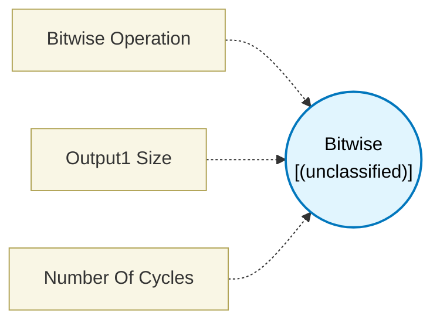

# Bitwise (`bitwise_block`) — Design Document

> Generated by `build_block_docs.js` from `.metadata/sysconfig/.meta/pru_blocks/data_handling/bitwise_block.syscfg.js`. Do not edit by hand; re-run `node build_block_docs.js`.

## Purpose

## Bitwise Block

### Purpose
Performs bitwise logical operations and bit shift operations on input values. Essential for bit manipulation, masking, and data formatting.

### How It Works
1. **Connect Inputs**: Connect one or two data sources (depends on operation)
2. **Select Operation**: Choose the bitwise operation
3. **Execute**: Generates the corresponding PRU bitwise instruction
4. **Output**: Provides the result to the next block

### Available Operations

**AND** (2 inputs)
- Bitwise AND: result = input1 & input2
- Used for masking bits, clearing specific bits
- Example: 0b1100 AND 0b1010 = 0b1000

**OR** (2 inputs)
- Bitwise OR: result = input1 | input2
- Used for setting bits, combining flags
- Example: 0b1100 OR 0b1010 = 0b1110

**XOR** (2 inputs)
- Bitwise XOR (exclusive OR): result = input1 ^ input2
- Used for toggling bits, comparison
- Example: 0b1100 XOR 0b1010 = 0b0110

**NOT** (1 input)
- Bitwise NOT (complement): result = ~input1
- Inverts all bits
- Example: NOT 0b1100 = 0b0011 (in 4-bit)

**LSL** (2 inputs)
- Logical Shift Left: result = input1 << input2
- Shifts bits left, fills with zeros
- Equivalent to multiplying by 2^input2
- Example: 0b0011 LSL 2 = 0b1100

**LSR** (2 inputs)
- Logical Shift Right: result = input1 >> input2
- Shifts bits right, fills with zeros
- Equivalent to dividing by 2^input2 (unsigned)
- Example: 0b1100 LSR 2 = 0b0011

### Configuration
- **Bitwise Operation**: Select AND, OR, XOR, NOT, LSL, or LSR
- Number of inputs adjusts automatically based on operation

### Technical Details (Additional Information)
**Generated Assembly**:
- AND result, input1, input2     ; Bitwise AND (1 cycle)
- OR  result, input1, input2     ; Bitwise OR (1 cycle)
- XOR result, input1, input2     ; Bitwise XOR (1 cycle)
- NOT result, input1             ; Bitwise NOT (1 cycle)
- LSL result, input1, input2     ; Left shift (1 cycle)
- LSR result, input1, input2     ; Right shift (1 cycle)

**Performance**: 1 PRU cycle for all operations

### Common Use Cases
- **Masking**: Use AND with bitmask to extract specific bits
- **Setting flags**: Use OR to set specific bits to 1
- **Toggling**: Use XOR to flip specific bits
- **Packing data**: Use shifts and OR to combine multiple values
- **Extracting fields**: Use shifts and AND to extract bit fields

### Terminology
- **Bitwise**: Operations that work on individual bits
- **Mask**: Bit pattern used to select/clear specific bits
- **Shift**: Moving bits left or right within a value
- **Logical shift**: Shift that fills with zeros (vs arithmetic shift)

## Block Diagram

## Classification

- **Block id:** `bitwise_block`
- **Category:** Data Handling
- **Execution model (inferred):** `(unclassified)`
- **Macro / opcode:** `AND`
- **Data ports:** 0 in / 0 out · **Cycles:** `1`

## Parameter schema

| Parameter | Display name | Default | Options |
|---|---|---|---|
| `opCode` | Bitwise Operation | `AND` | `AND`, `NOT`, `OR`, `XOR`, `LSL`, `LSR` |
| `output1Size` | Output1 Size | `maxOfInputs` | `maxOfInputs`, `1`, `2`, `4` |
| `noOfCycles` | Number Of Cycles | `1` | — |

## Ports

| Port | Type |
|---|---|
| `prev` | `PREV` |
| `next` | `NEXT` |

## Validation rules

- _(no explicit validate() rules)_

## Generated macro (`.xdt` equivalent)

_(inline opcode `AND` emitted by the shared generator)_

## Device portability

> **Source of truth:** `.metadata/sysconfig/.meta/pru_blocks/common/pru_device_caps.js` (TRM SPRUIM2J §6.4.1.1 / SPRUJB6 §7.3.1.1). Regenerated by `node build_block_docs.js` — do not edit by hand.

- **Required widget(s):** _(none)_
- **Validator:** `pru_blocks_static_module` raises a SysConfig **ERROR** naming both widget and device when a required widget is absent.

| Device (SoC) | Supported |
|---|---|
| `am243x` | ✅ |
| `am261x` | ✅ |
| `am263px` | ✅ |
| `am263x` | ✅ |
| `am64x` | ✅ |

## Outstanding TODO / VERIFY items

- None flagged in source.
