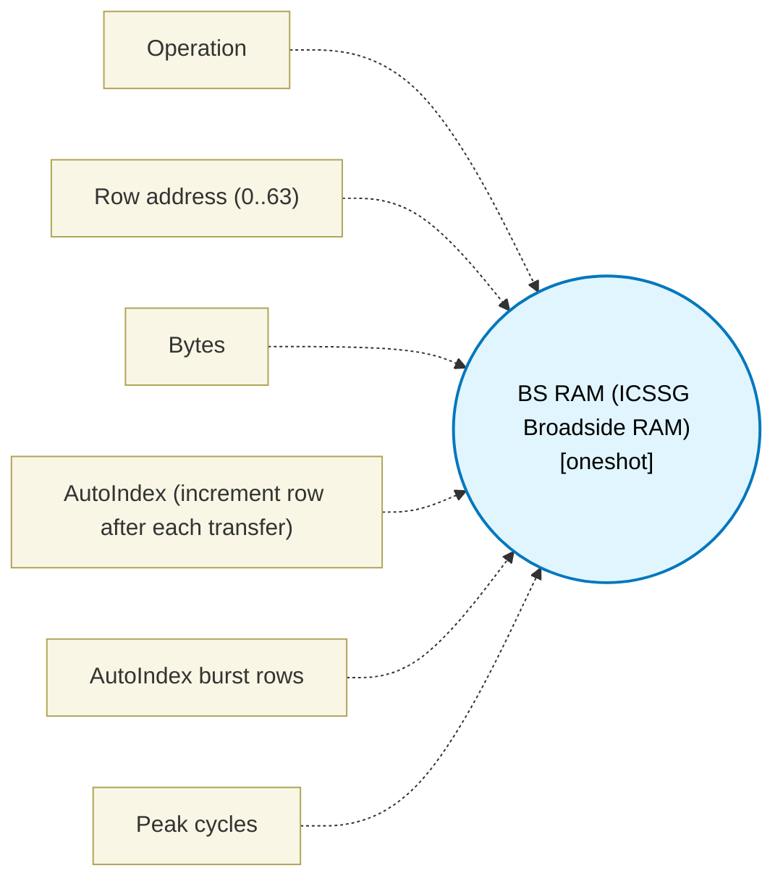

# BS RAM (ICSSG Broadside RAM) (`bs_ram_block`) — Design Document

> Generated by `build_block_docs.js` from `.metadata/sysconfig/.meta/pru_blocks/data_handling/bs_ram_block.syscfg.js`. Do not edit by hand; re-run `node build_block_docs.js`.

## Purpose

Wraps the ICSSG per-core private 2KB BS RAM (SPRUIM2J 6.4.6.2.5, Fig 6-49, Tables 6-91/6-92): 64 rows x 32 B, row 0..63. The TRM is internally inconsistent on the address space: 6.4.6.2.5 (PDF p.624) says each core has a dedicated 2KB BS RAM (2048/32 = 64 rows), while Table 6-92 (PDF p.625) gives R10 RAM_Address as bits 8-0 (512 entries) mapped to a '16KB RAM'. This block enforces the conservative 2KB reading, so a row address >63 is a build error. Sequences are deterministic XOUT/XIN with no other owner. Address is programmed via R10 (exactly 2 bytes, XOUT 48); data is via R2..R9 (XOUT/XIN 48 for direct read/write, 49 for BS RAM+SUM32 snoop). Write loads only R2 from its input, so write is limited to 1..4 bytes; read honours Bytes as the XIN length (1..32); snoop requires 32 Bytes (Table 6-91) and zero-fills R3..R9. Snoop is XOUT-only (XIN on snoop is refused) and has no TX_PRU mapping. AutoIndex past row 63 and addresses 64..511 are refused statically — the TRM is silent on them and no behaviour is invented. R10 and R2..R9 are architectural windows declared via registerClobbers and rejected if a live value would be overwritten. Cycle count is 1 by house convention (SPRUIM2J 6.4.6.2.5: XFR is 1 cycle) and must not promote maturity above simulator-tested without a bench. Default Bytes changed 32 -> 4; a saved Snoop Write that used the old default must set Bytes = 32. Available only on ICSSG (AM64x/AM243x), PRU0/PRU1 cores.

## Block Diagram




## Classification

- **Block id:** `bs_ram_block`
- **Category:** Data Handling
- **Execution model (inferred):** `oneshot`
- **Macro / opcode:** `m_bsram_write`
- **Data ports:** 1 in / 0 out · **Cycles:** `1`

## Parameter schema

| Parameter | Display name | Default | Options |
|---|---|---|---|
| `operation` | Operation | `write` | `write`, `read`, `snoop_write` |
| `rowAddress` | Row address (0..63) | `0` | — |
| `byteCount` | Bytes | `4` | — |
| `autoIndex` | AutoIndex (increment row after each transfer) | `false` | — |
| `autoCount` | AutoIndex burst rows | `1` | — |
| `noOfCycles` | Peak cycles | `1` | — |

## Ports

| Port | Type |
|---|---|
| `prev` | `IO_PREV` |
| `next` | `IO_NEXT` |
| `input1` | `input32` |

## Validation rules

- BS RAM operation '
- BS RAM base device ID 48 (0x30) is implemented here for PRU/TX_PRU only (SPRUIM2J Fig 6-49). RTU_PRU has a distinct mapping not implemented by this block; placed core is '
- BS RAM snoop (XOUT 49 / 0x31) has no documented TX_PRU mapping (SPRUIM2J Table 6-93 only lists PRU 49 and RTU 39). Snoop on TX_PRU is refused.
- XIN on snoop device ID 49 (BS RAM + SUM32) is not a defined direction (SPRUIM2J Tables 6-91/6-92: snoop is XOUT 49 only). Snoop is write-only.
- XIN on snoop device ID 49 is not a defined direction (SPRUIM2J Tables 6-91/6-92: snoop is XOUT 49 only).
- BS RAM row address must be an integer 0..
- BS RAM address programming is XOUT 48, &R10, 2 (SPRUIM2J Fig 6-49). R10 byte count must be exactly 2, got
- BS RAM address programming is XOUT 48, &R10, 2 (SPRUIM2J Fig 6-49). R10 byte count must be exactly 2.
- BS RAM data window is architecturally R2..R9 (SPRUIM2J Tables 6-91/6-92). Start register must be R2, got R
- BS RAM data window must start at R2 (SPRUIM2J Tables 6-91/6-92).
- BS RAM row is
- BS RAM write loads only R2 (4 bytes) from its input, so Bytes must be 1..
- BS RAM snoop write (XOUT 49) requires a 32 Byte write (SPRUIM2J 6.4.6.2.5 BS RAM + SUM32 snoop mode, Table 6-91). Bytes must be 32, got
- BS RAM AutoIndex from row
- BS RAM AutoIndex at row

## Generated macro (`.xdt` equivalent)

```asm
m_bsram_write .macro RES, INPUT, ROW, BYTECOUNT
    ; ICSSG BS RAM write — SPRUIM2J 6.4.6.2.5 Fig 6-49, Tables 6-91/6-92.
    ; Device is 2KB = 64 rows x 32 B; ROW 0..63 (TRM p.624 vs Table 6-92 p.625 disagree; conservative range).
    ; Address is programmed via R10 (2 bytes). Only R2 is loaded from INPUT, so BYTECOUNT is 1..4 (validate()).
    ldi   R10.w0, ROW
    xout  48, &R10, 2
    mov   R2, INPUT
    xout  48, &R2, BYTECOUNT
    mov   RES, R2
    .endm
```

## Device portability

> **Source of truth:** `.metadata/sysconfig/.meta/pru_blocks/common/pru_device_caps.js` (TRM SPRUIM2J §6.4.1.1 / SPRUJB6 §7.3.1.1). Regenerated by `node build_block_docs.js` — do not edit by hand.

- **Required widget(s):** `bs_ram`
- **Validator:** `pru_blocks_static_module` raises a SysConfig **ERROR** naming both widget and device when a required widget is absent.

| Device (SoC) | Supported |
|---|---|
| `am243x` | ✅ |
| `am261x` | ❌ bs_ram |
| `am263px` | ❌ bs_ram |
| `am263x` | ❌ bs_ram |
| `am64x` | ✅ |

## Outstanding TODO / VERIFY items

- None flagged in source.
