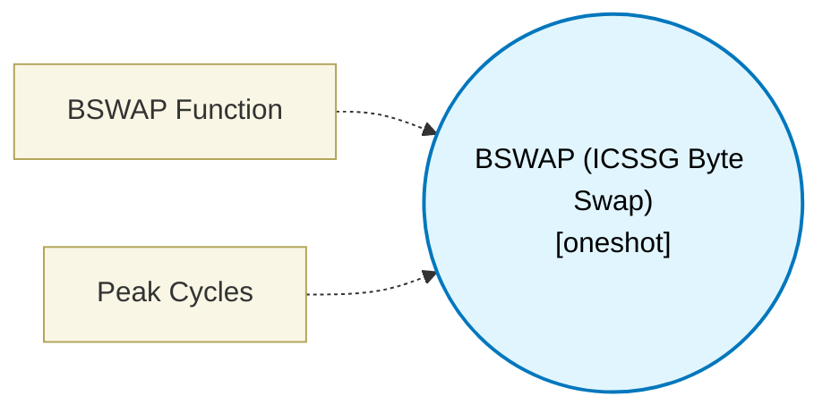

# BSWAP (ICSSG Byte Swap) (`bswap_block`) — Design Document

> Generated by `build_block_docs.js` from `.metadata/sysconfig/.meta/pru_blocks/data_handling/bswap_block.syscfg.js`. Do not edit by hand; re-run `node build_block_docs.js`.

## Purpose

Emits a real XIN against the ICSSG Byte Swap unit (SPRUIM2J 6.4.6.2.7, Table 6-95): 0xA0 flips byte order in place in the block's own register; 0xA1 swaps R2-R5 with R6-R9; 0xA2 swaps R2-R5 with R14-R17 and R6-R9 with R10-R13. The 0xA1/0xA2 windows are fixed, so this block declares them in registerClobbers and a design holding a live value across such a swap is rejected at build time. BSWAP is an ICSSG widget and is absent on ICSSM (AM261x/AM263Px); there is no software fallback in this block - it is a hardware block and requiresWidget says so. Maturity is 'assembles': the emitted macro is assembled by clpru and executed against a TRM-derived XIN device model in scripts/simulator.js. That model and this block were both written from SPRUIM2J, so the simulator arm is not an independent oracle and cannot substitute for silicon validation.

## Block Diagram




## Classification

- **Block id:** `bswap_block`
- **Category:** Data Handling
- **Execution model (inferred):** `oneshot`
- **Macro / opcode:** `m_bswap_word_swap`
- **Data ports:** 1 in / 1 out · **Cycles:** `2`

## Parameter schema

| Parameter | Display name | Default | Options |
|---|---|---|---|
| `mode` | BSWAP Function | `word_swap` | `word_swap`, `swap_4_8`, `swap_4_16` |
| `noOfCycles` | Peak Cycles | `2` | — |

## Ports

| Port | Type |
|---|---|
| `prev` | `IO_PREV` |
| `next` | `IO_NEXT` |
| `input1` | `input32` |
| `output1` | `output32` |

## Validation rules

- BSWAP mode '
- BSWAP has no Width setting: the span is the XIN length, and 0xA1/0xA2

## Generated macro (`.xdt` equivalent)

```asm
m_bswap_word_swap .macro RES, INPUT
    ; ICSSG BSWAP 0xA0 Byte Order Swap (SPRUIM2J 6.4.6.2.7.1, Table 6-95).
    ; 0xA0 operates in place on any of R0-R29, so the swap is done on the
    ; allocator's own output register and no fixed range is reserved.
    mov   RES, INPUT
    xin   160, &RES, 4
    .endm
```

## Device portability

> **Source of truth:** `.metadata/sysconfig/.meta/pru_blocks/common/pru_device_caps.js` (TRM SPRUIM2J §6.4.1.1 / SPRUJB6 §7.3.1.1). Regenerated by `node build_block_docs.js` — do not edit by hand.

- **Required widget(s):** `bswap`
- **Validator:** `pru_blocks_static_module` raises a SysConfig **ERROR** naming both widget and device when a required widget is absent.

| Device (SoC) | Supported |
|---|---|
| `am243x` | ✅ |
| `am261x` | ❌ bswap |
| `am263px` | ❌ bswap |
| `am263x` | ❌ bswap |
| `am64x` | ✅ |

## Outstanding TODO / VERIFY items

- None flagged in source.
