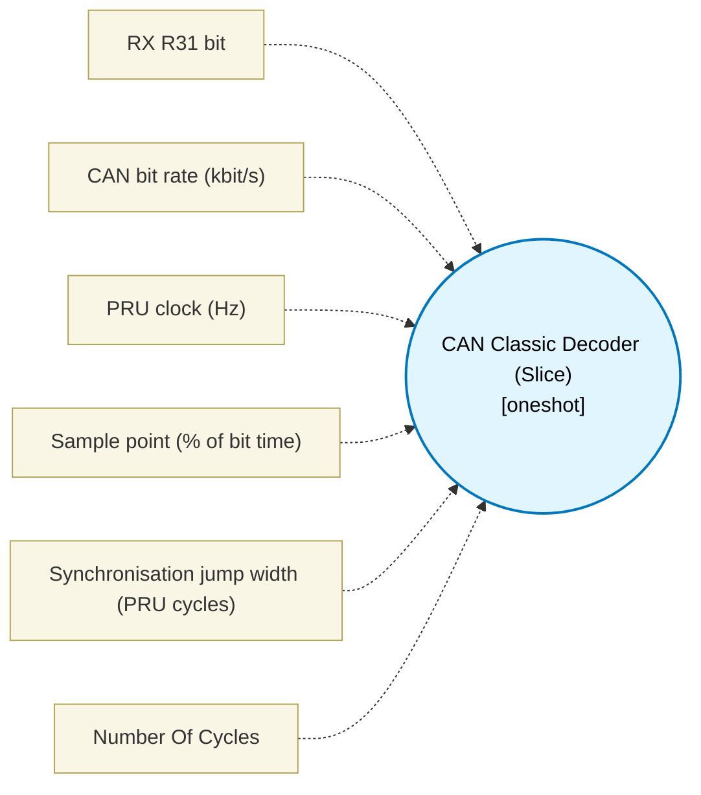

# CAN Classic Decoder (Slice) (`can_classic_decoder_block`) — Design Document

> Generated by `build_block_docs.js` on 2026-10-21 from `.metadata/sysconfig/.meta/pru_blocks/pru_io_blocks/can_classic_decoder_block.syscfg.js`. Do not edit by hand; re-run `node build_block_docs.js`.

## Purpose

Reads a bit-stuffed CAN Classic stream at a configurable bit rate, handles bit destuffing (skip after 5 identical), and extracts a 32-bit payload without MULL. Excludes arbitration and CRC for this slice; it does not flag stuff errors and does not check that SOF is still dominant at its sample point. TIMING: bit time is clkHz / (bitRateKbps * 1000) PRU cycles (200 for 1 Mbit/s and 400 for 500 kbit/s at 200 MHz); the sample point is samplePointPercent of the bit; the decoder hard-syncs on the SOF edge and then applies a soft resync (ISO 11898-1: recessive-to-dominant edges only, at most one per bit, armed after a recessive sample) whose correction is clamped to sjwCycles (rounded to the 3-cycle poll tick, default one tick). The destuff path costs exactly 10 PRU cycles on every path and the remainder of the bit is a cycle-counted 3-cycle poll loop, so sample-to-sample is exactly one bit time. Supported bit time is 41 to 20000 PRU cycles (sjwCycles = 3). Verified on the TI pru-simulator running the real clpru ELF at 200 and 400 cycles per bit (clean frame, per-bit jitter, oscillator drift, a phase error larger than SJW); NOT hardware validated. The block waits for the SOF edge and then runs for 32 destuffed bits, so it has no bounded peak cycle count: noOfCycles is -1 (unknown) and the generated OVERALL PEAK CYCLES header reads Unknown. BREAKING CHANGE: the old fixed 10-PRU-cycles-per-bit sampling (PRU clock / 10) is gone, and a saved .syscfg that lacks the new bitRateKbps, clkHz, samplePointPercent and sjwCycles fields now decodes at the defaults, 1 Mbit/s at 200 MHz = 200 cycles per bit. Dead zone: at the minimum configurations a late edge more than SJW + 2 cycles after nominal is ignored (the sample point does not move), and an early edge within the 10-cycle destuff path after the sample is ignored. See docs/can_classic_bit_timing.md for the cycle budget.

## Block Diagram




## Classification

- **Block id:** `can_classic_decoder_block`
- **Category:** I/O & Protocol
- **Execution model (inferred):** `oneshot`
- **Macro / opcode:** `m_can_classic_decoder`
- **Data ports:** 0 in / 0 out · **Cycles:** `-1`

## Parameter schema

| Parameter | Display name | Default | Options |
|---|---|---|---|
| `rxBit` | RX R31 bit | `0` | `0`, `1`, `2`, `3`, `4`, `5`, `6`, `7`, `8`, `9`, `10`, `11`, `12`, `13`, `14`, `15`, `16`, `17`, `18`, `19` |
| `bitRateKbps` | CAN bit rate (kbit/s) | `1000` | — |
| `clkHz` | PRU clock (Hz) | `200000000` | — |
| `samplePointPercent` | Sample point (% of bit time) | `75` | — |
| `sjwCycles` | Synchronisation jump width (PRU cycles) | `3` | — |
| `noOfCycles` | Number Of Cycles | `-1` | — |

## Ports

| Port | Type |
|---|---|
| `output1` | `output32` |
| `prev` | `IO_PREV` |
| `next` | `IO_NEXT` |

## Validation rules

- bitRateKbps must be a whole number of kbit/s >= 1
- clkHz must be the PRU clock in Hz (a whole number >= 1)
- samplePointPercent must be a whole number from 50 to 95 (CAN controllers use 75 to 87.5)
- sjwCycles must be a whole number of PRU cycles >= <value> (one 3-cycle poll tick; the macro rounds it to whole ticks)
- bit time is <value> PRU cycles (clkHz / (bitRateKbps * 1000)); the minimum is <value>. Lower bitRateKbps or raise clkHz
- bit time is <value> PRU cycles; the maximum is <value> (16-bit wait counter). Raise bitRateKbps or lower clkHz
- sjwCycles (<value>, <value> after rounding to whole ticks) exceeds Phase_Seg2 = bit time - sample point = <value> cycles; lower sjwCycles or the sample point
- sample point is <value> cycles after the edge; with sjwCycles = <value> the soft-resync poll window needs at least <value>. <value>
- Phase_Seg2 (bit time - sample point) is <value> cycles; with sjwCycles = <value> the 10-cycle destuff path plus the soft-resync poll window needs at least <value>. <value>

## Generated macro (`.xdt` equivalent)

```asm
; CAN Classic Bit-Stuffed Decoder Slice (configurable bit time, sample point, SOF hard sync, SJW-bounded soft resync)
; Descrambles 32 bits from RX stream (removes stuff bits)
; Does not use MULL
; Arguments (all derived by the block from bitRateKbps, clkHz, samplePointPercent, sjwCycles; BIT_CYC is
; clkHz / (bitRateKbps * 1000), e.g. 200 for 1 Mbit/s and 400 for 500 kbit/s at 200 MHz):
;   WAIT_TICKS  (BIT_CYC - 10) / 3   3-cycle poll ticks per bit
;   PAD_CYC     (BIT_CYC - 10) mod 3 nops after the wait loop, so 10 + 3 * WAIT_TICKS + PAD_CYC = BIT_CYC
;   SOF_TICKS   (BIT_CYC + 3 * HARD_TICKS + 4) / 3   wait from the SOF edge to the first data-bit sample
;   SOF_PAD     (BIT_CYC + 4) mod 3 nops on the SOF path
;   HARD_TICKS  (SAMPLE_CYC - PAD_CYC - 10 + 1) / 3   ticks to wait after an in-window edge (hard sync)
;   SJW_TICKS   max(1, (SJW_CYC + 1) / 3)   synchronisation jump width in 3-cycle ticks
; The destuff/shift path costs exactly 10 cycles on every path (sample instruction included). The rest of
; the bit is a 3-cycle poll loop (WAIT_TICKS iterations) plus PAD_CYC nops, so sample-to-sample is BIT_CYC.
; Hard sync on the SOF edge only; later recessive-to-dominant edges are a SOFT resync clamped to +-SJW
; (ISO 11898-1), at most one per bit, armed only after a recessive sample. See docs/can_classic_bit_timing.md.
; Temporaries: TEMP_REG1 (R28) wait counter, TEMP_REG2 (R29) compare scratch, R8..R10 as before.
m_can_classic_decoder .macro RES, RX_BIT, WAIT_TICKS, PAD_CYC, SOF_TICKS, SOF_PAD, HARD_TICKS, SJW_TICKS
    ; Temporaries in R8, R9, R10 for this slice
    ldi R8, 0 ; R_COUNT = 0
    ldi R9, 1 ; R_SAME = 1
    ldi R10, 1 ; R_PREV = 1
    ldi RES, 0 ; R_RESULT = 0

WAIT_SOF?:
    qbbs WAIT_SOF?, R31, RX_BIT ; 1-cycle poll while RX is 1; falls through on the SOF edge (hard sync)
    ldi R10, 0 ; +1
    ldi R9, 1 ; +2
    ldi R8, 0 ; +3
    ldi TEMP_REG1, SOF_TICKS ; +4  the first data-bit sample is BIT_CYC + sample point after the SOF edge
    .if SOF_PAD >= 1
    nop
    .endif
    .if SOF_PAD >= 2
    nop
    .endif
    jmp WAIT_D? ; SOF edge to the unarmed loop is 6 + SOF_PAD cycles

; Armed wait loop (previous sample recessive): 3 cycles per tick, polls for a dominant edge.
; Runs while TEMP_REG1 > G = SJW_TICKS + 3, then falls into the unarmed loop for the last G ticks
; (an edge in the final G ticks is not used, which also keeps the soft-resync reload >= 1).
WAIT_A?:
    qbbc EDGE?, R31, RX_BIT ; dominant: edge found (a taken branch costs 1 cycle)
    sub TEMP_REG1, TEMP_REG1, 1
    qbne WAIT_A?, TEMP_REG1, (SJW_TICKS + 3)
; Unarmed wait loop: identical 3-cycle tick, no edge poll.
WAIT_D?:
    nop
    sub TEMP_REG1, TEMP_REG1, 1
    qbne WAIT_D?, TEMP_REG1, 0
    ; remainder pad: PAD_CYC = BIT_CYC - 10 - 3 * WAIT_TICKS cycles (0..2) so the bit is exactly BIT_CYC
    .if PAD_CYC >= 1
    nop
    .endif
    .if PAD_CYC >= 2
    nop
    .endif

LOOP?:
    qbbs BIT_IS_1?, R31, RX_BIT ; cycle 1 = the sample instant
BIT_IS_0?:
    qbne NO_STUFF_0?, R9, 5 ; 2
    ; Stuff bit 0 (cycles 3..10)
    ldi R9, 1
    ldi R10, 0
    ldi TEMP_REG1, WAIT_TICKS
    nop
    nop
    nop
    nop
    qbne WAIT_D?, R8, 32 ; 10
    jmp EXIT?
NO_STUFF_0?:
    lsl RES, RES, 1 ; 3
    add R8, R8, 1 ; 4
    qbeq CHECK_SAME_0?, R10, 0 ; 5
    ; Diff 0 (cycles 6..10)
    ldi R9, 1
    ldi R10, 0
    ldi TEMP_REG1, WAIT_TICKS
    nop
    qbne WAIT_D?, R8, 32 ; 10
    jmp EXIT?
CHECK_SAME_0?:
    ; Same 0 (cycles 6..10)
    add R9, R9, 1
    ldi TEMP_REG1, WAIT_TICKS
    nop
    nop
    qbne WAIT_D?, R8, 32 ; 10
    jmp EXIT?

BIT_IS_1?:
    qbne NO_STUFF_1?, R9, 5 ; 2
    ; Stuff bit 1 (cycles 3..10)
    ldi R9, 1
    ldi R10, 1
    ldi TEMP_REG1, WAIT_TICKS
    nop
    nop
    nop
    nop
    qbne WAIT_A?, R8, 32 ; 10, recessive sample: the next wait is armed
    jmp EXIT?
NO_STUFF_1?:
    lsl RES, RES, 1 ; 3
    or RES, RES, 1 ; 4
    add R8, R8, 1 ; 5
    qbeq CHECK_SAME_1?, R10, 1 ; 6
    ; Diff 1 (cycles 7..10)
    ldi R9, 1
    ldi R10, 1
    ldi TEMP_REG1, WAIT_TICKS
    qbne WAIT_A?, R8, 32 ; 10
    jmp EXIT?
CHECK_SAME_1?:
    ; Same 1 (cycles 7..10)
    add R9, R9, 1
    ldi TEMP_REG1, WAIT_TICKS
    nop
    qbne WAIT_A?, R8, 32 ; 10
    jmp EXIT?

; Soft resync, entered from the armed poll (TEMP_REG1 = ticks still to wait, this one included).
; A nominal edge arrives with TEMP_REG1 = HARD_TICKS + 3. Within +-SJW_TICKS of that the reload is the
; hard-sync value HARD_TICKS; beyond it the reload is the nominal wait (TEMP_REG1 - 3) shifted by exactly
; +-SJW_TICKS. Every path is 8 cycles + the poll cycle = 9 = 3 ticks.
EDGE?:
    ldi TEMP_REG2, (HARD_TICKS + 3 - SJW_TICKS) ; 1
    qbgt LATE?, TEMP_REG1, TEMP_REG2 ; 2  lower bound > TEMP_REG1: edge later than nominal + SJW
    ldi TEMP_REG2, (HARD_TICKS + 3 + SJW_TICKS) ; 3
    qblt EARLY?, TEMP_REG1, TEMP_REG2 ; 4  upper bound < TEMP_REG1: edge earlier than nominal - SJW
    ldi TEMP_REG1, HARD_TICKS ; 5  within SJW: hard sync to the edge
    nop ; 6
    nop ; 7
    jmp WAIT_D? ; 8
LATE?:
    ldi TEMP_REG2, SJW_TICKS ; 3  (reload = TEMP_REG1 - 3 + SJW_TICKS)
    sub TEMP_REG1, TEMP_REG1, 3 ; 4
    add TEMP_REG1, TEMP_REG1, TEMP_REG2 ; 5
    nop ; 6
    nop ; 7
    jmp WAIT_D? ; 8
EARLY?:
    ldi TEMP_REG2, (SJW_TICKS + 3) ; 5  (reload = TEMP_REG1 - 3 - SJW_TICKS)
    sub TEMP_REG1, TEMP_REG1, TEMP_REG2 ; 6
    nop ; 7
    jmp WAIT_D? ; 8
EXIT?:
    .endm
```

## Device portability

> **Source of truth:** `.metadata/sysconfig/.meta/pru_blocks/common/pru_device_caps.js` (TRM SPRUIM2J §6.4.1.1 / SPRUJB6 §7.3.1.1). Regenerated by `node build_block_docs.js` — do not edit by hand.

- **Required widget(s):** _(none)_
- **Validator:** `pru_blocks_static_module` raises a SysConfig **ERROR** naming both widget and device when a required widget is absent.

| Device (SoC) | Supported |
|---|---|
| `am243x` | ✅ |
| `am261x` | ✅ |
| `am263px` | ✅ |
| `am263x` | ✅ |
| `am64x` | ✅ |

## Outstanding TODO / VERIFY items

- None flagged in source.
