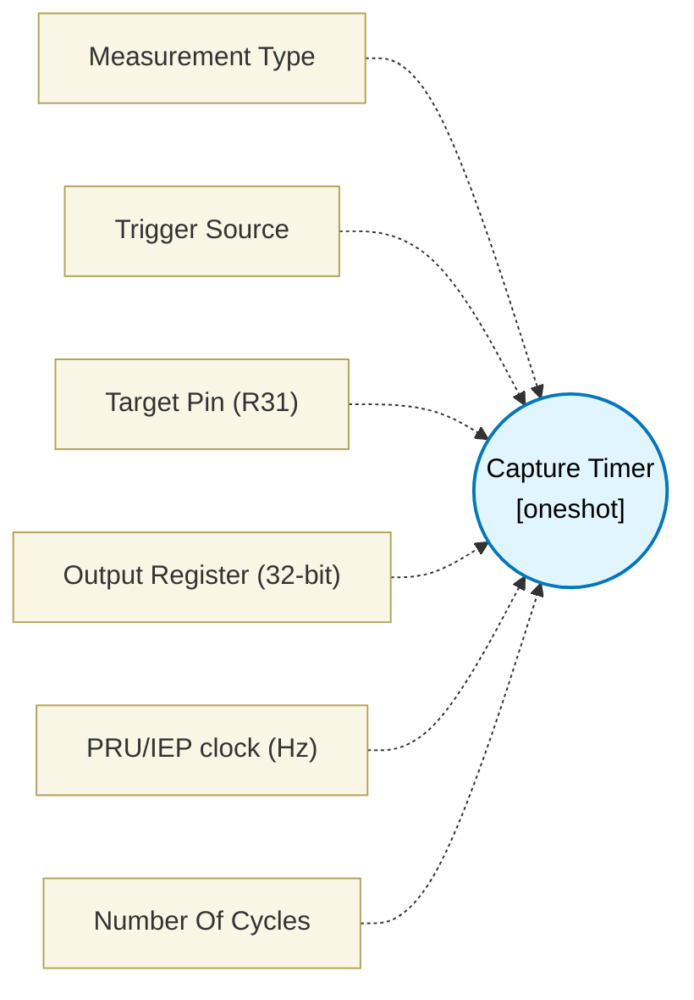

# Capture Timer (`capture_block`) — Design Document

> Generated by `build_block_docs.js` from `.metadata/sysconfig/.meta/pru_blocks/pru_io_blocks/capture_block.syscfg.js`. Do not edit by hand; re-run `node build_block_docs.js`.

## Purpose

Emits parameterized capture logic to measure pulse widths, frequencies, or time between edges.

## Block Diagram




## Classification

- **Block id:** `capture_block`
- **Category:** I/O & Protocol
- **Execution model (inferred):** `oneshot`
- **Macro / opcode:** `m_capture_run`
- **Data ports:** 0 in / 1 out · **Cycles:** `1`

## Parameter schema

| Parameter | Display name | Default | Options |
|---|---|---|---|
| `measurementType` | Measurement Type | `pulseWidth` | `pulseWidth`, `frequency`, `timeBetweenEdges` |
| `triggerSource` | Trigger Source | `iep` | `iep`, `gpio`, `internal` |
| `pin` | Target Pin (R31) | `5` | `0`, `1`, `2`, `3`, `4`, `5`, `6`, `7`, `8`, `9`, `10`, `11`, `12`, `13`, `14`, `15`, `16`, `17`, `18`, `19` |
| `dataRegister` | Output Register (32-bit) | `R4` | — |
| `clkHz` | PRU/IEP clock (Hz) | `200000000` | — |
| `noOfCycles` | Number Of Cycles | `1` | — |

## Ports

| Port | Type |
|---|---|
| `output1` | `output32` |
| `prev` | `IO_PREV` |
| `next` | `IO_NEXT` |

## Validation rules

- clkHz must be > 0

## Generated macro (`.xdt` equivalent)

```asm
m_capture_run .macro RES, TRIG_SRC, MEASURE_TYPE, PIN, DATA_REG
    .if TRIG_SRC == 0
    ; Enable IEP counter with DEFAULT_INC=1
    ldi32 TEMP_REG1, 0x11
    sbco  &TEMP_REG1, c26, 0x00, 4
    ldi32 TEMP_REG1, 1
    sbco  &TEMP_REG1, c26, 0x18, 4
cp_iw?:
    lbco  &TEMP_REG1, c26, 0x1C, 4
    qbbc  cp_iw?, TEMP_REG1, 0
    lbco  &DATA_REG, c26, 0x20, 4
    .else
    .if MEASURE_TYPE == 0
cp_pw_r?:
    qbbc  cp_pw_r?, R31, PIN
    zero  &DATA_REG, 4
cp_pw_l?:
    add   DATA_REG, DATA_REG, 1
    qbbs  cp_pw_l?, R31, PIN
    .else
    .if MEASURE_TYPE == 1
cp_fq_fr?:
    qbbc  cp_fq_fr?, R31, PIN
cp_fq_fa?:
    qbbs  cp_fq_fa?, R31, PIN
    zero  &DATA_REG, 4
cp_fq_p?:
    add   DATA_REG, DATA_REG, 1
    qbbc  cp_fq_p?, R31, PIN
    .else
    qbbs  cp_tb_ih?, R31, PIN
cp_tb_il?:
    qbbc  cp_tb_il?, R31, PIN
    zero  &DATA_REG, 4
cp_tb_wf?:
    add   DATA_REG, DATA_REG, 1
    qbbs  cp_tb_wf?, R31, PIN
    qba   cp_tb_d?
cp_tb_ih?:
    qbbs  cp_tb_ih?, R31, PIN
    zero  &DATA_REG, 4
cp_tb_wr?:
    add   DATA_REG, DATA_REG, 1
    qbbc  cp_tb_wr?, R31, PIN
cp_tb_d?:
    .endif
    .endif
    .endif
    .endm
```

## Device portability

> **Source of truth:** `.metadata/sysconfig/.meta/pru_blocks/common/pru_device_caps.js` (TRM SPRUIM2J §6.4.1.1 / SPRUJB6 §7.3.1.1). Regenerated by `node build_block_docs.js` — do not edit by hand.

- **Required widget(s):** _(none)_
- **Validator:** `pru_blocks_static_module` raises a SysConfig **ERROR** naming both widget and device when a required widget is absent.

| Device (SoC) | Supported |
|---|---|
| `am243x` | ✅ |
| `am261x` | ✅ |
| `am263px` | ✅ |
| `am263x` | ✅ |
| `am64x` | ✅ |

## Outstanding TODO / VERIFY items

- None flagged in source.
