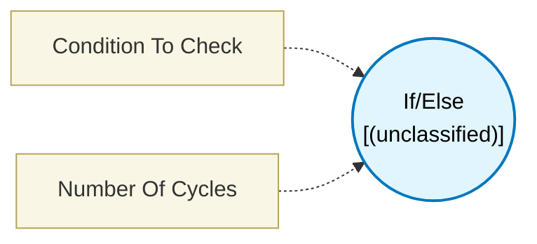

# If/Else (`conditional_block`) — Design Document

> Generated by `build_block_docs.js` on 2026-10-21 from `.metadata/sysconfig/.meta/pru_blocks/program_control/conditional_block.syscfg.js`. Do not edit by hand; re-run `node build_block_docs.js`.

## Purpose

## If/Else Block (Conditional Branching)

### Purpose
Implements conditional logic (IF/ELSE statements) to control program flow based on comparing two input values. Directs execution to different paths depending on whether the condition is true or false.

### How It Works
1. **Input 1**: First value to compare
2. **Input 2**: Second value to compare
3. **Condition**: Select comparison operation (>, <, ==, !=, >=, <=)
4. **Branching**:
- If condition is TRUE → executes blocks connected to **t_next** port
- If condition is FALSE → executes blocks connected to **f_next** port

### Configuration

**Condition To Check**: Select the comparison operation
- **Greater Than Input2**: Input1 > Input2
- **Less Than Input2**: Input1 < Input2
- **Equal To Input2**: Input1 == Input2
- **Not Equal To Input2**: Input1 != Input2
- **Greater Than Or Equal To Input2**: Input1 >= Input2
- **Less Than Or Equal To Input2**: Input1 <= Input2

### Technical Details (Additional Information)

**Generated Assembly**:
- ; Example: Greater Than Input2 (QBGT)
- QBGT TRUE_LABEL, input1_reg, input2_reg   ; Branch if input1 > input2 (1 cycle)
- ; FALSE path code here
- QBA  END_LABEL                             ; Jump to end
- TRUE_LABEL:
- ; TRUE path code here
- END_LABEL:

**PRU Branch Instructions**:
- **QBGT**: Quick Branch if Greater Than (unsigned comparison)
- **QBLT**: Quick Branch if Less Than (unsigned comparison)
- **QBEQ**: Quick Branch if Equal
- **QBNE**: Quick Branch if Not Equal
- **QBGE**: Quick Branch if Greater than or Equal
- **QBLE**: Quick Branch if Less than or Equal

**Performance**: 1 PRU cycle for the comparison and branch decision

**Comparison Type**: All comparisons are **unsigned** integer comparisons
- Treats values as unsigned (0 to 255 for bytes, 0 to 65535 for shorts, etc.)
- Negative numbers are not supported in standard mode

### Connection Ports

**Input Ports**:
- **input1**: First comparison value
- **input2**: Second comparison value

**Output Ports**:
- **t_next** (true next): Connect blocks to execute when condition is TRUE
- **f_next** (false next): Connect blocks to execute when condition is FALSE

### Usage Notes
- Both input ports must be connected for conditional operation
- Both t_next and f_next ports must be connected: an unconnected branch is a validation error (it would otherwise assemble to an undefined cmp_TRUE/cmp_FALSE label)
- Comparisons are unsigned - values treated as positive integers
- The conditional check happens instantly (1 cycle)
- Code on both branches is generated, only one path executes at runtime
- This block does not produce an output value - it only controls flow
- **Always terminate each branch (T and F) with a Flow Control block**: The FALSE path falls through to the TRUE path in the generated assembly unless explicitly stopped. Without a terminator on the FALSE branch, both branches execute sequentially regardless of the condition result.

### Terminology
- **Conditional branching**: Changing program flow based on a condition
- **IF/ELSE**: Fundamental programming construct for decisions
- **Branch instruction**: Assembly instruction that jumps to different code location
- **Quick Branch (QB)**: PRU's fast comparison and branch instructions
- **Unsigned comparison**: Treating all values as positive (0 to max)
- **Label**: Named location in assembly code for branching target
- **Control flow**: Order in which instructions execute
- **t_next/f_next**: True next and False next - execution paths after condition

---

## Block Diagram

## Classification

- **Block id:** `conditional_block`
- **Category:** Program Control
- **Execution model (inferred):** `(unclassified)`
- **Macro / opcode:** `LDI`
- **Data ports:** 0 in / 0 out · **Cycles:** `1`

## Parameter schema

| Parameter | Display name | Default | Options |
|---|---|---|---|
| `conditionToCheck` | Condition To Check | `greaterThanInput2` | `greaterThanInput2`, `lessThanInput2`, `equalToInput2`, `notEqualToInput2`, `greaterThanEqualtoInput2`, `lessThanEqualtoInput2` |
| `noOfCycles` | Number Of Cycles | `1` | — |

## Ports

| Port | Type |
|---|---|
| `T` | `CONDITIONAL_NEXT` |
| `F` | `CONDITIONAL_NEXT` |
| `prev` | `CONDITIONAL_PREV` |

## Validation rules

- t_next port is not connected: the generated code branches to <name>_TRUE, which would be an undefined symbol
- f_next port is not connected: the generated code falls through to <name>_FALSE, which would be an undefined symbol

## Generated macro (`.xdt` equivalent)

_(inline opcode `LDI` emitted by the shared generator)_

## Device portability

> **Source of truth:** `.metadata/sysconfig/.meta/pru_blocks/common/pru_device_caps.js` (TRM SPRUIM2J §6.4.1.1 / SPRUJB6 §7.3.1.1). Regenerated by `node build_block_docs.js` — do not edit by hand.

- **Required widget(s):** _(none)_
- **Validator:** `pru_blocks_static_module` raises a SysConfig **ERROR** naming both widget and device when a required widget is absent.

| Device (SoC) | Supported |
|---|---|
| `am243x` | ✅ |
| `am261x` | ✅ |
| `am263px` | ✅ |
| `am263x` | ✅ |
| `am64x` | ✅ |

## Outstanding TODO / VERIFY items

- None flagged in source.
