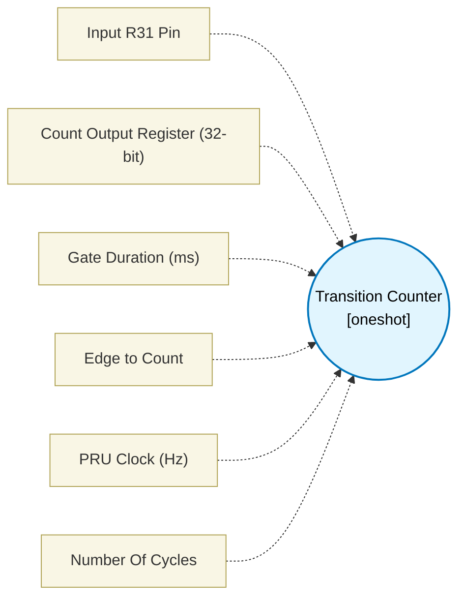

# Transition Counter (`counter_block`) — Design Document

> Generated by `build_block_docs.js` from `.metadata/sysconfig/.meta/pru_blocks/pru_io_blocks/counter_block.syscfg.js`. Do not edit by hand; re-run `node build_block_docs.js`.

## Purpose

Emits parameterized counter loop in PRU assembly.

## Block Diagram




## Classification

- **Block id:** `counter_block`
- **Category:** I/O & Protocol
- **Execution model (inferred):** `oneshot`
- **Macro / opcode:** `m_counter_run`
- **Data ports:** 0 in / 1 out · **Cycles:** `1`

## Parameter schema

| Parameter | Display name | Default | Options |
|---|---|---|---|
| `inputPin` | Input R31 Pin | `5` | `0`, `1`, `2`, `3`, `4`, `5`, `6`, `7`, `8`, `9`, `10`, `11`, `12`, `13`, `14`, `15`, `16`, `17`, `18`, `19` |
| `dataRegister` | Count Output Register (32-bit) | `R4` | — |
| `gateMs` | Gate Duration (ms) | `100` | — |
| `edgeType` | Edge to Count | `rising` | `rising`, `falling`, `both` |
| `clkHz` | PRU Clock (Hz) | `200000000` | — |
| `noOfCycles` | Number Of Cycles | `1` | — |

## Ports

| Port | Type |
|---|---|
| `output1` | `output32` |
| `prev` | `IO_PREV` |
| `next` | `IO_NEXT` |

## Validation rules

- gateMs must be > 0
- clkHz must be > 0

## Generated macro (`.xdt` equivalent)

```asm
m_counter_run .macro RES, INPUT_PIN, GATE_COUNTS, EDGE_TYPE
    ldi32 TEMP_REG4, 0x0002E000
    ldi32 TEMP_REG1, 0x11
    sbbo  &TEMP_REG1, TEMP_REG4, 0, 4
    lbbo  &TEMP_REG1, TEMP_REG4, 0x10, 4
    ldi32 TEMP_REG2, GATE_COUNTS
    add   TEMP_REG1, TEMP_REG1, TEMP_REG2
    zero  &RES, 4
    qbbs  ct_ih?, R31, INPUT_PIN
ct_il?:
    lbbo  &TEMP_REG2, TEMP_REG4, 0x10, 4
    qbge  ct_ge?, TEMP_REG1, TEMP_REG2
    qbbc  ct_il?, R31, INPUT_PIN
    .if EDGE_TYPE != 1
    add   RES, RES, 1
    .endif
    qba   ct_ih?
ct_ih?:
    lbbo  &TEMP_REG2, TEMP_REG4, 0x10, 4
    qbge  ct_ge?, TEMP_REG1, TEMP_REG2
    qbbs  ct_ih?, R31, INPUT_PIN
    .if EDGE_TYPE != 0
    add   RES, RES, 1
    .endif
    qba   ct_il?
ct_ge?:
    .endm
```

## Device portability

> **Source of truth:** `.metadata/sysconfig/.meta/pru_blocks/common/pru_device_caps.js` (TRM SPRUIM2J §6.4.1.1 / SPRUJB6 §7.3.1.1). Regenerated by `node build_block_docs.js` — do not edit by hand.

- **Required widget(s):** _(none)_
- **Validator:** `pru_blocks_static_module` raises a SysConfig **ERROR** naming both widget and device when a required widget is absent.

| Device (SoC) | Supported |
|---|---|
| `am243x` | ✅ |
| `am261x` | ✅ |
| `am263px` | ✅ |
| `am263x` | ✅ |
| `am64x` | ✅ |

## Outstanding TODO / VERIFY items

- None flagged in source.
