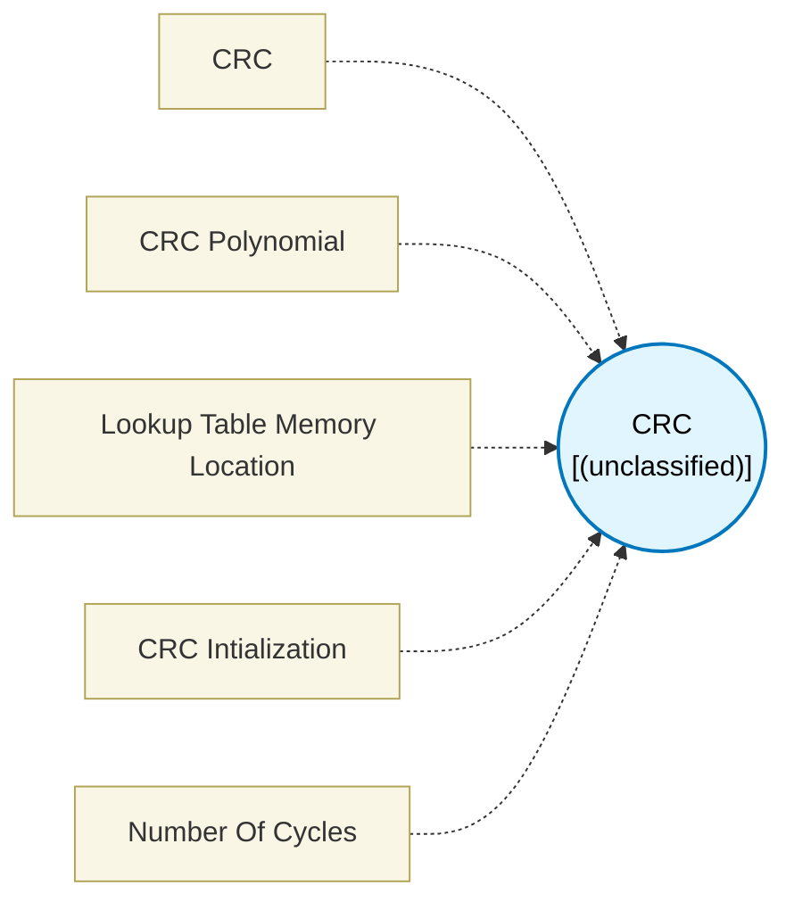

# CRC (`crc_block`) — Design Document

> Generated by `build_block_docs.js` on 2026-10-21 from `.metadata/sysconfig/.meta/pru_blocks/application_specific/crc_block.syscfg.js`. Do not edit by hand; re-run `node build_block_docs.js`.

## Purpose


## CRC Block (Cyclic Redundancy Check)

### Purpose
Calculates CRC checksums for error detection in data transmission and storage. CRC is a hash function that detects accidental changes to raw data.

### How It Works
1. **Input 1 (init)**: Connect CRC initialization value (either 0 from Load Constant or output from previous CRC block)
2. **Input 2 (data)**: Connect the data byte to process
3. **Process**: Uses table lookup and XOR operations to efficiently compute CRC
4. **Output**: Provides updated CRC value for next block or final checksum

### Configuration

**CRC Type**: Choose checksum size
- **CRC8**: 8-bit checksum (1 byte, 0-255)
- **CRC16**: 16-bit checksum (2 bytes, 0-65535)
- **CRC32**: 32-bit checksum (4 bytes, full 32-bit range)

**CRC Polynomial**: The generator polynomial in hexadecimal
- Defines the mathematical algorithm for CRC calculation
- Common polynomials:
  - CRC8: 0x07 (x⁸ + x² + x + 1)
  - CRC16: 0x8005 (x¹⁶ + x¹⁵ + x² + 1)
  - CRC32: 0x04C11DB7 (Ethernet/ZIP polynomial)

**CRC Initialization**: How to initialize the CRC accumulator
- **initialize_crc_result_with_zeros**: Start fresh calculation (connect LOAD_CONSTANT with value 0)
- **initialize_crc_result_from_crcblock**: Continue from previous CRC (chain CRC blocks)

### Technical Details (Additional Information)

**Generated Assembly** (CRC8 example):
- LDI32  TEMP_REG1, CRC_LUT_address   ; Load LUT address
- XOR    TEMP_REG2.b0, init, dataByte ; XOR init with data
- LBBO   &result, TEMP_REG1, TEMP_REG2.b0, 1  ; Lookup (6 cycles)


**Generated Assembly** (CRC16 example):
- LDI32  TEMP_REG1, CRC_LUT_address   ; Load LUT address
- LSR    TEMP_REG2.b0, init, 8        ; Extract high byte
- XOR    TEMP_REG2.b0, TEMP_REG2.b0, dataByte  ; XOR with data
- AND    TEMP_REG2, TEMP_REG2, 0xFF   ; Zero-extend the table index
- LSL    TEMP_REG2, TEMP_REG2, 1      ; Scale: entries are 2 bytes (index*2)
- ADD    TEMP_REG1, TEMP_REG1, TEMP_REG2  ; Base += scaled byte offset
- LDI    TEMP_REG2, 0                 ; Zero the LBBO offset register
- LBBO   &result, TEMP_REG1, TEMP_REG2.b0, 2   ; Lookup
- LSL    TEMP_REG2, init, 8           ; Shift init left
- XOR    result, TEMP_REG2.w0, result ; XOR with lookup (13 cycles)

**Generated Assembly** (CRC32 example):
- LDI32  TEMP_REG1, CRC_LUT_address   ; Load LUT address
- LSR    TEMP_REG2.b0, init, 24       ; Extract high byte
- XOR    TEMP_REG2.b0, TEMP_REG2.b0, dataByte  ; XOR with data
- AND    TEMP_REG2, TEMP_REG2, 0xFF   ; Zero-extend the table index
- LSL    TEMP_REG2, TEMP_REG2, 2      ; Scale: entries are 4 bytes (index*4)
- ADD    TEMP_REG1, TEMP_REG1, TEMP_REG2  ; Base += scaled byte offset
- LDI    TEMP_REG2, 0                 ; Zero the LBBO offset register
- LBBO   &result, TEMP_REG1, TEMP_REG2.b0, 4   ; Lookup
- LSL    TEMP_REG2, init, 8           ; Shift init left
- XOR    result, TEMP_REG2, result    ; XOR with lookup (13 cycles)

**Performance**:
- CRC8: 6 PRU cycles per byte
- CRC16: 13 PRU cycles per byte
- CRC32: 13 PRU cycles per byte

**Lookup Table**: Automatically generated 256-entry table based on polynomial
- CRC8: 256 bytes (256 × 1 byte)
- CRC16: 512 bytes (256 × 2 bytes)
- CRC32: 1024 bytes (256 × 4 bytes)
- Table stored in PRU DMEM
- Pre-computed at configuration time

### How CRC Works

**Algorithm Overview**:
1. Initialize CRC register (typically to 0)
2. For each data byte:
   - XOR with appropriate bits of current CRC
   - Use result as index into lookup table
   - Update CRC with table value
3. Final CRC value is the checksum

**Why Use CRC?**
- Detects single-bit errors
- Detects burst errors
- Fast computation using lookup tables
- Widely used in networking (Ethernet), storage (ZIP), and embedded systems

### Usage Notes
- Always initialize with zeros for first CRC calculation
- When processing multiple bytes, chain CRC blocks together
- Input data must be 1 byte (8 bits)
- The polynomial determines error detection capability
- Different standards use different polynomials - verify your protocol requirements
- LUT is shared between CRC blocks with same polynomial and type

### Terminology
- **CRC**: Cyclic Redundancy Check - error-detecting code
- **Checksum**: Result of CRC calculation used to verify data integrity
- **Polynomial**: Mathematical basis for CRC algorithm (e.g., 0x07, 0x8005)
- **Generator polynomial**: Divisor used in CRC calculation
- **LUT**: Lookup Table - pre-computed CRC values for each possible byte
- **DMEM**: PRU Data Memory where lookup table is stored
- **Chaining**: Connecting CRC blocks to process multiple bytes sequentially
- **Error detection**: Ability to detect corrupted or modified data


## Block Diagram




## Classification

- **Block id:** `crc_block`
- **Category:** Application-Specific
- **Execution model (inferred):** `(unclassified)`
- **Macro / opcode:** _(none)_
- **Data ports:** 0 in / 0 out · **Cycles:** `1`

## Parameter schema

| Parameter | Display name | Default | Options |
|---|---|---|---|
| `crcType` | CRC | `m_calculate_crc8` | `m_calculate_crc8`, `m_calculate_crc16`, `m_calculate_crc32` |
| `crcPolynomial` | CRC Polynomial | `0` | — |
| `lutMemoryLocation` | Lookup Table Memory Location | `dmem` | `dmem`, `smem` |
| `crc_intialization` | CRC Intialization | `zeros` | `zeros`, `crc_calculated_value` |
| `noOfCycles` | Number Of Cycles | `1` | — |

## Ports

| Port | Type |
|---|---|
| `input1` | `input32` |
| `input2` | `input32` |
| `prev` | `PREV` |
| `next` | `NEXT` |

## Validation rules

- _(no explicit validate() rules)_

## Generated macro (`.xdt` equivalent)

```asm
	.macro  crcResult, crcInit, dataByte, lutAddress
	; Parameters:
	;   crcResult   - Register to store the calculated CRC value
	;   crcInit     - Register containing the initial/previous CRC value
	;   dataByte    - Register containing the input data byte to process
	;   lutAddress  - Address of the CRC lookup table in memory

 .endm
```

## Device portability

> **Source of truth:** `.metadata/sysconfig/.meta/pru_blocks/common/pru_device_caps.js` (TRM SPRUIM2J §6.4.1.1 / SPRUJB6 §7.3.1.1). Regenerated by `node build_block_docs.js` — do not edit by hand.

- **Required widget(s):** _(none)_
- **Validator:** `pru_blocks_static_module` raises a SysConfig **ERROR** naming both widget and device when a required widget is absent.

| Device (SoC) | Supported |
|---|---|
| `am243x` | ✅ |
| `am261x` | ✅ |
| `am263px` | ✅ |
| `am263x` | ✅ |
| `am64x` | ✅ |

## Outstanding TODO / VERIFY items

- None flagged in source.
