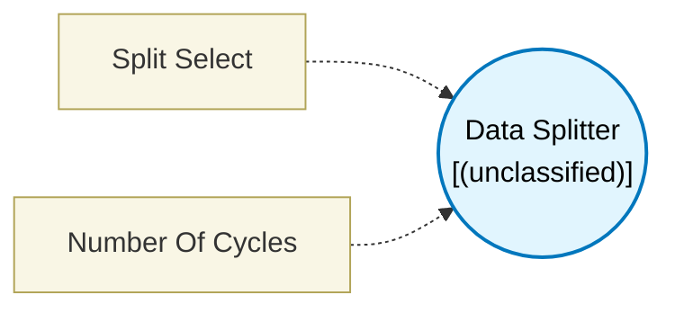

# Data Splitter (`data_splitter`) — Design Document

> Generated by `build_block_docs.js` on 2026-10-21 from `.metadata/sysconfig/.meta/pru_blocks/utils/data_splitter.syscfg.js`. Do not edit by hand; re-run `node build_block_docs.js`.

## Purpose


## Data Splitter Block

### Purpose
Extracts the lower or upper 32 bits from a 64-bit input (two consecutive registers).
Connect the output of a 64-bit block (e.g. UART RX Op in extended mode, Memory Access
with dataSize > 4) to this block's input, and select which half you need.

### Generated Assembly
**Lower 32 bits:**
```assembly
MOV  R_out, dataRegLo   ; copy lower register
```

**Upper 32 bits:**
```assembly
MOV  R_out, dataRegHi   ; copy upper register
```

### Ports
- **in64**: 64-bit data input (two consecutive registers)
- **out32**: 32-bit data output (selected half)

### Configuration
- **Split Select**: Choose `lower` (bits 31:0) or `upper` (bits 63:32)


## Block Diagram




## Classification

- **Block id:** `data_splitter`
- **Category:** Utilities
- **Execution model (inferred):** `(unclassified)`
- **Macro / opcode:** `m_data_splitter_lower`
- **Data ports:** 0 in / 0 out · **Cycles:** `1`

## Parameter schema

| Parameter | Display name | Default | Options |
|---|---|---|---|
| `splitSelect` | Split Select | `lower` | `lower`, `upper` |
| `noOfCycles` | Number Of Cycles | `1` | — |

## Ports

| Port | Type |
|---|---|
| `input1` | `input64` |
| `output1` | `output32` |
| `prev` | `PREV` |
| `next` | `NEXT` |

## Validation rules

- _(no explicit validate() rules)_

## Generated macro (`.xdt` equivalent)

```asm
m_data_splitter_lower	.macro  dataOut, dataRegLo, dataRegHi
	; Data Splitter — extract lower 32 bits from 64-bit input
	;   dataOut   - Destination register (32-bit output)
	;   dataRegLo - Lower 32 bits of 64-bit input
	;   dataRegHi - Upper 32 bits of 64-bit input
	mov     dataOut, dataRegLo
 .endm
```

## Device portability

> **Source of truth:** `.metadata/sysconfig/.meta/pru_blocks/common/pru_device_caps.js` (TRM SPRUIM2J §6.4.1.1 / SPRUJB6 §7.3.1.1). Regenerated by `node build_block_docs.js` — do not edit by hand.

- **Required widget(s):** _(none)_
- **Validator:** `pru_blocks_static_module` raises a SysConfig **ERROR** naming both widget and device when a required widget is absent.

| Device (SoC) | Supported |
|---|---|
| `am243x` | ✅ |
| `am261x` | ✅ |
| `am263px` | ✅ |
| `am263x` | ✅ |
| `am64x` | ✅ |

## Outstanding TODO / VERIFY items

- None flagged in source.
