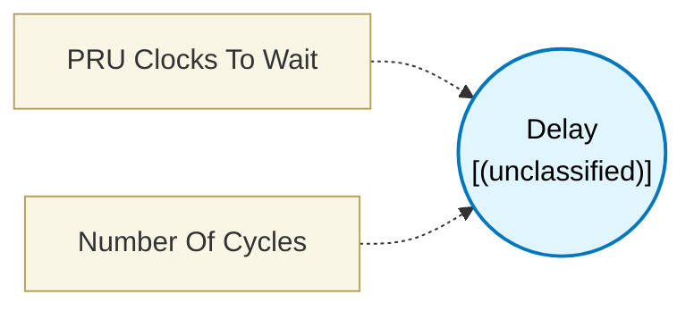

# Delay (`delay_block`) — Design Document

> Generated by `build_block_docs.js` on 2026-10-21 from `.metadata/sysconfig/.meta/pru_blocks/utils/delay_block.syscfg.js`. Do not edit by hand; re-run `node build_block_docs.js`.

## Purpose


## Delay Block

### Purpose
Introduces a precise timing delay in PRU execution. Each delay count equals one PRU clock cycle.

### How It Works
1. **Set Delay**: Specify the number of PRU clock cycles to wait (1-255)
2. **Execute**: Generates a loop that executes NOP instructions for the specified duration
3. **Continue**: After delay completes, execution proceeds to the next block

### Configuration
- **PRU Clocks To Wait**: Number of cycles to delay (1-255)
- Each cycle = 5ns at 200MHz PRU clock
- Example: 200 cycles = 1 microsecond delay

### Timing Calculations
At 200MHz PRU clock (default on most TI devices):
- 1 cycle = 5 nanoseconds
- 200 cycles = 1 microsecond
- 200,000 cycles = 1 millisecond (requires multiple blocks)

**Examples**:
- 10 cycles = 50ns
- 100 cycles = 500ns
- 255 cycles (max) = 1.275 microseconds

### Technical Details (Additional Information)
**Generated Assembly**:
- loop endloop, count - 1    ; Setup loop counter (1 cycle)
-     NOP                     ; No operation (count-1 times)
- endloop:                    ; Loop end label

**Total Cycles**: count (the block takes exactly count cycles, matching noOfCycles)

### Usage Notes
- Maximum delay per block: 255 cycles (hardware limitation)
- Minimum delay is 1 cycle (single NOP)
- This is a **pass-through block** - connects input to output without modification

### For Delays Greater Than 255 Cycles

One Delay block waits at most 255 cycles. For longer waits:

- **Chain Delay blocks.** Delay(255) -> Delay(255) -> Delay(100) waits 610 cycles. 10 us at 200 MHz is 2,000 cycles, so 8 chained blocks; 100 us is about 79.
- **Put the chain in an infinite Loop** for a periodic task. An infinite Loop compiles to a branch, not the hardware LOOP instruction, so Delay blocks of any length are legal inside it.
- **Use a software counter loop** (an Arithmetic block that decrements a counter and a Conditional block that branches back while it is non-zero) for very long waits.

Do not wrap a Delay longer than one cycle in a finite Loop: both emit the PRU hardware LOOP instruction, and the PRU has only one hardware-loop context, so SysConfig rejects it. Delay(1) is a plain NOP and is allowed inside any Loop.

**Important Notes**:
- Each Delay(count > 1) uses PRU hardware LOOP setup (1 cycle) plus count - 1 NOP iterations, totaling exactly count cycles matching noOfCycles
- For precise timing, check the generated cycle budget
- Use simulation to verify exact cycle counts

### Terminology
- **PRU Clock**: The clock signal driving PRU execution (typically 200MHz)
- **Cycle**: One tick of the PRU clock
- **NOP**: No Operation - instruction that does nothing but consume time
- **Loop overhead**: Extra cycles required for loop setup/teardown
- **Hardware-loop context**: PRU state used by the `LOOP` instruction; only one is available, so it cannot nest

---

## Block Diagram




## Classification

- **Block id:** `delay_block`
- **Category:** Utilities
- **Execution model (inferred):** `(unclassified)`
- **Macro / opcode:** `m_wait_cycles`
- **Data ports:** 0 in / 0 out · **Cycles:** `1`

## Parameter schema

| Parameter | Display name | Default | Options |
|---|---|---|---|
| `delayCount` | PRU Clocks To Wait | `1` | — |
| `noOfCycles` | Number Of Cycles | `1` | — |

## Ports

| Port | Type |
|---|---|
| `prev` | `PREV` |
| `next` | `NEXT` |

## Validation rules

- _(no explicit validate() rules)_

## Generated macro (`.xdt` equivalent)

```asm
m_wait_cycles	.macro  count
	; Parameters:
	;   count  - Number of PRU clock cycles to delay (wait time)
	loop    endloop?, count - 1
	NOP
endloop?:
 .endm
```

## Device portability

> **Source of truth:** `.metadata/sysconfig/.meta/pru_blocks/common/pru_device_caps.js` (TRM SPRUIM2J §6.4.1.1 / SPRUJB6 §7.3.1.1). Regenerated by `node build_block_docs.js` — do not edit by hand.

- **Required widget(s):** _(none)_
- **Validator:** `pru_blocks_static_module` raises a SysConfig **ERROR** naming both widget and device when a required widget is absent.

| Device (SoC) | Supported |
|---|---|
| `am243x` | ✅ |
| `am261x` | ✅ |
| `am263px` | ✅ |
| `am263x` | ✅ |
| `am64x` | ✅ |

## Outstanding TODO / VERIFY items

- None flagged in source.
