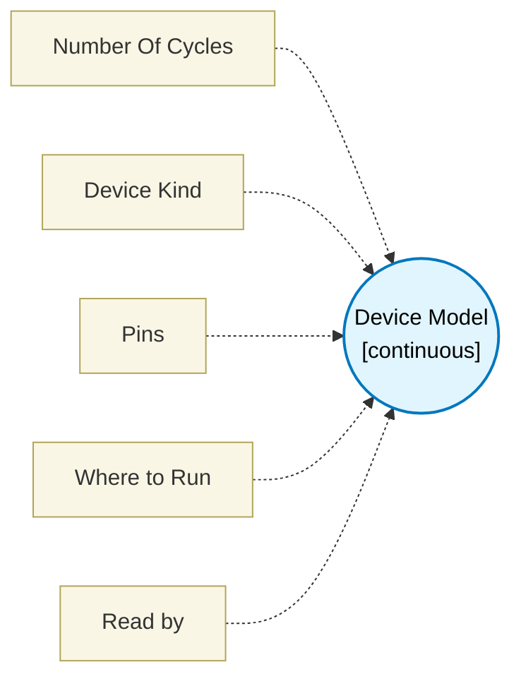

# Device Model (`device_model_block`) — Design Document

> Generated by `build_block_docs.js` from `.metadata/sysconfig/.meta/pru_blocks/utils/device_model_block.syscfg.js`. Do not edit by hand; re-run `node build_block_docs.js`.

## Purpose


### Device Model

Attaches a simulated device to the design - an SSI or BiSS-C encoder, a quadrature encoder, a UART transmitter, a SPI ADC and so on - as a block you can see, name and configure with typed fields. TI pru-simulator runs the real firmware against it (`gmake sim`, or **Run on TI pru-simulator** in the GUI).

**It generates no firmware.** It only adds one binding to `pru_device_bindings.json`.

**Two sources, one manifest.** Simulation Settings also attaches devices through its per-pin *GPIn Input Mode = Device* fields. Both work; neither is migrated. A pin claimed by both is an ERROR that names both.

**Pins.** Each pin says who drives it: *device drives* pins are read by the PRU; *PRU drives* pins are only listened to by the device. The Pins summary and the Read by field are computed for you.

**One driver per PRU-driven pin.** A GPO that a *PRU drives* pin listens on may be driven only by the blocks that talk to that device; any other block on that GPO, such as a SPI write sharing the clock, is an ERROR because the device counts its output as extra edges. Which blocks, per kind: the SSI, BiSS-C, EnDat and sigma-delta clocks accept only the reader block whose data pin is the device's data pin (SSI, BiSS-C or EnDat initiator, PDM microphone), shown in *Read by*; MDIO's MDC accepts an MDIO master whose MDIO pin is the device's; a SPI ADC's SCLK and MOSI are shared between chips so any SPI block may drive them, but its CS accepts only a SPI block whose CS pin is the device's; STEP/DIR and WS2812 accept the stepper, multi-axis or WS2812 block on that pad. A second block of the reader's own module pointing at a different data pin is foreign. With no matching block in the design a foreign block is a warning instead (it may be a hand-built generator). BiSS Line has no block in this tool, so it only warns when two or more blocks drive its MASTER pad. Two blocks reading one SSI, BiSS-C or EnDat encoder is also a warning: the second frame can start inside the encoder's monoflop time and is read as extra clocks.

**Parameters.** Every model parameter is a typed field and is range-checked here, not discovered at run time. Parameters this block does not expose keep the model's own default (BiSS-C encoder keywords, SSI/EnDat initial clock level, MDIO register map, BiSS Line sensor data).

**Simulation scope.** The in-tool JavaScript waveform preview does not attach Device Model blocks; TI pru-simulator does.

## How to Configure (For AI/Scripting)

```javascript
const deviceModel = scripting.addModule("/pru_blocks/utils/device_model_block", {}, false);
const enc = deviceModel.addInstance();
enc.$name = "Encoder_Model";
enc.deviceKind = "ssi";
enc.ssi_dataPin = 1;     // device drives, the PRU reads
enc.ssi_clkPin = 0;      // PRU drives
enc.ssi_bits = 25;
enc.ssi_position = 4321;
```

Field names are `<kind>_<pin or parameter>`; only the selected kind's fields apply. There is no connection to make: the block has no ports.


## Block Diagram




## Classification

- **Block id:** `device_model_block`
- **Category:** Utilities
- **Execution model (inferred):** `continuous`
- **Macro / opcode:** _(none)_
- **Data ports:** 0 in / 0 out · **Cycles:** `0`

## Parameter schema

| Parameter | Display name | Default | Options |
|---|---|---|---|
| `noOfCycles` | Number Of Cycles | `0` | — |
| `deviceKind` | Device Kind | `ssi` | — |
| `pinSummary` | Pins | `` | — |
| `runHint` | Where to Run | `` | — |
| `readBy` | Read by | `` | — |

## Ports

_(no ports declared)_

## Validation rules

- Pin

## Generated macro (`.xdt` equivalent)

_(declaration block; emits no PRU instruction, contributes a binding to pru_device_bindings.json)_

## Device portability

> **Source of truth:** `.metadata/sysconfig/.meta/pru_blocks/common/pru_device_caps.js` (TRM SPRUIM2J §6.4.1.1 / SPRUJB6 §7.3.1.1). Regenerated by `node build_block_docs.js` — do not edit by hand.

- **Required widget(s):** _(none)_
- **Validator:** `pru_blocks_static_module` raises a SysConfig **ERROR** naming both widget and device when a required widget is absent.

| Device (SoC) | Supported |
|---|---|
| `am243x` | ✅ |
| `am261x` | ✅ |
| `am263px` | ✅ |
| `am263x` | ✅ |
| `am64x` | ✅ |

## Outstanding TODO / VERIFY items

- None flagged in source.
