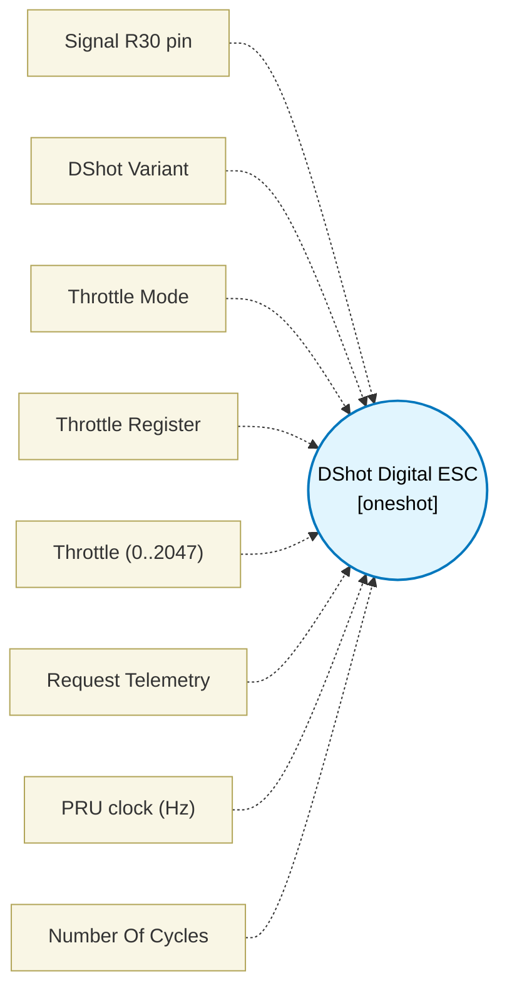

# DShot Digital ESC (`dshot_block`) — Design Document

> Generated by `build_block_docs.js` on 2026-10-21 from `.metadata/sysconfig/.meta/pru_blocks/pru_io_blocks/dshot_block.syscfg.js`. Do not edit by hand; re-run `node build_block_docs.js`.

## Purpose

Transmits a 16-bit DShot frame (11-bit throttle, 1-bit telemetry, 4-bit CRC) over a single GPIO pin. Bit timing is cycle-exact and the same for 1 and 0 bits: bit i rises round(i * P) cycles after the first edge, P = clkHz / bitrate, so each bit is floor(P) or floor(P) + 1 cycles and no edge drifts more than half a cycle (DShot1200 at 200 MHz: 166/167-cycle bits, 2667-cycle frame for 2666.67 nominal). The high time is round(3/4 P) for a 1 and round(3/8 P) for a 0. Delay counts are the nominal time minus the fixed instruction overhead (3 cycles high, 7 cycles low); a variant whose overhead does not fit at the given clkHz is rejected. In register mode (throttleMode = 'register'), the 11-bit throttle is read from a full PRU register (throttleRegister, R0..R27) with CRC computed dynamically on the PRU; the 11-bit mask applied to the register is defensive (bits above the frame never reach the wire), so it is pinned by source inspection, not by a behavioural test; telemetry request remains a build-time configuration option.

## Block Diagram




## Classification

- **Block id:** `dshot_block`
- **Category:** I/O & Protocol
- **Execution model (inferred):** `oneshot`
- **Macro / opcode:** `m_dshot_tx`
- **Data ports:** 0 in / 0 out · **Cycles:** `1`

## Parameter schema

| Parameter | Display name | Default | Options |
|---|---|---|---|
| `signalPin` | Signal R30 pin | `9` | `0`, `1`, `2`, `3`, `4`, `5`, `6`, `7`, `8`, `9`, `10`, `11`, `12`, `13`, `14`, `15`, `16`, `17`, `18`, `19` |
| `variant` | DShot Variant | `dshot600` | `dshot150`, `dshot300`, `dshot600`, `dshot1200` |
| `throttleMode` | Throttle Mode | `constant` | `constant`, `register` |
| `throttleRegister` | Throttle Register | `R14` | — |
| `throttle` | Throttle (0..2047) | `0` | — |
| `telemetry` | Request Telemetry | `false` | — |
| `clkHz` | PRU clock (Hz) | `200000000` | — |
| `noOfCycles` | Number Of Cycles | `1` | — |

## Ports

| Port | Type |
|---|---|
| `output1` | `output32` |
| `prev` | `IO_PREV` |
| `next` | `IO_NEXT` |

## Validation rules

- throttle must be 0..2047
- throttleRegister must be a full PRU register (e.g. R0..R27; sub-register tokens are not supported for 11-bit throttle)
- throttleRegister must be between R0 and R27
- throttleMode must be 'constant' or 'register'
- clkHz must be > 0
- <value> at clkHz <value>: the <value> time is <value> cycles
- <value> at clkHz <value>: the <value> delay needs <value> loop passes,

## Generated macro (`.xdt` equivalent)

```asm
m_dshot_tx .macro RES, PIN, FRAME_XMASK, NH1, PH1, NL1, PL1, NH0, PH0, NL0, PL0
    ldi32 TEMP_REG2, FRAME_XMASK
    ldi   TEMP_REG1.b2, 16
ds_b?:
    set   R30, R30, PIN
    qbbc  ds_z?, TEMP_REG2, 31
    .if PH1 == 1
    nop
    .endif
    ldi   TEMP_REG1.w0, NH1
ds_1h?:
    sub   TEMP_REG1.w0, TEMP_REG1.w0, 1
    qbne  ds_1h?, TEMP_REG1.w0, 0
    clr   R30, R30, PIN
    .if PL1 == 1
    nop
    .endif
    ldi   TEMP_REG1.w0, NL1
ds_1l?:
    sub   TEMP_REG1.w0, TEMP_REG1.w0, 1
    qbne  ds_1l?, TEMP_REG1.w0, 0
    qba   ds_n?
ds_z?:
    .if PH0 == 1
    nop
    .endif
    ldi   TEMP_REG1.w0, NH0
ds_0h?:
    sub   TEMP_REG1.w0, TEMP_REG1.w0, 1
    qbne  ds_0h?, TEMP_REG1.w0, 0
    clr   R30, R30, PIN
    .if PL0 == 1
    nop
    .endif
    ldi   TEMP_REG1.w0, NL0
ds_0l?:
    sub   TEMP_REG1.w0, TEMP_REG1.w0, 1
    qbne  ds_0l?, TEMP_REG1.w0, 0
    qba   ds_n?
ds_n?:
    qbbc  ds_e?, TEMP_REG2, 15
    nop
ds_e?:
    lsl   TEMP_REG2, TEMP_REG2, 1
    sub   TEMP_REG1.b2, TEMP_REG1.b2, 1
    qbne  ds_b?, TEMP_REG1.b2, 0
    .endm
```

## Device portability

> **Source of truth:** `.metadata/sysconfig/.meta/pru_blocks/common/pru_device_caps.js` (TRM SPRUIM2J §6.4.1.1 / SPRUJB6 §7.3.1.1). Regenerated by `node build_block_docs.js` — do not edit by hand.

- **Required widget(s):** _(none)_
- **Validator:** `pru_blocks_static_module` raises a SysConfig **ERROR** naming both widget and device when a required widget is absent.

| Device (SoC) | Supported |
|---|---|
| `am243x` | ✅ |
| `am261x` | ✅ |
| `am263px` | ✅ |
| `am263x` | ✅ |
| `am64x` | ✅ |

## Outstanding TODO / VERIFY items

- None flagged in source.
