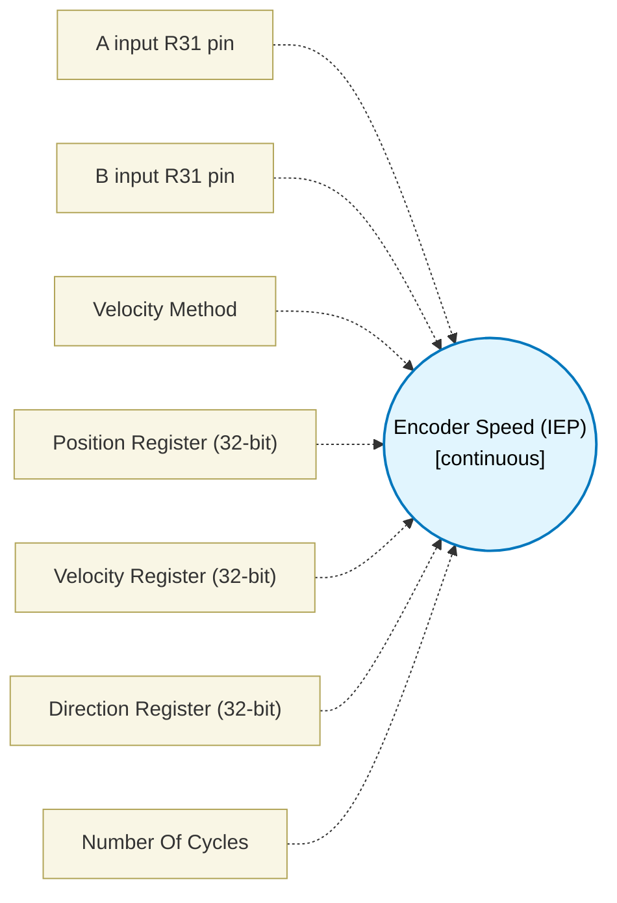

# Encoder Speed (IEP) (`encoder_speed_block`) — Design Document

> Generated by `build_block_docs.js` on 2026-10-21 from `.metadata/sysconfig/.meta/pru_blocks/pru_io_blocks/encoder_speed_block.syscfg.js`. Do not edit by hand; re-run `node build_block_docs.js`.

## Purpose

Emits parameterized speed, position and direction decoder loop in PRU assembly.

## Block Diagram




## Classification

- **Block id:** `encoder_speed_block`
- **Category:** I/O & Protocol
- **Execution model (inferred):** `continuous`
- **Macro / opcode:** `m_encoder_speed_run`
- **Data ports:** 0 in / 0 out · **Cycles:** `1`

## Parameter schema

| Parameter | Display name | Default | Options |
|---|---|---|---|
| `aBit` | A input R31 pin | `3` | `0`, `1`, `2`, `3`, `4`, `5`, `6`, `7`, `8`, `9`, `10`, `11`, `12`, `13`, `14`, `15`, `16`, `17`, `18`, `19` |
| `bBit` | B input R31 pin | `4` | `0`, `1`, `2`, `3`, `4`, `5`, `6`, `7`, `8`, `9`, `10`, `11`, `12`, `13`, `14`, `15`, `16`, `17`, `18`, `19` |
| `velocityMethod` | Velocity Method | `iep` | `iep`, `pulse-count` |
| `posRegister` | Position Register (32-bit) | `R4` | — |
| `velRegister` | Velocity Register (32-bit) | `R5` | — |
| `dirRegister` | Direction Register (32-bit) | `R8` | — |
| `noOfCycles` | Number Of Cycles | `1` | — |

## Ports

| Port | Type |
|---|---|
| `prev` | `IO_PREV` |

## Validation rules

- aBit and bBit must differ

## Generated macro (`.xdt` equivalent)

```asm
m_encoder_speed_run .macro RES, A_BIT, B_BIT, IS_IEP, POS_REG, VEL_REG, DIR_REG
    zero  &POS_REG, 4
    zero  &VEL_REG, 4
    zero  &DIR_REG, 4
    ldi32 TEMP_REG1, 0
    qbbs  es_ia?, R31, A_BIT
    ldi TEMP_REG2.w0, 0
    qba   es_ib?
es_ia?:
    ldi TEMP_REG2.w0, 2
es_ib?:
    qbbc  es_l?, R31, B_BIT
    add   TEMP_REG2.w0, TEMP_REG2.w0, 1
es_l?:
    ldi TEMP_REG2.w2, 0
    qbbc  es_rb?, R31, A_BIT
    ldi TEMP_REG2.w2, 2
es_rb?:
    qbbc  es_hs?, R31, B_BIT
    add   TEMP_REG2.w2, TEMP_REG2.w2, 1
es_hs?:
    qbeq  es_sd?, TEMP_REG2.w2, TEMP_REG2.w0
    .if IS_IEP == 1
    lbco  &TEMP_REG3, c26, 0x10, 4
    sub   VEL_REG, TEMP_REG3, TEMP_REG1
    mov   TEMP_REG1, TEMP_REG3
    .endif
    lsl   TEMP_REG4, TEMP_REG2.w0, 2
    or    TEMP_REG4, TEMP_REG4, TEMP_REG2.w2
    qbeq  es_fw?, TEMP_REG4, 1
    qbeq  es_fw?, TEMP_REG4, 7
    qbeq  es_fw?, TEMP_REG4, 14
    qbeq  es_fw?, TEMP_REG4, 8
    qbeq  es_rv?, TEMP_REG4, 2
    qbeq  es_rv?, TEMP_REG4, 11
    qbeq  es_rv?, TEMP_REG4, 13
    qbeq  es_rv?, TEMP_REG4, 4
    qba   es_ul?
es_fw?:
    add   POS_REG, POS_REG, 1
    ldi32 DIR_REG, 1
    qba   es_ul?
es_rv?:
    sub   POS_REG, POS_REG, 1
    ldi32 DIR_REG, 0xffffffff
es_ul?:
    mov   TEMP_REG2.w0, TEMP_REG2.w2
es_sd?:
    ldi TEMP_REG2.w2, 10
es_dl?:
    sub   TEMP_REG2.w2, TEMP_REG2.w2, 1
    qbne  es_dl?, TEMP_REG2.w2, 0
    qba   es_l?
    .endm
```

## Device portability

> **Source of truth:** `.metadata/sysconfig/.meta/pru_blocks/common/pru_device_caps.js` (TRM SPRUIM2J §6.4.1.1 / SPRUJB6 §7.3.1.1). Regenerated by `node build_block_docs.js` — do not edit by hand.

- **Required widget(s):** _(none)_
- **Validator:** `pru_blocks_static_module` raises a SysConfig **ERROR** naming both widget and device when a required widget is absent.

| Device (SoC) | Supported |
|---|---|
| `am243x` | ✅ |
| `am261x` | ✅ |
| `am263px` | ✅ |
| `am263x` | ✅ |
| `am64x` | ✅ |

## Outstanding TODO / VERIFY items

- None flagged in source.
