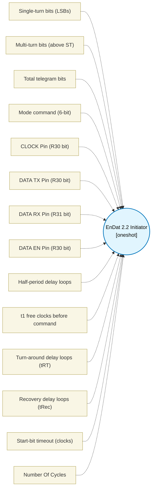

# EnDat 2.2 Initiator (`endat_initiator_block`) — Design Document

> Generated by `build_block_docs.js` from `.metadata/sysconfig/.meta/pru_blocks/application_specific/endat_initiator_block.syscfg.js`. Do not edit by hand; re-run `node build_block_docs.js`.

## Purpose

Heidenhain EnDat 2.2 initiator (RS-485, up to 2 Mbps without propagation-delay compensation). Staged implementation slice: position mode command + position telegram with CRC check and recovery idle.

FRAMING: CLOCK idles HIGH (H p.6). The first falling clock edge starts the transfer and latches the position; after two clock pulses (2T, t1Clocks) the master sends the 6-bit mode command M2 M1 M0 plus its redundant copy, MSB first, with NO CRC (H p.7). modeCommand 000111 (7) = "encoder send position values" (EnDat 2.1 command set), 111000 (56) = "send position value with additional data" (EnDat 2.2 set). The master then releases DATA and keeps clocking through the encoder's calculation time until the start bit (DATA = 1), giving up after timeoutCycles clocks (status bit1, RES 0). ABSENT ENCODER: a transceiver with fail-safe biasing (failsafe=1, the common part default) reads an unplugged or dead encoder as a steady HIGH line, i.e. an immediate start bit and then all-ones data, so it reports CRC error + F1 (status 0x5), NOT "no start bit" (bit1); bit1 is only seen with a line that stays LOW (no fail-safe bias, or a dead driver). Reply: start bit S = 1 | F1 (error 1) | F2 (error 2, EnDat 2.2 commands only, transmitted inverted) | position, LSB first | CRC-5, MSB first (H p.8-9). CRC (TI endat_make_crc_pos): x^5+x^3+x+1, all flip-flops preset to 1, over F1 [F2] and the position bits in wire order (start bit excluded), register inverted. DATA_RX is sampled at the rising clock edge (TI AM243x TRM 6.4.5.2.2.3.6: captured on the positive edge). Status in TEMP_REG2.b0: bit0=CRC error, bit1=no start bit, bit2=F1 (error 1), bit3=error 2. RES holds the raw telegram (MSB = start bit); the position is LSB first on the wire, so the caller reverses the position field (as TI's driver does).

PINS: one RS-485 transceiver per encoder: CLOCK out on one R30 bit, DATA driven through the transceiver driver from DATA_TX (R30) with its driver enable on DATA_EN (R30, DE = 1 only during the lead-in and the mode command), and the receiver output on DATA_RX (R31). TI's EnDat receiver uses the same split (pins endat_out, endat_out_en, endat_in). A PRU pad is either an input or an output, so TX, EN and RX must be different pad indices.

STAGED SCOPE (NOT implemented): other mode commands (parameters, memory area selection, reset, test values), additional data 1/2 and the EnDat 2.2 command supplement (MRS code), telegrams longer than 32 bits (needs a second accumulator register), propagation-delay compensation for clock rates above 2 MHz (requires IEP timestamping).

Peripheral resources (selection rule): the hard EnDat peripheral (PRU-ICSSG three-channel peripheral interface) is preferred when available and correctly pinned; fallback is bit-banged PRU via an RS-485 transceiver - the staged PRU initiator consumes zero dedicated peripheral instances (no UART/SPI/IEP required in fallback). All four pins must sit on the same PRU-ICSSG slice through pinmux (AM64x/AM243x/AM261x). Isolation: the owning PRU slice must be the only master driving CLK_PIN, DATA_TX_PIN and DATA_EN_PIN during a telegram. Concurrent workload: the transfer is a busy-wait delay-loop sequence; the PRU cannot service other blocks mid-telegram (budget documented in noOfCycles). Deterministic timing: every clock half-period is a calibrated delay loop (halfPeriodCycles); at 200 MHz PRU, halfPeriodCycles=25 gives ~1.9 MHz, and trecCycles=1000 gives 10 us of recovery. BOM/part: one RS-485 transceiver with driver enable per encoder channel (e.g. SN65HVD / THVD class), termination per the EnDat cable spec. Simulator validation: the real clpru ELF of a one-block design runs on TI pru-simulator in a closed loop against TI pru-simulator's EnDat encoder model through its RS-485 transceiver model (models not in every pru-simulator revision; tests/test_endat_framing.py); EnDat is not yet selectable in the gmake sim front door (ported:false). Physical propagation delay and transceiver switching glitches require silicon validation.

## Block Diagram




## Classification

- **Block id:** `endat_initiator_block`
- **Category:** Application-Specific
- **Execution model (inferred):** `oneshot`
- **Macro / opcode:** `m_endat_read`
- **Data ports:** 0 in / 1 out · **Cycles:** `6538`

## Parameter schema

| Parameter | Display name | Default | Options |
|---|---|---|---|
| `singleTurnBits` | Single-turn bits (LSBs) | `13` | — |
| `multiTurnBits` | Multi-turn bits (above ST) | `10` | — |
| `totalBits` | Total telegram bits | `30` | — |
| `modeCommand` | Mode command (6-bit) | `7` | — |
| `clkPin` | CLOCK Pin (R30 bit) | `0` | — |
| `dataTxPin` | DATA TX Pin (R30 bit) | `1` | — |
| `dataRxPin` | DATA RX Pin (R31 bit) | `2` | — |
| `dataEnPin` | DATA EN Pin (R30 bit) | `3` | — |
| `halfPeriodCycles` | Half-period delay loops | `25` | — |
| `t1Clocks` | t1 free clocks before command | `2` | — |
| `trtCycles` | Turn-around delay loops (tRT) | `20` | — |
| `trecCycles` | Recovery delay loops (tRec) | `1000` | — |
| `timeoutCycles` | Start-bit timeout (clocks) | `100` | — |
| `noOfCycles` | Number Of Cycles | `6538` | — |

## Ports

| Port | Type |
|---|---|
| `prev` | `IO_PREV` |
| `next` | `IO_NEXT` |
| `output1` | `output32` |

## Validation rules

- modeCommand must be 7 (000111, send position values) or 56 (111000, position with additional data); other EnDat mode commands are not implemented
- singleTurnBits must be 1..<value> (telegram must fit 32 bits)
- multiTurnBits must be 0..<value>
- singleTurnBits + multiTurnBits must be <= <value> (1 start + <value> error + position + 5 CRC <= 32 bits)
- totalBits must equal 1 start + <value> error + ST + MT + 5 CRC bits
- clkPin, dataTxPin, dataEnPin and dataRxPin must all differ (a PRU pad is an input or an output, and TX, DE and RX are separate transceiver pins)
- clkPin must be 0..15
- dataTxPin must be 0..15
- dataEnPin must be 0..15
- dataRxPin must be 0..15
- halfPeriodCycles too small (min 2)
- timeoutCycles must be 1..65535
- trecCycles below 500 violates the 10 us recovery time (need >=1000 at 200 MHz)

## Generated macro (`.xdt` equivalent)

```asm
m_endat_read .macro RES, MODE_CMD, TOTAL_BITS, ST_BITS, MT_BITS, CLK_PIN, DATA_TX_PIN, DATA_RX_PIN, HALF_PERIOD, T1_CLOCKS, TRT_CYCLES, TREC_CYCLES, TIMEOUT_CYCLES, DATA_EN_PIN
    ; --- EnDat 2.2 Initiator (RS-485 transceiver: TX + DE on R30, RX on R31; 2 Mbps; CRC-5; tRec) ---
    ; Framing per HEIDENHAIN EnDat 2.2 Technical Information ID 383942 (H) and TI MCU+ Motor Control SDK
    ; endat_drv.c (TI); page references below are to H.
    ; Transfer: CLK idles HIGH (H p.6); the first falling edge latches the position; T1_CLOCKS (2T) lead-in pulses;
    ;   6-bit MODE_CMD = M2 M1 M0 + redundant copy, MSB first, no CRC (H p.7); DE released; the master keeps
    ;   clocking through tcal until the start bit (DATA = 1), at most TIMEOUT_CYCLES clocks; then TOTAL_BITS-1 bits.
    ; DATA_RX is sampled at the end of each low phase, i.e. at the rising edge (TRM: captured on the positive edge).
    ; RES = TOTAL_BITS bits, MSB = first bit received: S(=1) | F1 | F2 (EnDat 2.2 commands only) | P0..P(n-1)
    ;   (position LSB first, so P_i sits at bit TOTAL_BITS-2-E-i, E = error bits) | CRC4..CRC0
    ; E = TOTAL_BITS - ST_BITS - MT_BITS - 6: 1 for 000111 (2.1 set), 2 for 111000 (2.2 set) (H p.8)
    ; TEMP_REG2.b0 status: bit0=CRC error, bit1=no start bit within TIMEOUT_CYCLES clocks, bit2=F1 (error 1),
    ;   bit3=error 2 (F2 is sent inverted, H p.9: set when F2 = 0)
    ldi   RES, 0
    ldi   TEMP_REG2.b0, 0            ; status = 0
    set   R30, R30, CLK_PIN          ; clock idles HIGH (EnDat); each bit is a low pulse, so the frame ends high
    clr   R30, R30, DATA_TX_PIN
    clr   R30, R30, DATA_EN_PIN      ; transceiver in receive (DE = 0)
    ldi   TEMP_REG4.w0, HALF_PERIOD   ; hold the idle-high level one half period so the first low pulse is not a runt
m_endat_idle?:
    sub   TEMP_REG4.w0, TEMP_REG4.w0, 1
    qbne  m_endat_idle?, TEMP_REG4.w0, 0
    set   R30, R30, DATA_EN_PIN      ; master drives the line (TX = 0) for the lead-in and the mode command
    ; --- t1: T1_CLOCKS lead-in pulses; the first falling edge starts the transfer (H p.8: 2T) ---
    ldi   TEMP_REG1.b0, T1_CLOCKS
m_endat_t1?:
    clr   R30, R30, CLK_PIN
    ldi   TEMP_REG4.w0, HALF_PERIOD
m_endat_t1d1?:
    sub   TEMP_REG4.w0, TEMP_REG4.w0, 1
    qbne  m_endat_t1d1?, TEMP_REG4.w0, 0
    set   R30, R30, CLK_PIN
    ldi   TEMP_REG4.w0, HALF_PERIOD
m_endat_t1d2?:
    sub   TEMP_REG4.w0, TEMP_REG4.w0, 1
    qbne  m_endat_t1d2?, TEMP_REG4.w0, 0
    sub   TEMP_REG1.b0, TEMP_REG1.b0, 1
    qbne  m_endat_t1?, TEMP_REG1.b0, 0
    ; --- mode command: 6 bits, MSB first (M2 first), no CRC (H p.7) ---
    ldi   TEMP_REG3, MODE_CMD
    ldi   TEMP_REG1.b0, 6
m_endat_tx?:
    qbbc  m_endat_tx0?, TEMP_REG3, 5
    set   R30, R30, DATA_TX_PIN
    qba   m_endat_txd?
m_endat_tx0?:
    clr   R30, R30, DATA_TX_PIN
m_endat_txd?:
    clr   R30, R30, CLK_PIN
    ldi   TEMP_REG4.w0, HALF_PERIOD
m_endat_txd1?:
    sub   TEMP_REG4.w0, TEMP_REG4.w0, 1
    qbne  m_endat_txd1?, TEMP_REG4.w0, 0
    set   R30, R30, CLK_PIN
    ldi   TEMP_REG4.w0, HALF_PERIOD
m_endat_txd2?:
    sub   TEMP_REG4.w0, TEMP_REG4.w0, 1
    qbne  m_endat_txd2?, TEMP_REG4.w0, 0
    lsl   TEMP_REG3, TEMP_REG3, 1
    sub   TEMP_REG1.b0, TEMP_REG1.b0, 1
    qbne  m_endat_tx?, TEMP_REG1.b0, 0
    ; --- turn-around: release the line (DE = 0), wait tRT ---
    clr   R30, R30, DATA_TX_PIN
    clr   R30, R30, DATA_EN_PIN
    ldi   TEMP_REG4.w0, TRT_CYCLES
m_endat_trt?:
    sub   TEMP_REG4.w0, TEMP_REG4.w0, 1
    qbne  m_endat_trt?, TEMP_REG4.w0, 0
    ; --- tcal: keep clocking until the start bit (DATA = 1), at most TIMEOUT_CYCLES clocks (H p.8) ---
    ldi   TEMP_REG1.w0, TIMEOUT_CYCLES
m_endat_sb?:
    clr   R30, R30, CLK_PIN
    ldi   TEMP_REG4.w0, HALF_PERIOD
m_endat_sbd1?:
    sub   TEMP_REG4.w0, TEMP_REG4.w0, 1
    qbne  m_endat_sbd1?, TEMP_REG4.w0, 0
    qbbs  m_endat_sbok?, R31, DATA_RX_PIN  ; sample at the rising edge
    set   R30, R30, CLK_PIN
    ldi   TEMP_REG4.w0, HALF_PERIOD
m_endat_sbd2?:
    sub   TEMP_REG4.w0, TEMP_REG4.w0, 1
    qbne  m_endat_sbd2?, TEMP_REG4.w0, 0
    sub   TEMP_REG1.w0, TEMP_REG1.w0, 1
    qbne  m_endat_sb?, TEMP_REG1.w0, 0
    or    TEMP_REG2.b0, TEMP_REG2.b0, 2  ; no start bit: framing error, the checks are skipped
    qba   m_endat_stop?
m_endat_sbok?:
    set   R30, R30, CLK_PIN
    ldi   TEMP_REG4.w0, HALF_PERIOD
m_endat_sbd3?:
    sub   TEMP_REG4.w0, TEMP_REG4.w0, 1
    qbne  m_endat_sbd3?, TEMP_REG4.w0, 0
    ldi   RES, 1                     ; the start bit
    ; --- RX: TOTAL_BITS-1 bits after the start bit, MSB-first accumulation ---
    ldi   TEMP_REG1.b0, (TOTAL_BITS - 1)
m_endat_rx?:
    clr   R30, R30, CLK_PIN
    ldi   TEMP_REG4.w0, HALF_PERIOD
m_endat_rxd1?:
    sub   TEMP_REG4.w0, TEMP_REG4.w0, 1
    qbne  m_endat_rxd1?, TEMP_REG4.w0, 0
    lsl   RES, RES, 1
    qbbc  m_endat_rx0?, R31, DATA_RX_PIN  ; sample at the rising edge
    or    RES, RES, 1
m_endat_rx0?:
    set   R30, R30, CLK_PIN
    ldi   TEMP_REG4.w0, HALF_PERIOD
m_endat_rxd2?:
    sub   TEMP_REG4.w0, TEMP_REG4.w0, 1
    qbne  m_endat_rxd2?, TEMP_REG4.w0, 0
    sub   TEMP_REG1.b0, TEMP_REG1.b0, 1
    qbne  m_endat_rx?, TEMP_REG1.b0, 0
m_endat_stop?:
    ; --- clock stays HIGH + recovery idle (tRec, H p.8 tm) ---
    set   R30, R30, CLK_PIN
    ldi   TEMP_REG4.w0, TREC_CYCLES
m_endat_trec?:
    sub   TEMP_REG4.w0, TEMP_REG4.w0, 1
    qbne  m_endat_trec?, TEMP_REG4.w0, 0
    qbbs  m_endat_crck?, TEMP_REG2.b0, 1  ; no frame to check
    ; --- F1 = error 1 (active high) ---
    qbbc  m_endat_f1?, RES, (TOTAL_BITS - 2)
    or    TEMP_REG2.b0, TEMP_REG2.b0, 4
m_endat_f1?:
    ; --- F2 = error 2: only for EnDat 2.2 commands, sent inverted (H p.9) ---
    ldi   TEMP_REG4.b0, (TOTAL_BITS - ST_BITS - MT_BITS - 6)
    qbne  m_endat_f2?, TEMP_REG4.b0, 2
    qbbs  m_endat_f2?, RES, (TOTAL_BITS - 3)
    or    TEMP_REG2.b0, TEMP_REG2.b0, 8
m_endat_f2?:
    ; --- CRC-5 (TI endat_drv.c endat_make_crc_pos): x^5+x^3+x+1, init 11111, over F1 [F2] + position in
    ;     wire order (start bit excluded), result inverted, MSB first ---
    ldi   TEMP_REG1, 0x1F                    ; crc accumulator, all ones
    lsr   TEMP_REG3, RES, 5                  ; S + covered bits (CRC field stripped)
    ldi   TEMP_REG4, (32 - (TOTAL_BITS - 6))  ; left-align: the start bit falls off, F1 lands at bit 31
    lsl   TEMP_REG3, TEMP_REG3, TEMP_REG4
    ldi   TEMP_REG4.b0, (TOTAL_BITS - 7)     ; covered bit count - 1 (loop processes bit then decrements; exits on wrap)
m_endat_crcl?:
    qbbs  m_endat_ct1?, TEMP_REG1, 4         ; crc top bit
    qbbs  m_endat_cd10?, TEMP_REG3, 31       ; top=0: data bit?
    lsl   TEMP_REG1, TEMP_REG1, 1            ; top=0,d=0: ex=0, shift only
    and   TEMP_REG1, TEMP_REG1, 0x1F
    qba   m_endat_cnx?
m_endat_cd10?:
    lsl   TEMP_REG1, TEMP_REG1, 1            ; top=0,d=1: ex=1, shift+xor
    and   TEMP_REG1, TEMP_REG1, 0x1F
    xor   TEMP_REG1, TEMP_REG1, 0x0B         ; x^3+x+1 (x^5 term implicit)
    qba   m_endat_cnx?
m_endat_ct1?:
    qbbs  m_endat_cd11?, TEMP_REG3, 31       ; top=1: data bit?
    lsl   TEMP_REG1, TEMP_REG1, 1            ; top=1,d=0: ex=1, shift+xor
    and   TEMP_REG1, TEMP_REG1, 0x1F
    xor   TEMP_REG1, TEMP_REG1, 0x0B
    qba   m_endat_cnx?
m_endat_cd11?:
    lsl   TEMP_REG1, TEMP_REG1, 1            ; top=1,d=1: ex=0, shift only
    and   TEMP_REG1, TEMP_REG1, 0x1F
m_endat_cnx?:
    lsl   TEMP_REG3, TEMP_REG3, 1            ; next data bit to bit 31
    sub   TEMP_REG4.b0, TEMP_REG4.b0, 1
    qbbc  m_endat_crcl?, TEMP_REG4.b0, 5      ; loop while counter not wrapped below zero
    xor   TEMP_REG1, TEMP_REG1, 0x1F         ; inverted output
    and   TEMP_REG3, RES, 0x1F               ; received CRC field
    qbeq  m_endat_crck?, TEMP_REG1, TEMP_REG3
    or    TEMP_REG2.b0, TEMP_REG2.b0, 1      ; CRC mismatch
m_endat_crck?:
    ; Caller: test TEMP_REG2.b0 for nonzero to detect faults before using RES
    .endm
```

## Device portability

> **Source of truth:** `.metadata/sysconfig/.meta/pru_blocks/common/pru_device_caps.js` (TRM SPRUIM2J §6.4.1.1 / SPRUJB6 §7.3.1.1). Regenerated by `node build_block_docs.js` — do not edit by hand.

- **Required widget(s):** _(none)_
- **Validator:** `pru_blocks_static_module` raises a SysConfig **ERROR** naming both widget and device when a required widget is absent.

| Device (SoC) | Supported |
|---|---|
| `am243x` | ✅ |
| `am261x` | ✅ |
| `am263px` | ✅ |
| `am263x` | ✅ |
| `am64x` | ✅ |

## Outstanding TODO / VERIFY items

- None flagged in source.
