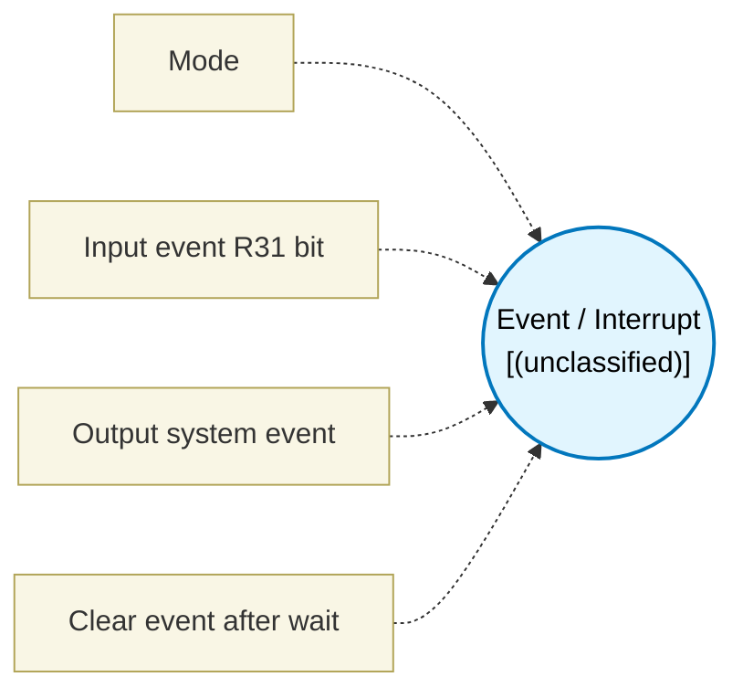

# Event / Interrupt (`event_block`) — Design Document

> Generated by `build_block_docs.js` from `.metadata/sysconfig/.meta/pru_blocks/program_control/event_block.syscfg.js`. Do not edit by hand; re-run `node build_block_docs.js`.

## Purpose

_(no description in module)_

## Block Diagram




## Classification

- **Block id:** `event_block`
- **Category:** Program Control
- **Execution model (inferred):** `(unclassified)`
- **Macro / opcode:** `m_event_block`
- **Data ports:** 0 in / 0 out · **Cycles:** `3`

## Parameter schema

| Parameter | Display name | Default | Options |
|---|---|---|---|
| `mode` | Mode | `wait` | `wait`, `signal`, `waitThenSignal` |
| `inputEventBit` | Input event R31 bit | `30` | — |
| `outputEvent` | Output system event | `16` | — |
| `clearAfterWait` | Clear event after wait | `true` | — |

## Ports

| Port | Type |
|---|---|
| `prev` | `PREV` |
| `next` | `NEXT` |

## Validation rules

- inputEventBit must be 0..31
- outputEvent must be a system event 16..31 (SPRUIM2J Table 6-67: R31 event-generate channels 0..15)

## Generated macro (`.xdt` equivalent)

```asm
m_event_block	.macro RES, mode, inputEventBit, outputEvent, clearAfterWait
    ; Parameters: mode, inputEventBit, outputEvent, clearAfterWait

    .if (mode != 1) ; wait or waitThenSignal
event_wait?:
    qbbc  event_wait?, R31, inputEventBit
    .if (clearAfterWait == 1)
    ; Clear/ack is SoC INTC-specific.
    ldi   R0, inputEventBit
    .endif
    .endif
    .if (mode != 0) ; signal or waitThenSignal
    ldi   R31.b0, outputEvent + 16
    .endif

    .endm
```

## Device portability

> **Source of truth:** `.metadata/sysconfig/.meta/pru_blocks/common/pru_device_caps.js` (TRM SPRUIM2J §6.4.1.1 / SPRUJB6 §7.3.1.1). Regenerated by `node build_block_docs.js` — do not edit by hand.

- **Required widget(s):** _(none)_
- **Validator:** `pru_blocks_static_module` raises a SysConfig **ERROR** naming both widget and device when a required widget is absent.

| Device (SoC) | Supported |
|---|---|
| `am243x` | ✅ |
| `am261x` | ✅ |
| `am263px` | ✅ |
| `am263x` | ✅ |
| `am64x` | ✅ |

## Outstanding TODO / VERIFY items

- None flagged in source.
