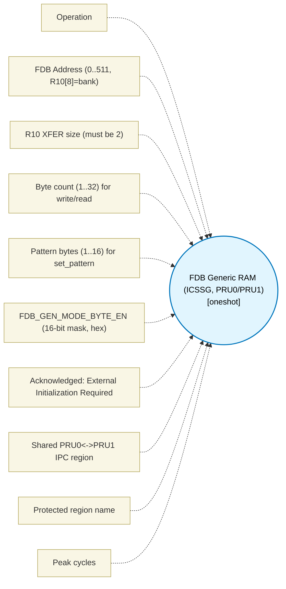

# FDB Generic RAM (ICSSG, PRU0/PRU1) (`fdb_gp_ram_block`) — Design Document

> Generated by `build_block_docs.js` on 2026-10-21 from `.metadata/sysconfig/.meta/pru_blocks/pru_io_blocks/fdb_gp_ram_block.syscfg.js`. Do not edit by hand; re-run `node build_block_docs.js`.

## Purpose

16 KB of shared 32-byte-wide table memory via the FDB generic broadside path (SPRUIM2J 6.4.11.2.3.7.4, Tables 6-103/6-105; BS IDs 30 data/address, 31 pattern, 35 compare_result; Table 6-60: 1 cycle per XFR; Table 6-105: 2-cycle hazard before XIN 35). 512 rows x 32 B are addressed by a 9-bit FDB_Address where R10[8] selects the bank; set_address XOUTs R10,2 to ID 30, write/read XFER R2..R9 (1..32 B) on ID 30, set_pattern XOUTs R2..R5 (1..16 B) on ID 31, compare_result XINs R10 from ID 35. The honest value is the table memory plus arbitrated inter-PRU IPC when every shared access is guarded by an XFR2SPIN spinlock. The compare is NOT a search: it compares the pattern against the CURRENTLY ADDRESSED ROW only. Walking N rows costs N x (advance + 2-cycle wait + read) and has NO cycle advantage over four 32-bit register compares after a 1-cycle XIN; the hashed search exists only in LUT/bridging mode with Ethernet framing, which this block does not implement. MII_G_RT_FDB_GEN_CFG2[7]/[8] must be asserted by external initialization for the bank selected by R10[8]. GO/NO-GO: the TRM's generic-mode prose and broadside tables describe this path without listing MII port configuration as a prerequisite, so the block is offered for non-Ethernet protocols on that reading; the TRM is however silent on whether the FDB clock/reset is gated by MII port enables, and this has not been proven on silicon - see header comment for exact tables/sections. Maturity is simulator-tested at most.

## Block Diagram




## Classification

- **Block id:** `fdb_gp_ram_block`
- **Category:** I/O & Protocol
- **Execution model (inferred):** `oneshot`
- **Macro / opcode:** `m_fdb_set_address`
- **Data ports:** 0 in / 0 out · **Cycles:** `1`

## Parameter schema

| Parameter | Display name | Default | Options |
|---|---|---|---|
| `operation` | Operation | `set_address` | `set_address`, `write`, `read`, `set_pattern`, `compare_result` |
| `fdbAddress` | FDB Address (0..511, R10[8]=bank) | `0` | — |
| `r10TransferSize` | R10 XFER size (must be 2) | `2` | — |
| `byteCount` | Byte count (1..32) for write/read | `32` | — |
| `patternBytes` | Pattern bytes (1..16) for set_pattern | `16` | — |
| `fdbGenModeByteEn` | FDB_GEN_MODE_BYTE_EN (16-bit mask, hex) | `0xFFFF` | — |
| `externalInitProvided` | Acknowledged: External Initialization Required | `false` | — |
| `sharedAcrossPru` | Shared PRU0<->PRU1 IPC region | `false` | — |
| `protectedRegion` | Protected region name | `fdb_gp_ram` | — |
| `noOfCycles` | Peak cycles | `1` | — |

## Ports

| Port | Type |
|---|---|
| `prev` | `IO_PREV` |
| `next` | `IO_NEXT` |
| `output1` | `output32` |

## Validation rules

- FDB Generic RAM is attached to PRU0/PRU1 only (SPRUIM2J FDB Generic Mode, Table 6-60 IDs 30/31/35 are PRU1/0 only); placed core is '
- FDB address must be an integer 0..511 (9-bit FDB_Address, Table 6-103; R10[8] selects the bank). Got '
- R10 transfer size must be 2 bytes (XOUT R10, 2 -> BS ID 30, Table 6-103). Got '
- FDB Generic Mode requires MII_G_RT_FDB_GEN_CFG2[7:8] to be enabled by an external application. Check the 'Acknowledged: External Initialization Required' box to confirm you have provided it.
- Byte count for
- Pattern size must be an integer 1..16 bytes (XOUT R2..R5, ID 31). Got '
- FDB_GEN_MODE_BYTE_EN must be a 16-bit mask 0x0000..0xFFFF (enables pattern bytes). Got '
- Pattern of

## Generated macro (`.xdt` equivalent)

```asm
m_fdb_set_address .macro RES, ADDR
    ; FDB Generic Mode set_address - SPRUIM2J 6.4.11.2.3.7.4 Table 6-103.
    ; R10 = FDB_Address (9-bit, R10[8]=bank select), XOUT 30, &R10, 2.
    ldi   R10, ADDR
    xout  30, &R10, 2
    mov   RES, R10
    .endm
```

## Device portability

> **Source of truth:** `.metadata/sysconfig/.meta/pru_blocks/common/pru_device_caps.js` (TRM SPRUIM2J §6.4.1.1 / SPRUJB6 §7.3.1.1). Regenerated by `node build_block_docs.js` — do not edit by hand.

- **Required widget(s):** `fdb_gp`
- **Validator:** `pru_blocks_static_module` raises a SysConfig **ERROR** naming both widget and device when a required widget is absent.

| Device (SoC) | Supported |
|---|---|
| `am243x` | ✅ |
| `am261x` | ❌ fdb_gp |
| `am263px` | ❌ fdb_gp |
| `am263x` | ❌ fdb_gp |
| `am64x` | ✅ |

## Outstanding TODO / VERIFY items

- None flagged in source.
