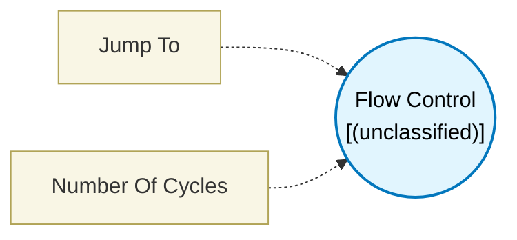

# Flow Control (`flow_control_block`) — Design Document

> Generated by `build_block_docs.js` from `.metadata/sysconfig/.meta/pru_blocks/program_control/flow_control_block.syscfg.js`. Do not edit by hand; re-run `node build_block_docs.js`.

## Purpose


## Flow Control Block

### Purpose
Controls PRU program flow by either jumping to the end of generated code or halting the PRU.

### How It Works
1. **Place in Flow**: Position this block where you want to control program flow
2. **Select Jump Target**: Choose between END or HALT
3. **Execution**: When reached, performs the selected jump
4. **No Output**: This is a **terminating block** - no next connections

### Configuration

**Jump To**: Select where the program should jump

**Option 1: Sysconfig Generated End**
- Jumps to the end label of the SysConfig-generated code
- Allows any cleanup code or epilogue to execute
- Recommended for normal program completion
- Generated instruction: JMP sysconfig_generated_end

**Option 2: Halt**
- Immediately stops the PRU execution
- Puts PRU into halt state
- No cleanup or epilogue runs
- Generated instruction: HALT
- Use for emergency stops or when no cleanup needed

### Technical Details (Additional Information)

**Generated Assembly** (END):
```asm
JMP  sysconfig_generated_end    ; Jump to end label (1 cycle)
```

**Generated Assembly** (HALT):
```asm
HALT                            ; Halt immediately (1 cycle)
```

**Performance**: Both options execute in 1 PRU cycle

### Block Appearance
- **Shape**: Circle (distinct from square data processing blocks)
- **Icon**: Flow control symbol
- **No Output Ports**: Terminating block - execution stops here

### Usage Notes
- This is a **terminating block** - it has no output connections
- Use END for normal program exits (recommended default)
- Use HALT for emergency stops or when cleanup isn't needed
- Multiple FLOW_CONTROL blocks can exist in different program paths

### Terminology
- **Flow control**: Directing program execution path
- **Terminating block**: Block with no output - ends execution path
- **HALT**: PRU instruction that stops core execution
- **JMP**: Jump instruction that transfers control to a label

---

## Block Diagram




## Classification

- **Block id:** `flow_control_block`
- **Category:** Program Control
- **Execution model (inferred):** `(unclassified)`
- **Macro / opcode:** `JMP`
- **Data ports:** 0 in / 0 out · **Cycles:** `1`

## Parameter schema

| Parameter | Display name | Default | Options |
|---|---|---|---|
| `opCode` | Jump To | `JMP` | `JMP`, `HALT` |
| `noOfCycles` | Number Of Cycles | `1` | — |

## Ports

| Port | Type |
|---|---|
| `prev` | `PREV` |

## Validation rules

- _(no explicit validate() rules)_

## Generated macro (`.xdt` equivalent)

_(inline opcode `JMP` emitted by the shared generator)_

## Device portability

> **Source of truth:** `.metadata/sysconfig/.meta/pru_blocks/common/pru_device_caps.js` (TRM SPRUIM2J §6.4.1.1 / SPRUJB6 §7.3.1.1). Regenerated by `node build_block_docs.js` — do not edit by hand.

- **Required widget(s):** _(none)_
- **Validator:** `pru_blocks_static_module` raises a SysConfig **ERROR** naming both widget and device when a required widget is absent.

| Device (SoC) | Supported |
|---|---|
| `am243x` | ✅ |
| `am261x` | ✅ |
| `am263px` | ✅ |
| `am263x` | ✅ |
| `am64x` | ✅ |

## Outstanding TODO / VERIFY items

- None flagged in source.
