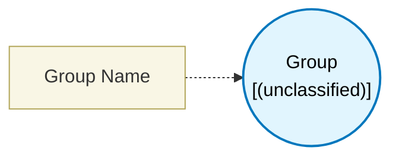

# Group (`group_block`) — Design Document

> Generated by `build_block_docs.js` on 2026-10-21 from `.metadata/sysconfig/.meta/pru_blocks/program_control/group_block.syscfg.js`. Do not edit by hand; re-run `node build_block_docs.js`.

## Purpose


## Group Block (Code Organization Container)

### Purpose
The Group Block allows you to organize related blocks into named, reusable sections that can be selectively executed from your main.asm firmware. This enables modular code organization where you have full control over which functionality executes and when.

### Key Concept
Instead of all blocks executing sequentially in one flow, you can:
- **Group related functionality** together (e.g., ADC config, sensor initialization, data processing)
- **Execute groups selectively** by calling them from main.asm only when needed
- **Keep ungrouped blocks** in the default execution path (`sysconfig_generated_start/end`)

---

## How To Use Group Blocks

### Step 1: Create a Group Block
1. Add a **Group Block** from the program control palette
2. Give it a **meaningful name** (e.g., "adc_config", "sensor_init", "data_process")
- Must be a valid identifier (letters, numbers, underscore only)
- Cannot start with a number
- Must be unique across all groups

### Step 2: Add Blocks Inside the Group
1. **Drag blocks** into the gray group container box
2. Connect blocks inside using their input/output/prev/next ports (same as normal)
3. The group acts as a visual container - all blocks inside will execute together when the group is called

### Step 3: Call Groups from main.asm
Simply use the CALL macro to invoke groups - execution automatically continues after the call.

**Example for a group named "ABC":**

```asm
; In main.asm - declare the group start label
	.ref ABC_start          ; Reference the start label (defined in pru_syscfg.asm)

main:
	; Your initialization code...

	; Call the ABC group - execution automatically returns here
	CALL ABC_start
	; No label needed! Execution continues here automatically

	; You can call the same group multiple times
	CALL ABC_start
	; Returns here again

	halt
```

**Important:**
- Use the CALL macro (defined in pru_syscfg.inc) instead of JAL directly
- Execution automatically returns to the next instruction after CALL
- No need to define end labels manually
- Groups can be called multiple times from anywhere in main.asm
- The CALL macro uses R27.w0 as the return address register


## Technical Details

### Generated Labels
For a group named "my_group":
- **Start label**: `my_group_start` (declared as `.global` in pru_syscfg.asm)
- **No end label needed** - RET instruction automatically returns to caller

### CALL/RET Pattern
Groups use standard subroutine calling convention:
- **CALL macro**: Uses JAL (Jump And Link) to save return address and jump to group
- **RET instruction**: Returns to the saved address
- **Return address register**: R27.w0 (RET_ADDR0)
- **Automatic return**: No manual label management required

### Execution Flow
1. **Ungrouped blocks** are processed first and appear in the `sysconfig_generated_start` section
2. **Grouped blocks** are processed separately and appear AFTER the default section
3. Groups only execute when you explicitly call them from main.asm
4. Each group **automatically generates** a return instruction (`JMP RET_ADDR0`) at the end

### Processing Order Inside Groups
Blocks inside groups follow the same execution order rules:
- **End blocks** (blocks with no output/next/T/F ports) process first
- **Unconnected next** blocks process second
- **Result nodes** (unconnected output ports) process third
- Data dependencies via input ports ensure correct evaluation order

### Container Features
- **Resizable**: Default 500×250 pixels, drag corners to resize
- **Visual organization**: Gray box clearly shows which blocks belong to the group
- **Drag-and-drop**: Simply drag blocks into/out of the container
- **Nesting support**: Can contain Loop blocks, or be nested in other groups

---

## Important Notes

### Automatic Return Generation
Groups automatically generate a return instruction at the end:
- No Flow Control block required
- Return instruction (`JMP RET_ADDR0`) is automatically added
- Execution returns to the instruction after CALL
- Optional: You can still add Flow Control blocks inside groups for conditional exits or HALT

### Ungrouped vs Grouped Blocks
- **Ungrouped blocks**: Execute automatically when you call `sysconfig_generated_start`
- **Grouped blocks**: Only execute when you explicitly call their start label
- Choose wisely what goes where based on your program flow

### Label Naming
- Group names become assembly labels
- Use descriptive names: "adc_config" not "group1"
- Keep names concise (< 32 characters recommended)
- Follow C identifier rules (no spaces, no special chars except underscore)

### Groups are Independent
- Groups don't automatically call each other
- Each group is a standalone code section
- You control the execution order from main.asm
- This gives you maximum flexibility

---

## Comparison: Grouped vs Ungrouped

| Feature | Ungrouped Blocks | Grouped Blocks |
|---------|------------------|----------------|
| Execution | Auto (when calling sysconfig_generated_start) | Manual (when you call group_start) |
| Use case | Initialization, always-needed code | Optional, conditional, or repeated functionality |
| Labels | sysconfig_generated_start/end | `groupName`_start (only) |
| Return Handling | JMP to sysconfig_generated_end | Automatic JMP RET_ADDR0 generated |
| Flexibility | Executes every time | Execute only when called |

---

## Block Diagram




## Classification

- **Block id:** `group_block`
- **Category:** Program Control
- **Execution model (inferred):** `(unclassified)`
- **Macro / opcode:** `group`
- **Data ports:** 0 in / 0 out · **Cycles:** `0`

## Parameter schema

| Parameter | Display name | Default | Options |
|---|---|---|---|
| `groupName` | Group Name | `` | — |

## Ports

_(no ports declared)_

## Validation rules

- Group name cannot be empty
- Group name must be a valid identifier (letters, numbers, underscore only, cannot start with number)
- Group name "<value>" is already used by another group

## Generated macro (`.xdt` equivalent)

_(structural container; shared register allocator emits its labelled child body)_

## Device portability

> **Source of truth:** `.metadata/sysconfig/.meta/pru_blocks/common/pru_device_caps.js` (TRM SPRUIM2J §6.4.1.1 / SPRUJB6 §7.3.1.1). Regenerated by `node build_block_docs.js` — do not edit by hand.

- **Required widget(s):** _(none)_
- **Validator:** `pru_blocks_static_module` raises a SysConfig **ERROR** naming both widget and device when a required widget is absent.

| Device (SoC) | Supported |
|---|---|
| `am243x` | ✅ |
| `am261x` | ✅ |
| `am263px` | ✅ |
| `am263x` | ✅ |
| `am64x` | ✅ |

## Outstanding TODO / VERIFY items

- None flagged in source.
