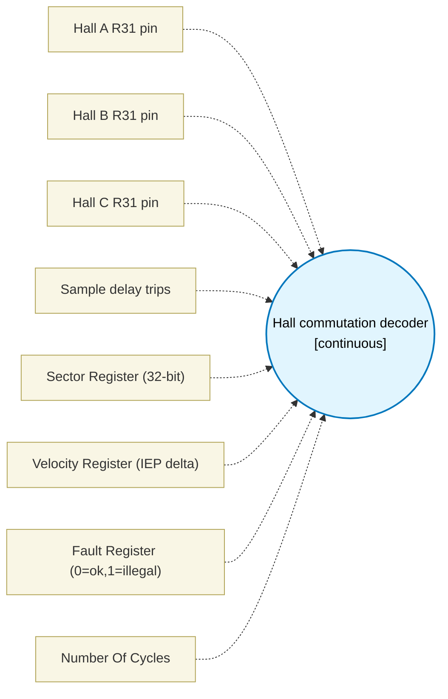

# Hall commutation decoder (`hall_block`) — Design Document

> Generated by `build_block_docs.js` from `.metadata/sysconfig/.meta/pru_blocks/pru_io_blocks/hall_block.syscfg.js`. Do not edit by hand; re-run `node build_block_docs.js`.

## Purpose

Hall commutation decoder for 3-phase BLDC motors.

Six-entry sector LUT: Hall code (A<<2|B<<1|C) maps 001->0, 011->1, 010->2, 110->3, 100->4, 101->5; 000 and 111 are illegal and trap.
IEP edge timestamp for speed: on each sector edge the IEP counter (c26, 0x10) is sampled via LBCO and the delta from the previous edge is written to VEL_REG.
Illegal-state trap: 000/111 sets FAULT_REG=1, SECTOR_REG=0xFFFFFFFF and does NOT interpolate; uses only TEMP_REG1 and TEMP_REG2 (2-TEMP_REG pattern).

## Block Diagram




## Classification

- **Block id:** `hall_block`
- **Category:** I/O & Protocol
- **Execution model (inferred):** `continuous`
- **Macro / opcode:** `m_hall_decode`
- **Data ports:** 0 in / 0 out · **Cycles:** `1`

## Parameter schema

| Parameter | Display name | Default | Options |
|---|---|---|---|
| `aBit` | Hall A R31 pin | `0` | `0`, `1`, `2`, `3`, `4`, `5`, `6`, `7`, `8`, `9`, `10`, `11`, `12`, `13`, `14`, `15`, `16`, `17`, `18`, `19` |
| `bBit` | Hall B R31 pin | `1` | `0`, `1`, `2`, `3`, `4`, `5`, `6`, `7`, `8`, `9`, `10`, `11`, `12`, `13`, `14`, `15`, `16`, `17`, `18`, `19` |
| `cBit` | Hall C R31 pin | `2` | `0`, `1`, `2`, `3`, `4`, `5`, `6`, `7`, `8`, `9`, `10`, `11`, `12`, `13`, `14`, `15`, `16`, `17`, `18`, `19` |
| `sampleCycles` | Sample delay trips | `10` | — |
| `sectorRegister` | Sector Register (32-bit) | `R4` | — |
| `velRegister` | Velocity Register (IEP delta) | `R5` | — |
| `faultRegister` | Fault Register (0=ok,1=illegal) | `R6` | — |
| `noOfCycles` | Number Of Cycles | `1` | — |

## Ports

| Port | Type |
|---|---|
| `prev` | `IO_PREV` |

## Validation rules

- aBit, bBit, and cBit must differ
- sampleCycles must be >= 1
- sector, velocity and fault registers must differ

## Generated macro (`.xdt` equivalent)

```asm
m_hall_decode .macro RES, A_BIT, B_BIT, C_BIT, SECTOR_REG, VEL_REG, FAULT_REG, SAMPLE_TRIPS
    ; Hall init - use only TEMP_REG1 and TEMP_REG2 (2-TEMP_REG pattern)
    ldi32 FAULT_REG, 0
    ldi32 VEL_REG, 0
    ldi32 TEMP_REG1, 0               ; prev IEP timestamp
    ldi32 TEMP_REG2, 0               ; bit0..2 code temp, sector temp in b1
    ldi32 SECTOR_REG, 0xffffffff     ; invalid until first legal sector
hall_loop?:
    ; ----- build 3-bit Hall code (A<<2|B<<1|C) into TEMP_REG2.b0 -----
    ldi TEMP_REG2.b0, 0
    qbbs hall_a1?, R31, A_BIT
    qba hall_b?
hall_a1?:
    or TEMP_REG2.b0, TEMP_REG2.b0, 4
hall_b?:
    qbbs hall_b1?, R31, B_BIT
    qba hall_c?
hall_b1?:
    or TEMP_REG2.b0, TEMP_REG2.b0, 2
hall_c?:
    qbbs hall_c1?, R31, C_BIT
    qba hall_lut?
hall_c1?:
    or TEMP_REG2.b0, TEMP_REG2.b0, 1
hall_lut?:
    ; ----- six-entry sector LUT + illegal trap -----
    qbeq hall_fault?, TEMP_REG2.b0, 0
    qbeq hall_fault?, TEMP_REG2.b0, 7
    qbeq hall_s0?, TEMP_REG2.b0, 1
    qbeq hall_s1?, TEMP_REG2.b0, 3
    qbeq hall_s2?, TEMP_REG2.b0, 2
    qbeq hall_s3?, TEMP_REG2.b0, 6
    qbeq hall_s4?, TEMP_REG2.b0, 4
    qbeq hall_s5?, TEMP_REG2.b0, 5
    qba hall_fault?
hall_s0?:
    ldi TEMP_REG2.b1, 0
    qba hall_edge?
hall_s1?:
    ldi TEMP_REG2.b1, 1
    qba hall_edge?
hall_s2?:
    ldi TEMP_REG2.b1, 2
    qba hall_edge?
hall_s3?:
    ldi TEMP_REG2.b1, 3
    qba hall_edge?
hall_s4?:
    ldi TEMP_REG2.b1, 4
    qba hall_edge?
hall_s5?:
    ldi TEMP_REG2.b1, 5
hall_edge?:
    ; ----- edge detection: compare current sector (TEMP_REG2.b1) with SECTOR_REG -----
    qbeq hall_delay?, TEMP_REG2.b1, SECTOR_REG
    ; ----- IEP edge timestamp for speed (c26, 0x10) via R10 spill -----
    mov R10.b0, TEMP_REG2.b1
    mov TEMP_REG2, TEMP_REG1
    lbco &TEMP_REG1, c26, 0x10, 4
    sub VEL_REG, TEMP_REG1, TEMP_REG2
    mov SECTOR_REG, R10.b0
    qba hall_delay?
hall_fault?:
    ; ----- illegal-state trap: do NOT interpolate -----
    ldi32 SECTOR_REG, 0xffffffff
    ldi FAULT_REG, 1
    ; hold fault - do not update velocity on illegal
hall_delay?:
    ldi TEMP_REG2.w0, SAMPLE_TRIPS
hall_dl?:
    sub TEMP_REG2.w0, TEMP_REG2.w0, 1
    qbne hall_dl?, TEMP_REG2.w0, 0
    qba hall_loop?
    .endm
```

## Device portability

> **Source of truth:** `.metadata/sysconfig/.meta/pru_blocks/common/pru_device_caps.js` (TRM SPRUIM2J §6.4.1.1 / SPRUJB6 §7.3.1.1). Regenerated by `node build_block_docs.js` — do not edit by hand.

- **Required widget(s):** _(none)_
- **Validator:** `pru_blocks_static_module` raises a SysConfig **ERROR** naming both widget and device when a required widget is absent.

| Device (SoC) | Supported |
|---|---|
| `am243x` | ✅ |
| `am261x` | ✅ |
| `am263px` | ✅ |
| `am263x` | ✅ |
| `am64x` | ✅ |

## Outstanding TODO / VERIFY items

- None flagged in source.
