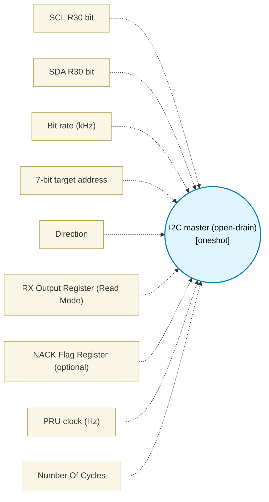

# I2C master (open-drain) (`i2c_block`) — Design Document

> Generated by `build_block_docs.js` from `.metadata/sysconfig/.meta/pru_blocks/pru_io_blocks/i2c_block.syscfg.js`. Do not edit by hand; re-run `node build_block_docs.js`.

## Purpose

Emits a parameterized START / address-byte / ACK / STOP frame (in read mode, followed by an 8-bit data receive and NACK). ADDRESS NACK: the master samples SDA while SCL is high for the ninth (ACK) clock. SDA high means the target did not acknowledge: the master then skips the data phase, issues STOP with the same tSU;STO / tBUF delays as a normal frame (SDA driven low after the ninth clock falls, SCL released, SDA released), and falls through to the next block without any further SCL clock. In read mode the RX Output Register is not written on that path. The NACK flag register is OPTIONAL and empty by default: the STOP and early exit happen either way, but no flag is written and no register is reserved, so existing designs (a second I2C block, encoder_speed_block on R8) generate unchanged. When you type a register in NACK Flag Register (a result register like the status/fault registers of safety_dual_monitor_block and hall_block) the sampled ACK bit is stored there on every call (0 = target acknowledged, 1 = address NACK) and the register is reserved, so a following block can test it (for example a Flow Control compare against 0). At a 200 MHz PRU clock, the delay loop makes each SCL low/high phase and the START/STOP hold/setup phases at least the UM10204 minima for the selected 100, 400, or 1000 kHz mode (tLOW, tHIGH, tSU;STA, tHD;STA, tSU;STO, and tSU;DAT). HALF_TRIPS is one half-period in cycles divided by two, plus a margin of 4 trips, because each delay-loop trip is two PRU cycles (sub + qbne); the resulting waveform is deliberately no faster than the selected bus rate. Frame duration (noOfCycles) is modeled as ~9 SCL clocks (11 bit times) for write mode and ~18 SCL clocks (20 bit times) for read mode.

## Block Diagram




## Classification

- **Block id:** `i2c_block`
- **Category:** I/O & Protocol
- **Execution model (inferred):** `oneshot`
- **Macro / opcode:** `m_i2c_run`
- **Data ports:** 0 in / 0 out · **Cycles:** `5500`

## Parameter schema

| Parameter | Display name | Default | Options |
|---|---|---|---|
| `sclBit` | SCL R30 bit | `0` | `0`, `1`, `2`, `3`, `4`, `5`, `6`, `7`, `8`, `9`, `10`, `11`, `12`, `13`, `14`, `15`, `16`, `17`, `18`, `19` |
| `sdaBit` | SDA R30 bit | `1` | `0`, `1`, `2`, `3`, `4`, `5`, `6`, `7`, `8`, `9`, `10`, `11`, `12`, `13`, `14`, `15`, `16`, `17`, `18`, `19` |
| `bitRateKhz` | Bit rate (kHz) | `400` | `100`, `400`, `1000` |
| `addr7` | 7-bit target address | `0x50` | — |
| `rw` | Direction | `write` | `write`, `read` |
| `dataRegister` | RX Output Register (Read Mode) | `R7` | — |
| `nackRegister` | NACK Flag Register (optional) | `` | — |
| `clkHz` | PRU clock (Hz) | `200000000` | — |
| `noOfCycles` | Number Of Cycles | `5500` | — |

## Ports

| Port | Type |
|---|---|
| `prev` | `IO_PREV` |
| `next` | `IO_NEXT` |

## Validation rules

- sclBit and sdaBit must differ

## Generated macro (`.xdt` equivalent)

```asm
m_i2c_run .macro RES, SCL_BIT, SDA_BIT, HALF_TRIPS, ADDR_BYTE, IS_READ, DATA_REG, NACK_REG
    set   R30, R30, SCL_BIT
    set   R30, R30, SDA_BIT
    ldi TEMP_REG2.w2, HALF_TRIPS
ic_ss?:
    sub   TEMP_REG2.w2, TEMP_REG2.w2, 1
    qbne  ic_ss?, TEMP_REG2.w2, 0
    clr   R30, R30, SDA_BIT
    ldi TEMP_REG2.w2, HALF_TRIPS
ic_sh?:
    sub   TEMP_REG2.w2, TEMP_REG2.w2, 1
    qbne  ic_sh?, TEMP_REG2.w2, 0
    clr   R30, R30, SCL_BIT
    ldi32 TEMP_REG1, ADDR_BYTE
    lsl   TEMP_REG1, TEMP_REG1, 24
    ldi TEMP_REG2.b0, 8
ic_dl?:
    lsr   TEMP_REG2.b1, TEMP_REG1, 31
    and   TEMP_REG2.b1, TEMP_REG2.b1, 1
    clr   R30, R30, SDA_BIT
    lsl   TEMP_REG2.w2, TEMP_REG2.b1, SDA_BIT
    or    R30, R30, TEMP_REG2.w2
    ldi TEMP_REG2.w2, HALF_TRIPS
ic_ds?:
    sub   TEMP_REG2.w2, TEMP_REG2.w2, 1
    qbne  ic_ds?, TEMP_REG2.w2, 0
    set   R30, R30, SCL_BIT
    ldi TEMP_REG2.w2, HALF_TRIPS
ic_dh?:
    sub   TEMP_REG2.w2, TEMP_REG2.w2, 1
    qbne  ic_dh?, TEMP_REG2.w2, 0
    clr   R30, R30, SCL_BIT
    lsl   TEMP_REG1, TEMP_REG1, 1
    sub   TEMP_REG2.b0, TEMP_REG2.b0, 1
    qbne  ic_dl?, TEMP_REG2.b0, 0
    ldi TEMP_REG2.w2, HALF_TRIPS
ic_al?:
    sub   TEMP_REG2.w2, TEMP_REG2.w2, 1
    qbne  ic_al?, TEMP_REG2.w2, 0
    set   R30, R30, SDA_BIT
    set   R30, R30, SCL_BIT
    lsr   TEMP_REG1, R31, SDA_BIT
    and   NACK_REG, TEMP_REG1, 1
    ldi TEMP_REG2.w2, HALF_TRIPS
ic_ah?:
    sub   TEMP_REG2.w2, TEMP_REG2.w2, 1
    qbne  ic_ah?, TEMP_REG2.w2, 0
    clr   R30, R30, SCL_BIT
    qbne  ic_st?, NACK_REG, 0
    .if IS_READ == 1
    set   R30, R30, SDA_BIT
    ldi32 DATA_REG, 0
    ldi TEMP_REG2.b0, 8
ic_rl?:
    lsl   DATA_REG, DATA_REG, 1
    ldi TEMP_REG2.w2, HALF_TRIPS
ic_rs?:
    sub   TEMP_REG2.w2, TEMP_REG2.w2, 1
    qbne  ic_rs?, TEMP_REG2.w2, 0
    set   R30, R30, SCL_BIT
    lsr   TEMP_REG1, R31, SDA_BIT
    and   TEMP_REG1, TEMP_REG1, 1
    or    DATA_REG, DATA_REG, TEMP_REG1
    ldi TEMP_REG2.w2, HALF_TRIPS
ic_rh?:
    sub   TEMP_REG2.w2, TEMP_REG2.w2, 1
    qbne  ic_rh?, TEMP_REG2.w2, 0
    clr   R30, R30, SCL_BIT
    sub   TEMP_REG2.b0, TEMP_REG2.b0, 1
    qbne  ic_rl?, TEMP_REG2.b0, 0
    set   R30, R30, SDA_BIT
    ldi TEMP_REG2.w2, HALF_TRIPS
ic_nl?:
    sub   TEMP_REG2.w2, TEMP_REG2.w2, 1
    qbne  ic_nl?, TEMP_REG2.w2, 0
    set   R30, R30, SCL_BIT
    ldi TEMP_REG2.w2, HALF_TRIPS
ic_nh?:
    sub   TEMP_REG2.w2, TEMP_REG2.w2, 1
    qbne  ic_nh?, TEMP_REG2.w2, 0
    clr   R30, R30, SCL_BIT
    .endif
ic_st?:
    clr   R30, R30, SDA_BIT
    ldi TEMP_REG2.w2, HALF_TRIPS
ic_sl?:
    sub   TEMP_REG2.w2, TEMP_REG2.w2, 1
    qbne  ic_sl?, TEMP_REG2.w2, 0
    set   R30, R30, SCL_BIT
    ldi TEMP_REG2.w2, HALF_TRIPS
ic_sp?:
    sub   TEMP_REG2.w2, TEMP_REG2.w2, 1
    qbne  ic_sp?, TEMP_REG2.w2, 0
    set   R30, R30, SDA_BIT
    .endm
```

## Device portability

> **Source of truth:** `.metadata/sysconfig/.meta/pru_blocks/common/pru_device_caps.js` (TRM SPRUIM2J §6.4.1.1 / SPRUJB6 §7.3.1.1). Regenerated by `node build_block_docs.js` — do not edit by hand.

- **Required widget(s):** _(none)_
- **Validator:** `pru_blocks_static_module` raises a SysConfig **ERROR** naming both widget and device when a required widget is absent.

| Device (SoC) | Supported |
|---|---|
| `am243x` | ✅ |
| `am261x` | ✅ |
| `am263px` | ✅ |
| `am263x` | ✅ |
| `am64x` | ✅ |

## Outstanding TODO / VERIFY items

- None flagged in source.
