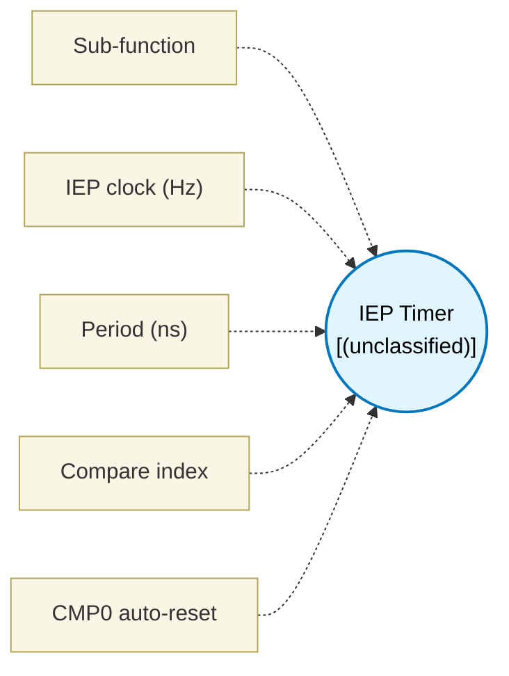

# IEP Timer (`iep_block`) — Design Document

> Generated by `build_block_docs.js` on 2026-10-21 from `.metadata/sysconfig/.meta/pru_blocks/utils/iep_block.syscfg.js`. Do not edit by hand; re-run `node build_block_docs.js`.

## Purpose

_(no description in module)_

## Block Diagram




## Classification

- **Block id:** `iep_block`
- **Category:** Utilities
- **Execution model (inferred):** `(unclassified)`
- **Macro / opcode:** `m_iep_block`
- **Data ports:** 0 in / 0 out · **Cycles:** `10`

## Parameter schema

| Parameter | Display name | Default | Options |
|---|---|---|---|
| `func` | Sub-function | `periodic` | `periodic`, `oneshot`, `capture` |
| `clkHz` | IEP clock (Hz) | `200000000` | — |
| `periodNs` | Period (ns) | `5000` | — |
| `cmpIndex` | Compare index | `0` | — |
| `autoReset` | CMP0 auto-reset | `true` | — |

## Ports

| Port | Type |
|---|---|
| `prev` | `PREV` |
| `next` | `NEXT` |

## Validation rules

- clkHz must be > 0
- periodNs must be > 0
- cmpIndex must be 0..15
- periodic auto-reset requires cmpIndex 0

## Generated macro (`.xdt` equivalent)

```asm
m_iep_block	.macro RES, func, counts, cmpIndex, autoReset
    ; Parameters: func(0=periodic,1=oneshot,2=capture), counts, cmpIndex, autoReset

    ; IEP register offsets: TRM SPRUIM2J 14.3.6.1.25.
    .asg 0x00, IEP_GLOBAL_CFG
    .asg 0x70, IEP_CMP_CFG
    .asg 0x74, IEP_CMP_STATUS
    .asg 0x78, IEP_CMP0
    .asg 0x11, INCR_1_ENABLE
    .asg c26, CONST_IEP
    
    .if (func != 2) ; Not capture
iep_init?:
    ldi   R0, INCR_1_ENABLE
    sbco  &R0, CONST_IEP, IEP_GLOBAL_CFG, 4
    ldi32 R2, counts
    sbco  &R2, CONST_IEP, IEP_CMP0, 4
    
    .if (func == 0)
        .if (autoReset == 1)
            ldi   R0, 0x03 ; periodic CMP0 en+reset
        .else
            ldi   R0, 0x02 ; oneshot: CMP_EN[0] only (bit 0 is CMP0_RST_CNT_EN)
        .endif
    .else
        ldi   R0, 0x02 ; oneshot: CMP_EN[0] only (bit 0 is CMP0_RST_CNT_EN)
    .endif
    sbco  &R0, CONST_IEP, IEP_CMP_CFG, 4
    ldi   R0, 1
    sbco  &R0, CONST_IEP, IEP_CMP_STATUS, 4
    
iep_wait_cmp?:
wait_loop?:
    lbco  &R1, CONST_IEP, IEP_CMP_STATUS, 4
    qbbc  wait_loop?, R1, cmpIndex
    ldi   R0, 1
    sbco  &R0, CONST_IEP, IEP_CMP_STATUS, 4
    .endif

    .endm
```

## Device portability

> **Source of truth:** `.metadata/sysconfig/.meta/pru_blocks/common/pru_device_caps.js` (TRM SPRUIM2J §6.4.1.1 / SPRUJB6 §7.3.1.1). Regenerated by `node build_block_docs.js` — do not edit by hand.

- **Required widget(s):** _(none)_
- **Validator:** `pru_blocks_static_module` raises a SysConfig **ERROR** naming both widget and device when a required widget is absent.

| Device (SoC) | Supported |
|---|---|
| `am243x` | ✅ |
| `am261x` | ✅ |
| `am263px` | ✅ |
| `am263x` | ✅ |
| `am64x` | ✅ |

## Outstanding TODO / VERIFY items

- None flagged in source.
