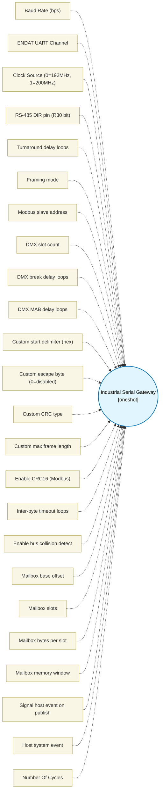

# Industrial Serial Gateway (`industrial_serial_gateway_block`) — Design Document

> Generated by `build_block_docs.js` from `.metadata/sysconfig/.meta/pru_blocks/application_specific/industrial_serial_gateway_block.syscfg.js`. Do not edit by hand; re-run `node build_block_docs.js`.

## Purpose

Half-duplex RS-485 serial gateway block that transports framed payloads over PRU-ICSSG ENDAT UART hardware and routes data through a shared-memory mailbox ring buffer to the host (R5F/A53).

Transport: drives an R30 direction pin (DE/RE for RS-485 transceiver) and uses the ENDAT UART peripheral for TX/RX at configurable baud rates (1.2 kbaud - 12 Mbaud). Turnaround time (idle before TX-to-RX or RX-to-TX switch) is configurable as a delay loop count.

Framing modes:
- MODBUS_RTU: address (1B) + function (1B) + data (0-252B) + CRC16 (2B, poly 0x8005, big-endian). Slave address match filter. Inter-frame silence detection (3.5 char = ~350 bit times at baud rate, floor to 2 byte-times for short frames).
- DMX512: Break (configurable duration, default 100 us low) + MAB (12 us high) + start code (slot 0) + 1-512 slot bytes at 250 kbaud.
- CUSTOM: configurable delimiter (start byte), optional escape byte, CRC16/CRC8/sum, max frame length.

CRC: For Modbus RTU uses CRC16-IBM (poly 0x8005, init 0xFFFF, ref-in/ref-out). DMX512 uses no CRC. CUSTOM mode selects CRC type from a CRC8-Dallas/CRC16-IBM/simple-sum set.

Mailbox: received frames are published to the host ring buffer (configurable DMEM/shared memory offset, 8-256 slots, 4-32 bytes per slot). Frames exceeding slotBytes are truncated or split across multiple slots with a continuation flag. The host signals new frames by updating the ring write pointer; the PRU polls the host-to-PRU queue (from mailbox) for TX commands (address+payload to send).

Timeout: configurable inter-byte timeout (delay loops between consecutive bytes). If inter-byte gap exceeds timeout, the frame-in-progress is discarded and the bus is released.

Bus collision: after TX, read back the echoed data on the RX line. Any mismatch is flagged as a collision in the status register output.

Peripheral resources: uses one ENDAT UART channel (CH0/1/2) for both TX and RX (half-duplex), one R30 GPIO bit for RS-485 direction control. Requires the R30 pin for DE/RE, the ENDAT RX channel for receive, and the ENDAT TX channel for transmit. Pinmux: the RS-485 DE/RE pin must be on a PRU R30 bit routed through PRU-ICSSG pinmux. Isolation: single PRU slice owns the UART channel and direction pin during the full exchange. Deterministic timing: each byte at a given baud rate is handled by the ENDAT hardware; framing/turnaround uses calibrated delay loops. BOM: an RS-485 transceiver (e.g. THVD1450, SN65HVD72) with DE/RE tied to the designated R30 pin. Current maturity: metadata-only. The emitted macro has mailbox and direction-control scaffolding, but TX/RX framing, ENDAT UART programming, CRC, and collision echo handling are incomplete; no generated ELF behavior is claimed. Physical transceiver timing also requires silicon validation.

## Block Diagram




## Classification

- **Block id:** `industrial_serial_gateway_block`
- **Category:** Application-Specific
- **Execution model (inferred):** `oneshot`
- **Macro / opcode:** `m_serial_gateway_run`
- **Data ports:** 2 in / 1 out · **Cycles:** `5000`

## Parameter schema

| Parameter | Display name | Default | Options |
|---|---|---|---|
| `baudRate` | Baud Rate (bps) | `115200` | — |
| `uartChannel` | ENDAT UART Channel | `0` | `0`, `1`, `2` |
| `clockSource` | Clock Source (0=192MHz, 1=200MHz) | `0` | — |
| `dirPin` | RS-485 DIR pin (R30 bit) | `0` | — |
| `turnaroundCycles` | Turnaround delay loops | `50` | — |
| `framingMode` | Framing mode | `MODBUS_RTU` | `MODBUS_RTU`, `DMX512`, `CUSTOM` |
| `modbusAddress` | Modbus slave address | `1` | — |
| `dmxSlotCount` | DMX slot count | `16` | — |
| `dmxBreakCycles` | DMX break delay loops | `200` | — |
| `dmxMabCycles` | DMX MAB delay loops | `20` | — |
| `customStartDelim` | Custom start delimiter (hex) | `0xAA` | — |
| `customEscapeByte` | Custom escape byte (0=disabled) | `0x00` | — |
| `customCrcType` | Custom CRC type | `CRC16_IBM` | `CRC8_DALLAS`, `CRC16_IBM`, `SUM8` |
| `customMaxLen` | Custom max frame length | `64` | — |
| `crcEnable` | Enable CRC16 (Modbus) | `true` | — |
| `interByteTimeout` | Inter-byte timeout loops | `200` | — |
| `collisionDetect` | Enable bus collision detect | `true` | — |
| `mbBaseOffset` | Mailbox base offset | `0x2000` | — |
| `mbSlots` | Mailbox slots | `16` | — |
| `mbSlotBytes` | Mailbox bytes per slot | `32` | — |
| `mbMemory` | Mailbox memory window | `dmem0` | — |
| `mbSignalEvent` | Signal host event on publish | `false` | — |
| `mbHostEvent` | Host system event | `16` | — |
| `noOfCycles` | Number Of Cycles | `5000` | — |

## Ports

| Port | Type |
|---|---|
| `prev` | `IO_PREV` |
| `next` | `IO_NEXT` |
| `input1` | `input32` |
| `input2` | `input32` |
| `output1` | `output32` |

## Validation rules

- baudRate must be 1200..12000000
- dirPin must be 0..15
- uartChannel must be 0..2
- modbusAddress must be 0..247
- dmxSlotCount must be 1..512
- customMaxLen must be 4..256
- mbHostEvent must be a system event 16..31 (R31 event-generate channels 0..15)
- mbSlots must be 2..256
- mbSlots must be a power of two
- mbSlotBytes must be 4..32
- turnaroundCycles too small

## Generated macro (`.xdt` equivalent)

```asm
m_serial_gateway_run .macro STATUS, TX_DATA_REG, TX_CMD_REG, MODE, BAUDRATE_DIV, UART_CH, DIR_PIN, TURNAROUND, TIMEOUT_BYTES, MB_BASE, MB_SLOT_LOG2, MB_SLOT_BYTES, MB_IS_SHARED, MB_SIGNAL_EV, MB_HOST_EV, MODBUS_ADDR, DMX_SLOTS, DMX_BREAK_CYCLES, DMX_MAB_CYCLES, CUSTOM_DELIM, CUSTOM_ESC, CUSTOM_CRC_TYPE, CUSTOM_MAX_BYTES, CRC_EN, COLL_EN, INTER_BYTE_TMO
    ldi   STATUS, 0
    ; Phase 1: TX queue consume
    ldi   TEMP_REG3.w2, MB_BASE
    .if MB_IS_SHARED == 1
    lbco  &TEMP_REG1, c28, TEMP_REG3.w2, 4
    add   TEMP_REG2.w0, TEMP_REG3.w2, 4
    lbco  &TEMP_REG2.w0, c28, TEMP_REG2.w0, 4
    .else
    lbco  &TEMP_REG1, c24, TEMP_REG3.w2, 4
    add   TEMP_REG2.w0, TEMP_REG3.w2, 4
    lbco  &TEMP_REG2.w0, c24, TEMP_REG2.w0, 4
    .endif
    qbeq  sg_rx_phase, TEMP_REG1, TEMP_REG2.w0
    ; read payload slot: offset = ((readPtr & mask) << log2) + MB_BASE + 8
    ldi   TEMP_REG4.w2, (1 << MB_SLOT_LOG2) - 1
    and   TEMP_REG4.w2, TEMP_REG2.w0, TEMP_REG4.w2
    lsl   TEMP_REG4.w2, TEMP_REG4.w2, MB_SLOT_LOG2
    add   TEMP_REG4.w2, TEMP_REG4.w2, TEMP_REG3.w2
    add   TEMP_REG4.w2, TEMP_REG4.w2, 8
    .if MB_IS_SHARED == 1
    lbco  &TEMP_REG3, c28, TEMP_REG4.w2, MB_SLOT_BYTES
    .else
    lbco  &TEMP_REG3, c24, TEMP_REG4.w2, MB_SLOT_BYTES
    .endif
    ; increment PRU read ptr (TEMP_REG1 = masked (ptr+1))
    add   TEMP_REG1, TEMP_REG2.w0, 1
    ldi   TEMP_REG4.w2, (1 << MB_SLOT_LOG2) - 1
    and   TEMP_REG1, TEMP_REG1, TEMP_REG4.w2
    ; write back: sbco &TEMP_REG1, c24, MB_BASE+4, 4
    add   TEMP_REG4.w2, TEMP_REG3.w2, 4
    .if MB_IS_SHARED == 1
    sbco  &TEMP_REG1, c28, TEMP_REG4.w2, 4
    .else
    sbco  &TEMP_REG1, c24, TEMP_REG4.w2, 4
    .endif
    ; DIR = TX
    set   R30, R30, DIR_PIN
    ldi   TEMP_REG4.w0, TURNAROUND
sg_tx_turn:
    sub   TEMP_REG4.w0, TEMP_REG4.w0, 1
    qbne  sg_tx_turn, TEMP_REG4.w0, 0
    ; turnaround delay then DIR = RX
    ldi   TEMP_REG4.w0, TURNAROUND
sg_tx_done:
    sub   TEMP_REG4.w0, TEMP_REG4.w0, 1
    qbne  sg_tx_done, TEMP_REG4.w0, 0
    clr   R30, R30, DIR_PIN
    .if COLL_EN == 1
    ; collision echo placeholder
    .endif
sg_rx_phase:
    ; Phase 2: RX mailbox publish
    clr   R30, R30, DIR_PIN
    ldi   TEMP_REG3.w2, MB_BASE
    .if MB_IS_SHARED == 1
    lbco  &TEMP_REG1, c28, TEMP_REG3.w2, 4
    .else
    lbco  &TEMP_REG1, c24, TEMP_REG3.w2, 4
    .endif
    ldi   TEMP_REG2.w2, (1 << MB_SLOT_LOG2) - 1
    and   TEMP_REG4.w2, TEMP_REG1, TEMP_REG2.w2
    lsl   TEMP_REG4.w2, TEMP_REG4.w2, MB_SLOT_LOG2
    add   TEMP_REG4.w2, TEMP_REG4.w2, TEMP_REG3.w2
    add   TEMP_REG4.w2, TEMP_REG4.w2, 8
    add   STATUS, STATUS, 1
    .if MB_IS_SHARED == 1
    sbco  &STATUS, c28, TEMP_REG4.w2, MB_SLOT_BYTES
    .else
    sbco  &STATUS, c24, TEMP_REG4.w2, MB_SLOT_BYTES
    .endif
    add   TEMP_REG1, TEMP_REG1, 1
    and   TEMP_REG1, TEMP_REG1, TEMP_REG2.w2
    .if MB_IS_SHARED == 1
    sbco  &TEMP_REG1, c28, TEMP_REG3.w2, 4
    .else
    sbco  &TEMP_REG1, c24, TEMP_REG3.w2, 4
    .endif
    .if MB_SIGNAL_EV != 0
    ldi   R31.b0, MB_HOST_EV
    .endif
    .endm
```

## Device portability

> **Source of truth:** `.metadata/sysconfig/.meta/pru_blocks/common/pru_device_caps.js` (TRM SPRUIM2J §6.4.1.1 / SPRUJB6 §7.3.1.1). Regenerated by `node build_block_docs.js` — do not edit by hand.

- **Required widget(s):** _(none)_
- **Validator:** `pru_blocks_static_module` raises a SysConfig **ERROR** naming both widget and device when a required widget is absent.

| Device (SoC) | Supported |
|---|---|
| `am243x` | ✅ |
| `am261x` | ✅ |
| `am263px` | ✅ |
| `am263x` | ✅ |
| `am64x` | ✅ |

## Outstanding TODO / VERIFY items

- ⚠️ TODO: ENDAT UART framing, CRC, and collision echo handling remain incomplete. The block is metadata-only; no generated ELF behavior is claimed.
