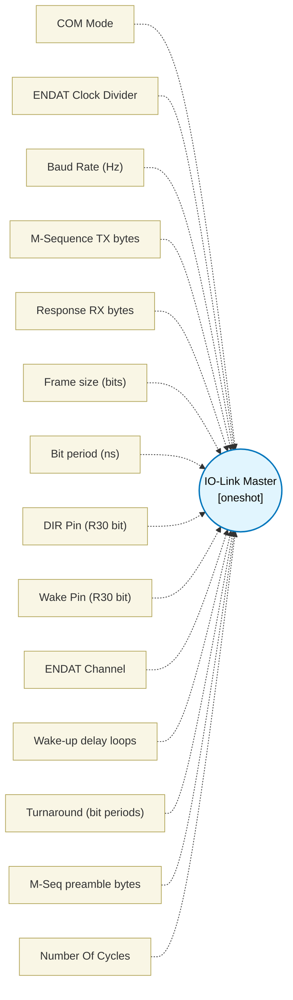

# IO-Link Master (`iolink_master_block`) — Design Document

> Generated by `build_block_docs.js` from `.metadata/sysconfig/.meta/pru_blocks/application_specific/iolink_master_block.syscfg.js`. Do not edit by hand; re-run `node build_block_docs.js`.

## Purpose

IO-Link master PHY engine that orchestrates a complete master -> device
transaction cycle on the C/Q half-duplex line.

**Protocol flow per transaction:**
  1. Wake-up pulse: C/Q driven low for >=80 us, then released high.
  2. M-sequence TX: Master transmits N bytes of 8N1 UART via ENDAT hardware.
  3. Turnaround: C/Q released; master listens for >=4 bit periods.
  4. Response RX: Device replies with M bytes of 8N1 UART via ENDAT hardware.
  5. Idle: C/Q high.

**Peripheral resources:**
- ENDAT channel (1 of 3 per PRU) for hardware UART TX/RX framing.
- 1x R30 GPIO for transceiver direction control (DIR).
- 1x R30 GPIO for wake-up pulse drive.
- No IEP, MAC, or SPAD required.

**Supported COM rates:**
  COM1 = 4.8 kbps  (divider 39999, frame 10 bits)
  COM2 = 38.4 kbps (divider  4999, frame 10 bits)
  COM3 = 230.4 kbps(divider   832, frame 10 bits)

**BOM:** Requires an external IO-Link transceiver (e.g. TI OL1013, MAX14819)
to convert the PRU's 3.3V ENDAT UART to 24V C/Q levels.

**Maturity:** `assembles`. The ENDAT wrapper is accurately modelled on the
existing `uart_tx` / `uart_rx` blocks, but the headless simulator does NOT
model the internal ENDAT FIFO/TX/RX state machine. Simulator-tested upgrade
requires an ENDAT stub.

## Block Diagram




## Classification

- **Block id:** `iolink_master_block`
- **Category:** Application-Specific
- **Execution model (inferred):** `oneshot`
- **Macro / opcode:** `m_iolink_master`
- **Data ports:** 2 in / 1 out · **Cycles:** `50000`

## Parameter schema

| Parameter | Display name | Default | Options |
|---|---|---|---|
| `comMode` | COM Mode | `COM3` | `COM1`, `COM2`, `COM3` |
| `baudDivider` | ENDAT Clock Divider | `832` | — |
| `baudHz` | Baud Rate (Hz) | `230400` | — |
| `txBytes` | M-Sequence TX bytes | `4` | — |
| `rxBytes` | Response RX bytes | `4` | — |
| `frameSizeBits` | Frame size (bits) | `10` | — |
| `bitPeriodNs` | Bit period (ns) | `4340` | — |
| `dirPin` | DIR Pin (R30 bit) | `2` | — |
| `wakePin` | Wake Pin (R30 bit) | `3` | — |
| `endatChannel` | ENDAT Channel | `0` | `0`, `1`, `2` |
| `wakeLoops` | Wake-up delay loops | `6400` | — |
| `turnaroundBitPeriods` | Turnaround (bit periods) | `5` | — |
| `mSeqPreambleBytes` | M-Seq preamble bytes | `0` | — |
| `noOfCycles` | Number Of Cycles | `50000` | — |

## Ports

| Port | Type |
|---|---|
| `prev` | `IO_PREV` |
| `next` | `IO_NEXT` |
| `input1` | `input32` |
| `input2` | `input32` |
| `output1` | `output32` |

## Validation rules

- txBytes must be 1..16
- rxBytes must be 0..16
- DIR pin and Wake pin must differ
- dirPin must be 0..15
- wakePin must be 0..15
- Turnaround must be at least 4 bit periods per IO-Link spec
- Computed clock divider

## Generated macro (`.xdt` equivalent)

```asm
; ========== ICSS CFG register definitions (iolink_master_block) ==========
    .if !$isdefed("ICSS_CFG")
    .asg    c4,     ICSS_CFG
    .endif
    .if !$isdefed("ICSS_CFG_GPCFG0")
ICSS_CFG_GPCFG0                 .set    0x0008
    .endif
    .if !$isdefed("ICSS_CFG_GPCFG1")
ICSS_CFG_GPCFG1                 .set    0x000C
    .endif
    .if !$isdefed("ICSS_CFG_PRU0_ENDAT_TXCFG")
ICSS_CFG_PRU0_ENDAT_TXCFG       .set    0x00E4
    .endif
    .if !$isdefed("ICSS_CFG_PRU1_ENDAT_TXCFG")
ICSS_CFG_PRU1_ENDAT_TXCFG       .set    0x0104
    .endif
    .if !$isdefed("ICSS_CFG_PRU0_ENDAT_RXCFG")
ICSS_CFG_PRU0_ENDAT_RXCFG       .set    0x00E0
    .endif
    .if !$isdefed("ICSS_CFG_PRU1_ENDAT_RXCFG")
ICSS_CFG_PRU1_ENDAT_RXCFG       .set    0x0100
    .endif
    .if !$isdefed("ICSS_CFG_PRU0_ENDAT_CH0_CFG0")
ICSS_CFG_PRU0_ENDAT_CH0_CFG0    .set    0x00E8
    .endif
    .if !$isdefed("ICSS_CFG_PRU0_ENDAT_CH1_CFG0")
ICSS_CFG_PRU0_ENDAT_CH1_CFG0    .set    0x00F0
    .endif
    .if !$isdefed("ICSS_CFG_PRU0_ENDAT_CH2_CFG0")
ICSS_CFG_PRU0_ENDAT_CH2_CFG0    .set    0x00F8
    .endif
    .if !$isdefed("ICSS_CFG_PRU1_ENDAT_CH0_CFG0")
ICSS_CFG_PRU1_ENDAT_CH0_CFG0    .set    0x0108
    .endif
    .if !$isdefed("ICSS_CFG_PRU1_ENDAT_CH1_CFG0")
ICSS_CFG_PRU1_ENDAT_CH1_CFG0    .set    0x0110
    .endif
    .if !$isdefed("ICSS_CFG_PRU1_ENDAT_CH2_CFG0")
ICSS_CFG_PRU1_ENDAT_CH2_CFG0    .set    0x0118
    .endif
; ========================================================================

m_iolink_master .macro RES, DATA_IN_LO, DATA_IN_HI, DIR_PIN, WAKE_PIN, CHANNEL, CLK_DIV, TX_BYTES, RX_BYTES, TURN_BITS, WAKE_LPS, PREAMBLE
    ; ================================================================
    ; m_iolink_master -- IO-Link master transaction engine
    ;
    ; Performs one complete IO-Link master cycle:
    ;   WAKE -> ENDAT TX (M-sequence) -> TURNAROUND -> ENDAT RX (response)
    ;
    ; Parameters:
    ;   RES         -- Destination register for received response bytes
    ;   DATA_IN_LO  -- Register with lower 32 bits of TX payload
    ;   DATA_IN_HI  -- Register with upper 32 bits of TX payload
    ;   DIR_PIN     -- R30 bit for transceiver direction (0=RX, 1=TX)
    ;   WAKE_PIN    -- R30 bit for wake-up pulse (driven low for WAKE_LPS)
    ;   CHANNEL     -- ENDAT channel (0/1/2)
    ;   CLK_DIV     -- ENDAT TX clock divider
    ;   TX_BYTES    -- Number of payload bytes to TX (1..16)
    ;   RX_BYTES    -- Number of bytes expected from device (0..16, 0=skip RX)
    ;   TURN_BITS   -- Turnaround pause in bit periods (min 4)
    ;   WAKE_LPS    -- Wake-up delay loop iterations (~5 cy/iter @ 200 MHz)
    ;   PREAMBLE    -- Preamble byte value (0 = no preamble)
    ; ================================================================
    ; ---- register setup ----
    ldi   RES, 0
    ldi   TEMP_REG1, 0
    ldi   TEMP_REG2, 0
    ldi   TEMP_REG3, 0
    ; ======== Phase 1: Wake-up pulse ========
    ; Enable TX driver
    set   R30, R30, DIR_PIN
    ; Drive WAKE_PIN low
    clr   R30, R30, WAKE_PIN
    ; Hold for WAKE_LPS iterations (~5 cycles each = 25 ns)
    ldi   TEMP_REG1.w0, WAKE_LPS
m_iolink_wait_wake?:
    sub   TEMP_REG1.w0, TEMP_REG1.w0, 1
    qbne  m_iolink_wait_wake?, TEMP_REG1.w0, 0
    ; Release wake pin high
    set   R30, R30, WAKE_PIN
    ; Disable TX driver (C/Q floats, pull-up holds high)
    clr   R30, R30, DIR_PIN
    ; Brief idle before TX (10 loops ~ 250 ns)
    ldi   TEMP_REG1.w0, 10
m_iolink_post_wake?:
    sub   TEMP_REG1.w0, TEMP_REG1.w0, 1
    qbne  m_iolink_post_wake?, TEMP_REG1.w0, 0
    ; ======== Phase 2: Configure ENDAT TX ========
    ; Disable RX, assert global reinit
    ldi     R30.b3, 0x00
    set     R31, R31, 19
    ; Poll reinit busy
    .if CHANNEL == 0
m_iolink_wait_reinit_tx?:
    qbbs    m_iolink_wait_reinit_tx?, R31, 5
    .elseif CHANNEL == 1
m_iolink_wait_reinit_tx?:
    qbbs    m_iolink_wait_reinit_tx?, R31, 13
    .else
m_iolink_wait_reinit_tx?:
    qbbs    m_iolink_wait_reinit_tx?, R31, 21
    .endif
    ldi     R30.b3, 0x00
    ; Set PRU0 peripheral mode via GPCFG0
    ldi32   TEMP_REG1, 0x04000000
    ldi     TEMP_REG2.w0, ICSS_CFG_GPCFG0
    sbco    &TEMP_REG1, ICSS_CFG, TEMP_REG2.w0, 4
    ; Configure TX clock: [31:16]=CLK_DIV, [4]=0 (192 MHz UART_CLK)
    ldi     TEMP_REG1.w0, 0
    ldi     TEMP_REG1.w2, CLK_DIV
    ldi     TEMP_REG2.w0, ICSS_CFG_PRU0_ENDAT_TXCFG
    sbco    &TEMP_REG1, ICSS_CFG, TEMP_REG2.w0, 4
    ; Configure CHCFG0: frameSize=0 (continuous), bitSwap=1 (LSB-first)
    ldi     TEMP_REG1, 0
    set     TEMP_REG1, TEMP_REG1, 31
    .if CHANNEL == 0
    ldi     TEMP_REG2.w0, ICSS_CFG_PRU0_ENDAT_CH0_CFG0
    .elseif CHANNEL == 1
    ldi     TEMP_REG2.w0, ICSS_CFG_PRU0_ENDAT_CH1_CFG0
    .else
    ldi     TEMP_REG2.w0, ICSS_CFG_PRU0_ENDAT_CH2_CFG0
    .endif
    sbco    &TEMP_REG1, ICSS_CFG, TEMP_REG2.w0, 4
    ; Select channel with clk_mode=3
    .if CHANNEL == 0
    ldi     R30.w2, 0x0018
    .elseif CHANNEL == 1
    ldi     R30.w2, 0x0019
    .else
    ldi     R30.w2, 0x001A
    .endif
    ; ======== Phase 3: Transmit M-Sequence ========
    ; Enable TX driver for master transmission
    set     R30, R30, DIR_PIN
    ; Wait briefly (5 NOPs) for transceiver to turn on
    nop
    nop
    nop
    nop
    nop
    ; Pack TX data byte into 10-bit UART frame
    ; Frame: [0]=start(0), [8:1]=data, [9]=stop(1)
    ; SIMPLIFIED: pack byte 0 only (1-byte TX)
    ; Full multi-byte packing TBD in follow-up
    mov     TEMP_REG4.b1, DATA_IN_LO   ; 8-bit data
    lsl     TEMP_REG4.b1, TEMP_REG4.b1, 1  ; shift for start bit
    set     TEMP_REG4.b1, TEMP_REG4.b1, 9  ; stop bit at position 9
    ; Place into TEMP_REG1 bits 9..0
    mov     TEMP_REG1.b0, TEMP_REG4.b1
    lsl     TEMP_REG4.b1, TEMP_REG4.b1, 8
    lsr     TEMP_REG1.b1, TEMP_REG4.b1, 8
    and     TEMP_REG1.b1, TEMP_REG1.b1, 0x03
    ; ======== ENDAT TX FIFO Load ========
    ; TEMP_REG1 holds packed frame (up to 16 bits for 1 byte)
    ; Load into FIFO bitSwap=1 (LSB on wire)
    mov     R30.b0, TEMP_REG1.b0          ; Byte 0
    .if TX_BYTES >= 2
    mov     R30.b0, TEMP_REG1.b1          ; Byte 1
    .endif
    set     R31, R31, 18                  ; TX GO
    ; Wait for TX complete (poll busy)
    .if CHANNEL == 0
m_iolink_wait_tx?:
    qbbs    m_iolink_wait_tx?, R31, 5
    .elseif CHANNEL == 1
m_iolink_wait_tx?:
    qbbs    m_iolink_wait_tx?, R31, 13
    .else
m_iolink_wait_tx?:
    qbbs    m_iolink_wait_tx?, R31, 21
    .endif
    ; Disable TX driver
    clr     R30, R30, DIR_PIN
    ; ======== Phase 5: Turnaround ========
    ; Wait TURN_BITS bit periods via nested delay loop
    ; Inner: ~174 iterations per bit (calibrated for COM3 @ 230.4k)
    ldi     TEMP_REG1.w0, TURN_BITS
    ldi     TEMP_REG2.w0, 174
m_iolink_turn_check?:
    sub     TEMP_REG1.w0, TEMP_REG1.w0, 1
    qbeq    m_iolink_turn_done?, TEMP_REG1.w0, 0
    mov     TEMP_REG4.w0, TEMP_REG2.w0
m_iolink_turn_inner?:
    sub     TEMP_REG4.w0, TEMP_REG4.w0, 1
    qbne    m_iolink_turn_inner?, TEMP_REG4.w0, 0
    qbne    m_iolink_turn_check?, TEMP_REG1.w0, 1
m_iolink_turn_done?:
    nop
    nop
    ; ======== Phase 6: Configure and Receive ENDAT RX ========
    .if RX_BYTES > 0
    ; ENDAT reinit for RX
    ldi     R30.b3, 0x00
    set     R31, R31, 19
    .if CHANNEL == 0
m_iolink_wait_reinit_rx?:
    qbbs    m_iolink_wait_reinit_rx?, R31, 5
    .elseif CHANNEL == 1
m_iolink_wait_reinit_rx?:
    qbbs    m_iolink_wait_reinit_rx?, R31, 13
    .else
m_iolink_wait_reinit_rx?:
    qbbs    m_iolink_wait_reinit_rx?, R31, 21
    .endif
    ldi     R30.b3, 0x00
    ; Configure RXCFG: oversample=0 (1x), clkDiv=CLK_DIV
    ldi     TEMP_REG1.w0, 0
    ldi     TEMP_REG1.w2, CLK_DIV
    ldi     TEMP_REG2.w0, ICSS_CFG_PRU0_ENDAT_RXCFG
    sbco    &TEMP_REG1, ICSS_CFG, TEMP_REG2.w0, 4
    ; Configure CHCFG0: frameSize=10, bitSwap=1 (LSB first)
    ldi     TEMP_REG1, 0
    set     TEMP_REG1, TEMP_REG1, 31
    ldi     TEMP_REG1.w0, (10 << 11)
    .if CHANNEL == 0
    ldi     TEMP_REG2.w0, ICSS_CFG_PRU0_ENDAT_CH0_CFG0
    .elseif CHANNEL == 1
    ldi     TEMP_REG2.w0, ICSS_CFG_PRU0_ENDAT_CH1_CFG0
    .else
    ldi     TEMP_REG2.w0, ICSS_CFG_PRU0_ENDAT_CH2_CFG0
    .endif
    sbco    &TEMP_REG1, ICSS_CFG, TEMP_REG2.w0, 4
    ; Enable RX
    .if CHANNEL == 0
    set     R30, R30, 24
    .elseif CHANNEL == 1
    set     R30, R30, 25
    .else
    set     R30, R30, 26
    .endif
    ; Poll for valid frame byte
    ldi     TEMP_REG3.b0, RX_BYTES
m_iolink_rx_next_byte?:
    ; Poll valid flag
    .if CHANNEL == 0
m_iolink_rx_wait_valid?:
    qbbc    m_iolink_rx_wait_valid?, R31, 24
    .elseif CHANNEL == 1
m_iolink_rx_wait_valid?:
    qbbc    m_iolink_rx_wait_valid?, R31, 25
    .else
m_iolink_rx_wait_valid?:
    qbbc    m_iolink_rx_wait_valid?, R31, 26
    .endif
    ; Read FIFO byte and accumulate in RES
    mov     TEMP_REG4.b0, R30.b0
    lsl     RES, RES, 8
    or      RES, RES, TEMP_REG4.b0
    ; Clear valid flag by toggling RX
    .if CHANNEL == 0
    clr     R30, R30, 24
    set     R30, R30, 24
    .elseif CHANNEL == 1
    clr     R30, R30, 25
    set     R30, R30, 25
    .else
    clr     R30, R30, 26
    set     R30, R30, 26
    .endif
    sub     TEMP_REG3.b0, TEMP_REG3.b0, 1
    qbne    m_iolink_rx_next_byte?, TEMP_REG3.b0, 0
    ; Disable RX
    .if CHANNEL == 0
    clr     R30, R30, 24
    .elseif CHANNEL == 1
    clr     R30, R30, 25
    .else
    clr     R30, R30, 26
    .endif
    .endif ; RX_BYTES > 0
    ; ======== Phase 7: Cleanup ========
    clr     R30, R30, DIR_PIN
    set     R31, R31, 19
    ldi     TEMP_REG1.w0, 20
m_iolink_cleanup_delay?:
    sub     TEMP_REG1.w0, TEMP_REG1.w0, 1
    qbne    m_iolink_cleanup_delay?, TEMP_REG1.w0, 0
    ldi     R30.b3, 0x00
    .endm
```

## Device portability

> **Source of truth:** `.metadata/sysconfig/.meta/pru_blocks/common/pru_device_caps.js` (TRM SPRUIM2J §6.4.1.1 / SPRUJB6 §7.3.1.1). Regenerated by `node build_block_docs.js` — do not edit by hand.

- **Required widget(s):** _(none)_
- **Validator:** `pru_blocks_static_module` raises a SysConfig **ERROR** naming both widget and device when a required widget is absent.

| Device (SoC) | Supported |
|---|---|
| `am243x` | ✅ |
| `am261x` | ✅ |
| `am263px` | ✅ |
| `am263x` | ✅ |
| `am64x` | ✅ |

## Outstanding TODO / VERIFY items

- None flagged in source.
