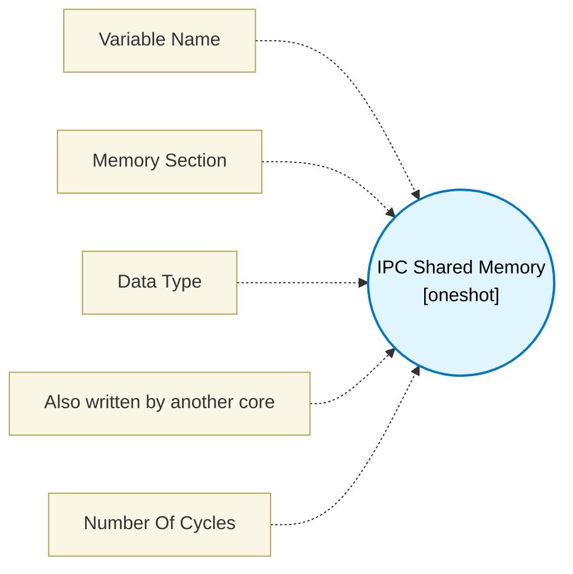

# IPC Shared Memory (`ipc_shared_mem_block`) — Design Document

> Generated by `build_block_docs.js` on 2026-10-21 from `.metadata/sysconfig/.meta/pru_blocks/application_specific/ipc_shared_mem_block.syscfg.js`. Do not edit by hand; re-run `node build_block_docs.js`.

## Purpose

Creates a shared memory bridge for passing data between PRU and R5F Host.

## Block Diagram




## Classification

- **Block id:** `ipc_shared_mem_block`
- **Category:** Application-Specific
- **Execution model (inferred):** `oneshot`
- **Macro / opcode:** `m_ipc_shmem_write`
- **Data ports:** 0 in / 0 out · **Cycles:** `2`

## Parameter schema

| Parameter | Display name | Default | Options |
|---|---|---|---|
| `variableName` | Variable Name | `encoder_data` | — |
| `memorySection` | Memory Section | `PRU_SHARED_RAM` | `PRU_SHARED_RAM`, `PRU_DRAM_0`, `PRU_DRAM_1` |
| `dataType` | Data Type | `uint32_t` | `uint32_t`, `int32_t`, `float` |
| `crossCoreWriters` | Also written by another core | `false` | — |
| `noOfCycles` | Number Of Cycles | `2` | — |

## Ports

| Port | Type |
|---|---|
| `prev` | `IO_PREV` |
| `next` | `IO_NEXT` |
| `input1` | `input32` |

## Validation rules

- _(no explicit validate() rules)_

## Generated macro (`.xdt` equivalent)

```asm
m_ipc_shmem_write .macro IN1, VAR_NAME
    ; Write to IPC shared memory variable
    ; Assuming VAR_NAME is allocated in the chosen memory section
    ; IN1 is allocator-sized (often a .b/.w piece); &IN1
    ; would store bytes IN1+1.. past the value. Copy through a
    ; full register so SBBO stores exactly the 4-byte value.
    mov   TEMP_REG3, IN1
    ldi32 TEMP_REG1, VAR_NAME
    sbbo  &TEMP_REG3, TEMP_REG1, 0, 4
    .endm
```

## Device portability

> **Source of truth:** `.metadata/sysconfig/.meta/pru_blocks/common/pru_device_caps.js` (TRM SPRUIM2J §6.4.1.1 / SPRUJB6 §7.3.1.1). Regenerated by `node build_block_docs.js` — do not edit by hand.

- **Required widget(s):** _(none)_
- **Validator:** `pru_blocks_static_module` raises a SysConfig **ERROR** naming both widget and device when a required widget is absent.

| Device (SoC) | Supported |
|---|---|
| `am243x` | ✅ |
| `am261x` | ✅ |
| `am263px` | ✅ |
| `am263x` | ✅ |
| `am64x` | ✅ |

## Outstanding TODO / VERIFY items

- None flagged in source.
