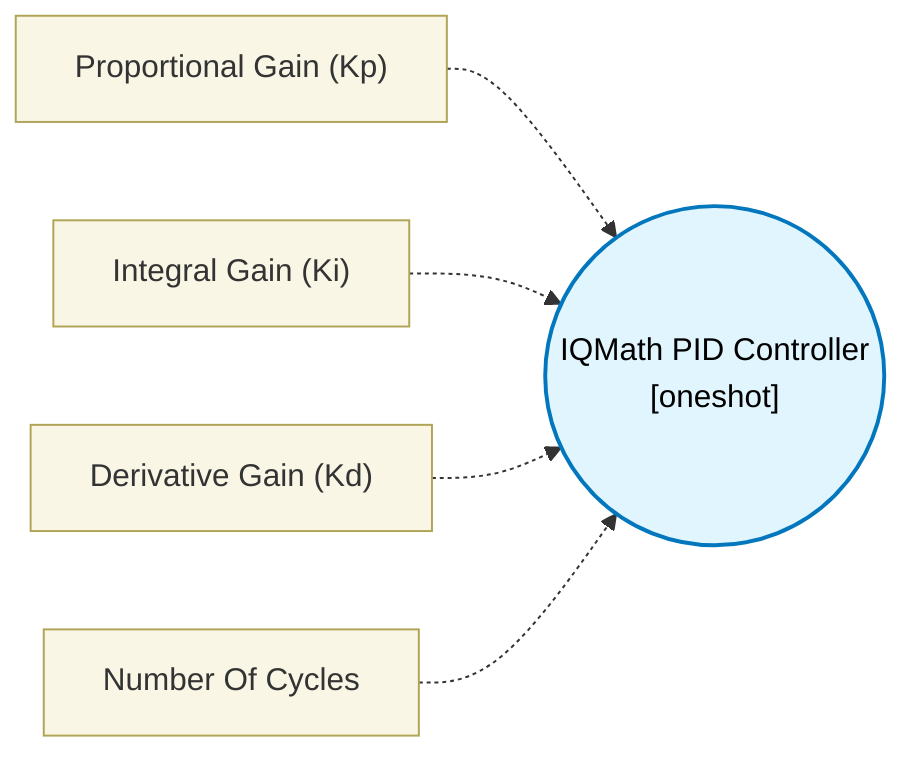

# IQMath PID Controller (`iqmath_pid_block`) — Design Document

> Generated by `build_block_docs.js` from `.metadata/sysconfig/.meta/pru_blocks/data_handling/iqmath_pid_block.syscfg.js`. Do not edit by hand; re-run `node build_block_docs.js`.

## Purpose

Calculates the PID output based on Setpoint and Feedback using fixed-point Q12 math via the PRU MAC broadside interface.

## Block Diagram




## Classification

- **Block id:** `iqmath_pid_block`
- **Category:** Data Handling
- **Execution model (inferred):** `oneshot`
- **Macro / opcode:** `m_iqmath_pid`
- **Data ports:** 2 in / 1 out · **Cycles:** `50`

## Parameter schema

| Parameter | Display name | Default | Options |
|---|---|---|---|
| `kp` | Proportional Gain (Kp) | `1.0` | — |
| `ki` | Integral Gain (Ki) | `0.1` | — |
| `kd` | Derivative Gain (Kd) | `0.01` | — |
| `noOfCycles` | Number Of Cycles | `50` | — |

## Ports

| Port | Type |
|---|---|
| `prev` | `IO_PREV` |
| `next` | `IO_NEXT` |
| `input1` | `input32` |
| `input2` | `input32` |
| `output1` | `output32` |

## Validation rules

- _(no explicit validate() rules)_

## Generated macro (`.xdt` equivalent)

```asm
m_iqmath_pid .macro RES, SETPOINT, FEEDBACK, KP, KI, KD, STATE_PTR
    ; --- PID Controller (Fixed-Point Q12) ---
    ; Layout in STATE_PTR (16 bytes): [Integral, Prev_Error, Error, Derivative]

    ; 1. Calculate and save Error
    ldi32 TEMP_REG3, STATE_PTR
    sub   TEMP_REG4, SETPOINT, FEEDBACK
    sbbo  &TEMP_REG4, TEMP_REG3, 8, 4  ; Save Error to offset 8

    ; 2. Calculate and save Derivative (Error - Prev_Error)
    lbbo  &TEMP_REG1, TEMP_REG3, 4, 4  ; Load Prev_Error into TEMP_REG1
    sub   TEMP_REG2, TEMP_REG4, TEMP_REG1 ; Derivative = Error - Prev_Error
    sbbo  &TEMP_REG2, TEMP_REG3, 12, 4 ; Save Derivative to offset 12

    ; 3. Update and save Prev_Error
    sbbo  &TEMP_REG4, TEMP_REG3, 4, 4  ; Save Error as Prev_Error to offset 4

    ; 4. Update and save Integral (Integral + Error)
    lbbo  &TEMP_REG1, TEMP_REG3, 0, 4  ; Load Integral into TEMP_REG1
    add   TEMP_REG1, TEMP_REG1, TEMP_REG4
    sbbo  &TEMP_REG1, TEMP_REG3, 0, 4  ; Save new Integral to offset 0

    ; Initialize Output Accumulator to 0
    ldi32 RES, 0

    ; Configure MAC for multiply-only mode
    ldi32 TEMP_REG3, 0
    xout  0, &TEMP_REG3, 1

    ; --- Kp * Error ---
    ldi32 TEMP_REG3, STATE_PTR
    lbbo  &TEMP_REG2, TEMP_REG3, 8, 4  ; Load Error into TEMP_REG2 (R29)
    ldi32 TEMP_REG1, KP                ; Load Kp into TEMP_REG1 (R28)
    nop
    xin   0, &TEMP_REG3, 8
    ; Q12 64-to-32 shift (handles sign)
    lsr   TEMP_REG3, TEMP_REG3, 12
    lsl   TEMP_REG4, TEMP_REG4, 20
    or    TEMP_REG3, TEMP_REG3, TEMP_REG4
    add   RES, RES, TEMP_REG3

    ; --- Ki * Integral ---
    ldi32 TEMP_REG3, STATE_PTR
    lbbo  &TEMP_REG2, TEMP_REG3, 0, 4  ; Load Integral into TEMP_REG2 (R29)
    ldi32 TEMP_REG1, KI                ; Load Ki into TEMP_REG1 (R28)
    nop
    xin   0, &TEMP_REG3, 8
    lsr   TEMP_REG3, TEMP_REG3, 12
    lsl   TEMP_REG4, TEMP_REG4, 20
    or    TEMP_REG3, TEMP_REG3, TEMP_REG4
    add   RES, RES, TEMP_REG3

    ; --- Kd * Derivative ---
    ldi32 TEMP_REG3, STATE_PTR
    lbbo  &TEMP_REG2, TEMP_REG3, 12, 4 ; Load Derivative into TEMP_REG2 (R29)
    ldi32 TEMP_REG1, KD                ; Load Kd into TEMP_REG1 (R28)
    nop
    xin   0, &TEMP_REG3, 8
    lsr   TEMP_REG3, TEMP_REG3, 12
    lsl   TEMP_REG4, TEMP_REG4, 20
    or    TEMP_REG3, TEMP_REG3, TEMP_REG4
    add   RES, RES, TEMP_REG3
    .endm
```

## Device portability

> **Source of truth:** `.metadata/sysconfig/.meta/pru_blocks/common/pru_device_caps.js` (TRM SPRUIM2J §6.4.1.1 / SPRUJB6 §7.3.1.1). Regenerated by `node build_block_docs.js` — do not edit by hand.

- **Required widget(s):** `mac`
- **Validator:** `pru_blocks_static_module` raises a SysConfig **ERROR** naming both widget and device when a required widget is absent.

| Device (SoC) | Supported |
|---|---|
| `am243x` | ✅ |
| `am261x` | ✅ |
| `am263px` | ✅ |
| `am263x` | ✅ |
| `am64x` | ✅ |

## Outstanding TODO / VERIFY items

- None flagged in source.
