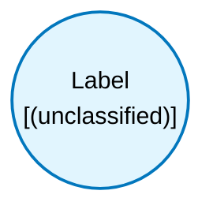

# Label (`label`) — Design Document

> Generated by `build_block_docs.js` from `.metadata/sysconfig/.meta/pru_blocks/utils/label.syscfg.js`. Do not edit by hand; re-run `node build_block_docs.js`.

## Purpose

## Label Block

### Purpose
This is a text box which can be used in the visual interface for user to maintain notes on block connections. It doesn't play any role in the actual code generation.

### How It Works
- Add labels anywhere in your block diagram to document your design
- Labels are purely visual annotations - they generate no code
- Use them to explain complex logic, mark sections, or add reminders

### Usage Notes
- Labels don't have input or output ports
- They don't affect PRU execution or timing
- Useful for team collaboration and documentation

---

## Block Diagram

## Classification

- **Block id:** `label`
- **Category:** Utilities
- **Execution model (inferred):** `(unclassified)`
- **Macro / opcode:** _(none)_
- **Data ports:** 0 in / 0 out

## Parameter schema

_(no user-visible parameters)_

## Ports

_(no ports declared)_

## Validation rules

- _(no explicit validate() rules)_

## Generated macro (`.xdt` equivalent)

_(marker block; contributes a label through graph metadata, not a PRU instruction)_

## Device portability

> **Source of truth:** `.metadata/sysconfig/.meta/pru_blocks/common/pru_device_caps.js` (TRM SPRUIM2J §6.4.1.1 / SPRUJB6 §7.3.1.1). Regenerated by `node build_block_docs.js` — do not edit by hand.

- **Required widget(s):** _(none)_
- **Validator:** `pru_blocks_static_module` raises a SysConfig **ERROR** naming both widget and device when a required widget is absent.

| Device (SoC) | Supported |
|---|---|
| `am243x` | ✅ |
| `am261x` | ✅ |
| `am263px` | ✅ |
| `am263x` | ✅ |
| `am64x` | ✅ |

## Outstanding TODO / VERIFY items

- None flagged in source.
