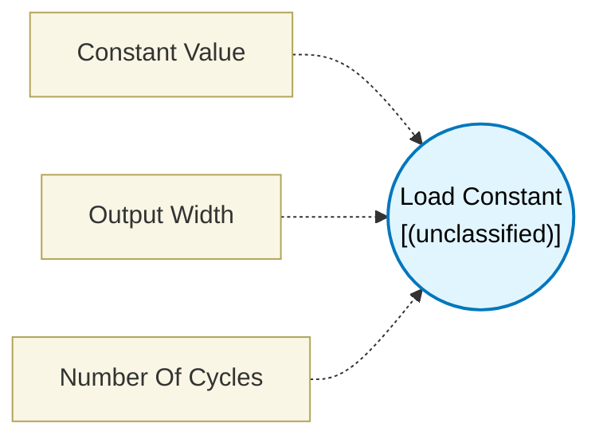

# Load Constant (`load_constant_block`) — Design Document

> Generated by `build_block_docs.js` on 2026-10-21 from `.metadata/sysconfig/.meta/pru_blocks/data_handling/load_constant_block.syscfg.js`. Do not edit by hand; re-run `node build_block_docs.js`.

## Purpose

## Load Constant Block

### Purpose
Loads an immediate constant value into a register. This is typically the starting block in a data flow, providing initial values or configuration parameters.

### How It Works
1. **Enter Value**: Specify a constant value (0 to 0xFFFFFFFF)
2. **Auto-sizing**: Block automatically selects the appropriate instruction based on value size
3. **Output**: Provides the constant value to the next block

### Configuration
- **Constant Value**: Enter any value from 0 to 4,294,967,295 (0xFFFFFFFF)
  - Can be entered in decimal or hexadecimal format
  - Block automatically determines optimal instruction
- **Output Width**: Auto (default), 1, 2 or 4 bytes. Auto sizes the register from the value; 4 reserves a full 32-bit register even for a small value

### Technical Details (Additional Information)
**Generated Assembly** (auto-selected based on value size):
; For values 0-255 (8-bit):
LDI result, value                  ; 1 cycle

; For values 256-65535 (16-bit):
LDI result, value                  ; 1 cycle

; For values > 65535 (32-bit):
LDI32 result, value                ; 1 cycle (uses two instruction slots)

**Performance**: 1 PRU cycle

### Usage Notes
- No input connections - this is a source block
- Output can be connected to any block that accepts data input
- Value is loaded at the time this block executes in the flow
- Commonly used for:
  - Table indices
  - Counter initialization
  - Configuration values
  - Bit masks

### Terminology
- **LDI**: Load Immediate - instruction to load a constant into a register
- **LDI32**: Load 32-bit Immediate - instruction for full 32-bit constants
- **Immediate value**: Constant value embedded directly in the instruction

---

## Block Diagram

## Classification

- **Block id:** `load_constant_block`
- **Category:** Data Handling
- **Execution model (inferred):** `(unclassified)`
- **Macro / opcode:** `LDI`
- **Data ports:** 0 in / 0 out · **Cycles:** `1`

## Parameter schema

| Parameter | Display name | Default | Options |
|---|---|---|---|
| `constant1` | Constant Value | `0` | — |
| `outputWidth` | Output Width | `auto` | `auto`, `1`, `2`, `4` |
| `noOfCycles` | Number Of Cycles | `1` | — |

## Ports

| Port | Type |
|---|---|
| `prev` | `PREV` |
| `next` | `NEXT` |

## Validation rules

- Constant

## Generated macro (`.xdt` equivalent)

_(inline opcode `LDI` emitted by the shared generator)_

## Device portability

> **Source of truth:** `.metadata/sysconfig/.meta/pru_blocks/common/pru_device_caps.js` (TRM SPRUIM2J §6.4.1.1 / SPRUJB6 §7.3.1.1). Regenerated by `node build_block_docs.js` — do not edit by hand.

- **Required widget(s):** _(none)_
- **Validator:** `pru_blocks_static_module` raises a SysConfig **ERROR** naming both widget and device when a required widget is absent.

| Device (SoC) | Supported |
|---|---|
| `am243x` | ✅ |
| `am261x` | ✅ |
| `am263px` | ✅ |
| `am263x` | ✅ |
| `am64x` | ✅ |

## Outstanding TODO / VERIFY items

- None flagged in source.
