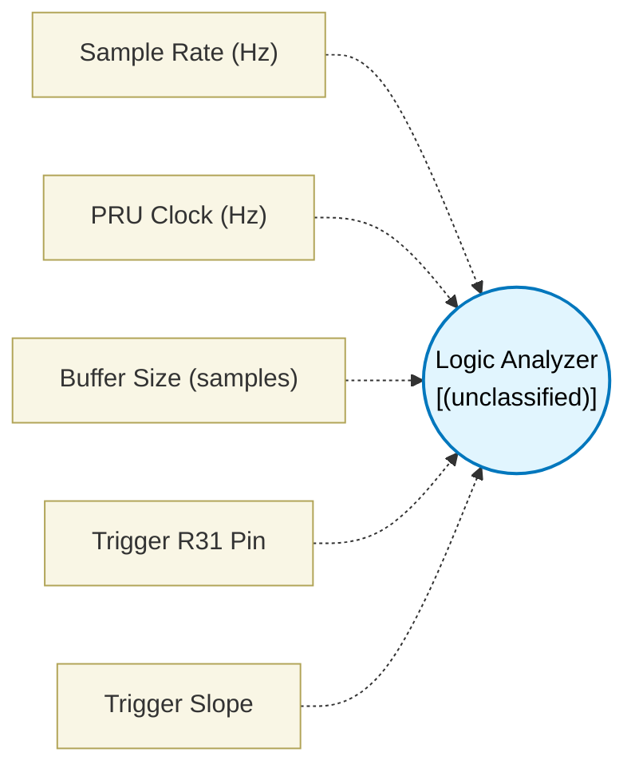

# Logic Analyzer (`logic_analyzer_block`) — Design Document

> Generated by `build_block_docs.js` from `.metadata/sysconfig/.meta/pru_blocks/utils/logic_analyzer_block.syscfg.js`. Do not edit by hand; re-run `node build_block_docs.js`.

## Purpose

_(no description in module)_

## Block Diagram




## Classification

- **Block id:** `logic_analyzer_block`
- **Category:** Utilities
- **Execution model (inferred):** `(unclassified)`
- **Macro / opcode:** `m_logic_analyzer_block`
- **Data ports:** 0 in / 0 out · **Cycles:** `1024`

## Parameter schema

| Parameter | Display name | Default | Options |
|---|---|---|---|
| `sampleRateHz` | Sample Rate (Hz) | `10000000` | — |
| `clkHz` | PRU Clock (Hz) | `200000000` | — |
| `bufferSize` | Buffer Size (samples) | `1024` | — |
| `triggerPin` | Trigger R31 Pin | `0` | — |
| `triggerSlope` | Trigger Slope | `rising` | `none`, `rising`, `falling` |

## Ports

| Port | Type |
|---|---|
| `prev` | `PREV` |
| `next` | `NEXT` |

## Validation rules

- sampleRateHz must be > 0
- clkHz must be > 0
- bufferSize must be a positive power of two
- triggerPin must be 0..31

## Generated macro (`.xdt` equivalent)

```asm
m_logic_analyzer_block	.macro RES, periodCycles, bufferSize, triggerPin, triggerSlope
    ; Parameters: periodCycles, bufferSize, triggerPin, triggerSlope(0=none,1=rising,2=falling)

    .asg c28, CONST_SHARED_RAM          ; c28 = CTPPR0.C28_POINTER << 8 (reset 0 = own DMEM); the static module sets it to shared RAM 0x10000 at startup

    .if (triggerSlope == 1) ; rising
wait_trigger_low?:
    qbbs  wait_trigger_low?, R31, triggerPin
wait_trigger_high?:
    qbbc  wait_trigger_high?, R31, triggerPin
    .endif

    .if (triggerSlope == 2) ; falling
wait_trigger_high?:
    qbbc  wait_trigger_high?, R31, triggerPin
wait_trigger_low?:
    qbbs  wait_trigger_low?, R31, triggerPin
    .endif

    ; Start sampling into shared RAM buffer
    ldi   R10, bufferSize              ; Samples counter
    ldi   R2, 0                         ; Offset index in buffer (bytes)

sample_loop?:
    ; Read R31 pins
    mov   R0, R31                       ; Capture entire register state

    ; Write sample to Shared RAM buffer
    sbco  &R0, CONST_SHARED_RAM, R2, 4  ; Write 32-bit sample
    add   R2, R2, 4                     ; Increment write offset

    ; Sample period timing delay
    ldi   R6, periodCycles
delay_loop?:
    sub   R6, R6, 1
    qbne  delay_loop?, R6, 0

    sub   R10, R10, 1
    qbne  sample_loop?, R10, 0

    .endm
```

## Device portability

> **Source of truth:** `.metadata/sysconfig/.meta/pru_blocks/common/pru_device_caps.js` (TRM SPRUIM2J §6.4.1.1 / SPRUJB6 §7.3.1.1). Regenerated by `node build_block_docs.js` — do not edit by hand.

- **Required widget(s):** _(none)_
- **Validator:** `pru_blocks_static_module` raises a SysConfig **ERROR** naming both widget and device when a required widget is absent.

| Device (SoC) | Supported |
|---|---|
| `am243x` | ✅ |
| `am261x` | ✅ |
| `am263px` | ✅ |
| `am263x` | ✅ |
| `am64x` | ✅ |

## Outstanding TODO / VERIFY items

- None flagged in source.
