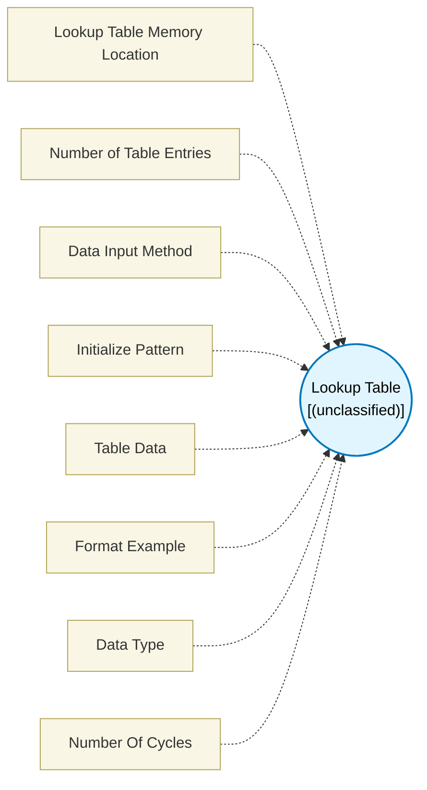

# Lookup Table (`look_up_table`) — Design Document

> Generated by `build_block_docs.js` on 2026-10-21 from `.metadata/sysconfig/.meta/pru_blocks/utils/look_up_table.syscfg.js`. Do not edit by hand; re-run `node build_block_docs.js`.

## Purpose


## Lookup Table Block

### Purpose
Defines a lookup table (LUT) that stores data values in PRU Data Memory (DMEM). This table can be accessed by Access Lookup Table block during PRU execution.

### How It Works
1. **Definition**: You define table data in this block (manually, using patterns, or importing from JSON)
2. **Compilation**: The data is placed in the PRU firmware's .data section during compilation
3. **Runtime Initialization**: The R5F core writes this data to PRU DMEM before starting the PRU
4. **Access**: Access Lookup Table block reads from this table during PRU execution

### Configuration Steps
1. **Set Table Size**: Specify how many entries your table needs (1-65536)
2. **Choose Data Type**:
- **byte** (8-bit): Values 0-255, uses 1 byte per entry
- **ushort** (16-bit): Values 0-65535, uses 2 bytes per entry
- **uint** (32-bit): Full 32-bit values, uses 4 bytes per entry
3. **Input Data**: Choose one of three methods:
- **Manual/Pattern**: Use Initialize Pattern dropdown to auto-generate data
- **Paste JSON Data**: For large tables, paste JSON data directly
- **Load JSON From File**: For very large tables, browse and load a JSON file

### Data Input Methods

**Method 1: Pattern-Based (Quick Setup)**
- **Sequential**: 0, 1, 2, 3, ... (default)
- **All zeros**: 0, 0, 0, 0, ...
- **All ones**: 0xFF, 0xFF, ... (or 0xFFFF/0xFFFFFFFF based on type)
- **Custom fill**: Same value repeated
- **Manual**: Edit the comma-separated list directly

**Method 2: Paste JSON Data (For Large Tables)**
Paste JSON directly in the text field:
```json
{
"values": [0, 1, 2, 3, 4, 5, ...],
"dataType": "byte"
}
```

**Method 3: Load JSON From File (Recommended for Very Large Tables)**
Browse and select a .json file from your file system with the same format:
```json
{
"values": [0, 1, 2, 3, 4, 5, ...],
"dataType": "byte"
}
```

**JSON Format Details:**
- **Required**: "values" field containing an array of numbers
- **Optional**: "dataType" field ("byte", "ushort", or "uint") - will auto-set the data type if provided
- The table size is automatically updated to match the array length
- All values must be valid numbers appropriate for the selected data type

### Memory Layout
- LUT data is stored in PRU DMEM starting at offset determined by linker
- Total size = (table size) × (bytes per entry)
- Maximum DMEM size: 8KB per PRU core

### Technical Details (Additional Information)
**Generated Assembly**: Creates a .data section with the table values
- .data
- .align 4
- LUT_0: .byte 0, 1, 2, 3, 4, 5, 6, 7, ...


**Performance**: No runtime overhead - data is pre-loaded in memory

### Terminology
- **LUT**: Lookup Table - array of pre-computed values
- **DMEM**: PRU Data Memory - 8KB local RAM in each PRU core
- **.data section**: Section in firmware binary that contains initialized data
- **R5F initialization**: Main ARM core writes LUT to PRU memory before starting PRU

---

## Block Diagram




## Classification

- **Block id:** `look_up_table`
- **Category:** Utilities
- **Execution model (inferred):** `(unclassified)`
- **Macro / opcode:** _(none)_
- **Data ports:** 0 in / 0 out · **Cycles:** `0`

## Parameter schema

| Parameter | Display name | Default | Options |
|---|---|---|---|
| `lutMemoryLocation` | Lookup Table Memory Location | `dmem` | `dmem`, `smem` |
| `tableSize` | Number of Table Entries | `16` | — |
| `importMethod` | Data Input Method | `manual` | `manual`, `json_paste`, `json_file` |
| `initPattern` | Initialize Pattern | `sequential` | `manual`, `sequential`, `zeros`, `ones`, `custom` |
| `tableData` | Table Data | `0,1,2,3,4,5,6,7,8,9,10,11,12,13,14,15` | — |
| `manualDataPreview` | Format Example | `` | — |
| `dataType` | Data Type | `byte` | `byte`, `ushort`, `uint` |
| `noOfCycles` | Number Of Cycles | `0` | — |

## Ports

| Port | Type |
|---|---|
| `prev` | `PREV` |
| `next` | `NEXT` |

## Validation rules

- Table size must be between 1 and 65536
- Too many values: entered <value> values but maximum table size is <value>

## Generated macro (`.xdt` equivalent)

```asm
0
```

## Device portability

> **Source of truth:** `.metadata/sysconfig/.meta/pru_blocks/common/pru_device_caps.js` (TRM SPRUIM2J §6.4.1.1 / SPRUJB6 §7.3.1.1). Regenerated by `node build_block_docs.js` — do not edit by hand.

- **Required widget(s):** _(none)_
- **Validator:** `pru_blocks_static_module` raises a SysConfig **ERROR** naming both widget and device when a required widget is absent.

| Device (SoC) | Supported |
|---|---|
| `am243x` | ✅ |
| `am261x` | ✅ |
| `am263px` | ✅ |
| `am263x` | ✅ |
| `am64x` | ✅ |

## Outstanding TODO / VERIFY items

- None flagged in source.
