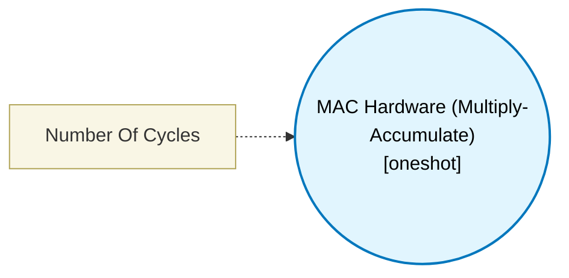

# MAC Hardware (Multiply-Accumulate) (`mac_hw_block`) — Design Document

> Generated by `build_block_docs.js` from `.metadata/sysconfig/.meta/pru_blocks/data_handling/mac_hw_block.syscfg.js`. Do not edit by hand; re-run `node build_block_docs.js`.

## Purpose

Utilizes the PRU's internal MAC hardware to perform fast multiplication and accumulation (A * B + C).

## Block Diagram




## Classification

- **Block id:** `mac_hw_block`
- **Category:** Data Handling
- **Execution model (inferred):** `oneshot`
- **Macro / opcode:** `m_mac_hw`
- **Data ports:** 3 in / 1 out · **Cycles:** `9`

## Parameter schema

| Parameter | Display name | Default | Options |
|---|---|---|---|
| `noOfCycles` | Number Of Cycles | `9` | — |

## Ports

| Port | Type |
|---|---|
| `prev` | `IO_PREV` |
| `next` | `IO_NEXT` |
| `input1` | `input32` |
| `input2` | `input32` |
| `input3` | `input32` |
| `output1` | `output32` |

## Validation rules

- _(no explicit validate() rules)_

## Generated macro (`.xdt` equivalent)

```asm
m_mac_hw .macro RES, OP_A, OP_B, ACC_VAL
    ; --- MAC Hardware ---
    ; Configure MAC for multiply-only mode
    ldi32 R25, 0
    xout  0, &R25, 1
    ; Load operands to MAC input registers
    mov   R28, OP_A
    mov   R29, OP_B
    nop
    ; Read result (lower 32-bits from R26)
    xin   0, &TEMP_REG3, 4
    ; Accumulate
    add   RES, TEMP_REG3, ACC_VAL
    .endm
```

## Device portability

> **Source of truth:** `.metadata/sysconfig/.meta/pru_blocks/common/pru_device_caps.js` (TRM SPRUIM2J §6.4.1.1 / SPRUJB6 §7.3.1.1). Regenerated by `node build_block_docs.js` — do not edit by hand.

- **Required widget(s):** `mac`
- **Validator:** `pru_blocks_static_module` raises a SysConfig **ERROR** naming both widget and device when a required widget is absent.

| Device (SoC) | Supported |
|---|---|
| `am243x` | ✅ |
| `am261x` | ✅ |
| `am263px` | ✅ |
| `am263x` | ✅ |
| `am64x` | ✅ |

## Outstanding TODO / VERIFY items

- None flagged in source.
