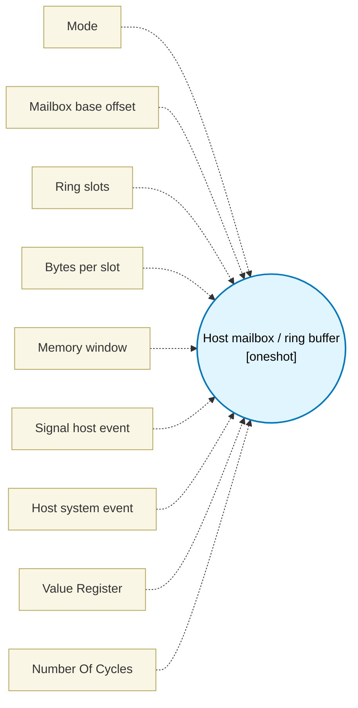

# Host mailbox / ring buffer (`mailbox_block`) — Design Document

> Generated by `build_block_docs.js` on 2026-10-21 from `.metadata/sysconfig/.meta/pru_blocks/pru_io_blocks/mailbox_block.syscfg.js`. Do not edit by hand; re-run `node build_block_docs.js`.

## Purpose

Emits PRU-side publish/consume skeletons over DMEM/shared-memory windows. In consume mode, output1 is the slot value and is slotBytes wide; when the ring is empty, output1 is left unwritten.

## Block Diagram




## Classification

- **Block id:** `mailbox_block`
- **Category:** I/O & Protocol
- **Execution model (inferred):** `oneshot`
- **Macro / opcode:** `m_mailbox_run`
- **Data ports:** 0 in / 0 out · **Cycles:** `21`

## Parameter schema

| Parameter | Display name | Default | Options |
|---|---|---|---|
| `mode` | Mode | `publish` | `publish`, `consume` |
| `baseOffset` | Mailbox base offset | `0x0000` | — |
| `slots` | Ring slots | `16` | — |
| `slotBytes` | Bytes per slot | `4` | `4`, `8`, `16`, `32` |
| `memory` | Memory window | `dmem0` | `dmem0`, `shared` |
| `signalEvent` | Signal host event | `false` | — |
| `hostEvent` | Host system event | `16` | — |
| `dataRegister` | Value Register | `R10` | — |
| `noOfCycles` | Number Of Cycles | `21` | — |

## Ports

| Port | Type |
|---|---|
| `output1` | `output32` |
| `prev` | `IO_PREV` |
| `next` | `IO_NEXT` |

## Validation rules

- baseOffset must be 0..0xFFFF
- slots must be 2..256
- slots must be a power of two
- hostEvent must be a system event 16..31 (SPRUIM2J Table 6-67: R31 event-generate channels 0..15)

## Generated macro (`.xdt` equivalent)

```asm
m_mailbox_run .macro RES, BASE_OFF, RING_MASK, LOG2_SLOT, SLOT_BYTES, IS_SHARED, IS_PUBLISH, SIGNAL_EVENT, DATA_REG
    .if IS_SHARED == 1
    lbco  &TEMP_REG1, c28, BASE_OFF + 0, 4
    lbco  &TEMP_REG2.w0, c28, BASE_OFF + 4, 4
    .else
    lbco  &TEMP_REG1, c24, BASE_OFF + 0, 4
    lbco  &TEMP_REG2.w0, c24, BASE_OFF + 4, 4
    .endif
    .if IS_PUBLISH == 1
    mov   TEMP_REG2.w2, TEMP_REG1
    .else
    qbeq  mb_e?, TEMP_REG1, TEMP_REG2.w0
    mov   TEMP_REG2.w2, TEMP_REG2.w0
    .endif
    lsl   TEMP_REG2.w2, TEMP_REG2.w2, LOG2_SLOT
    add   TEMP_REG2.w2, TEMP_REG2.w2, BASE_OFF
    add   TEMP_REG2.w2, TEMP_REG2.w2, 8
    .if IS_SHARED == 1
    .if IS_PUBLISH == 1
    sbco  &DATA_REG, c28, TEMP_REG2.w2, SLOT_BYTES
    .else
    lbco  &DATA_REG, c28, TEMP_REG2.w2, SLOT_BYTES
    lbco  &RES, c28, TEMP_REG2.w2, SLOT_BYTES
    .endif
    .else
    .if IS_PUBLISH == 1
    sbco  &DATA_REG, c24, TEMP_REG2.w2, SLOT_BYTES
    .else
    lbco  &DATA_REG, c24, TEMP_REG2.w2, SLOT_BYTES
    lbco  &RES, c24, TEMP_REG2.w2, SLOT_BYTES
    .endif
    .endif
    .if IS_PUBLISH == 1
    add   TEMP_REG1, TEMP_REG1, 1
    and   TEMP_REG1, TEMP_REG1, RING_MASK
    .if IS_SHARED == 1
    sbco  &TEMP_REG1, c28, BASE_OFF + 0, 4
    .else
    sbco  &TEMP_REG1, c24, BASE_OFF + 0, 4
    .endif
    .else
    add   TEMP_REG2.w0, TEMP_REG2.w0, 1
    and   TEMP_REG2.w0, TEMP_REG2.w0, RING_MASK
    ldi   TEMP_REG2.w2, 0
    .if IS_SHARED == 1
    sbco  &TEMP_REG2.w0, c28, BASE_OFF + 4, 4
    .else
    sbco  &TEMP_REG2.w0, c24, BASE_OFF + 4, 4
    .endif
    .endif
    .if SIGNAL_EVENT != 0
    ldi   R31.b0, SIGNAL_EVENT
    .endif
mb_e?:
    .endm
```

## Device portability

> **Source of truth:** `.metadata/sysconfig/.meta/pru_blocks/common/pru_device_caps.js` (TRM SPRUIM2J §6.4.1.1 / SPRUJB6 §7.3.1.1). Regenerated by `node build_block_docs.js` — do not edit by hand.

- **Required widget(s):** _(none)_
- **Validator:** `pru_blocks_static_module` raises a SysConfig **ERROR** naming both widget and device when a required widget is absent.

| Device (SoC) | Supported |
|---|---|
| `am243x` | ✅ |
| `am261x` | ✅ |
| `am263px` | ✅ |
| `am263x` | ✅ |
| `am64x` | ✅ |

## Outstanding TODO / VERIFY items

- None flagged in source.
