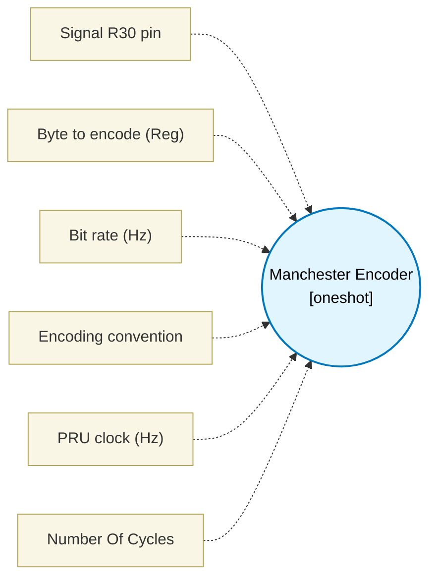

# Manchester Encoder (`manchester_block`) — Design Document

> Generated by `build_block_docs.js` from `.metadata/sysconfig/.meta/pru_blocks/pru_io_blocks/manchester_block.syscfg.js`. Do not edit by hand; re-run `node build_block_docs.js`.

## Purpose

Cycle-exact half-bit timing on the PRU for jitter-free mid-bit edges: every half-bit is clkHz / (2 * bitRateHz) PRU cycles on both data paths, so the bit period does not depend on the data, and the macro returns one half-bit after the last mid-bit edge. The delay counts are the nominal half-bit minus the fixed instruction overhead (7 cycles before the mid-bit edge, 10 after it). A fractional half-bit puts edge k at round(k * H) cycles (half-bits of floor(H) or floor(H) + 1), so no edge is more than half a cycle off and the error does not accumulate. Fastest rate: clkHz / 24 (8.33 Mbit/s at 200 MHz).

## Block Diagram




## Classification

- **Block id:** `manchester_block`
- **Category:** I/O & Protocol
- **Execution model (inferred):** `oneshot`
- **Macro / opcode:** `m_manchester_run`
- **Data ports:** 0 in / 1 out · **Cycles:** `1`

## Parameter schema

| Parameter | Display name | Default | Options |
|---|---|---|---|
| `signalPin` | Signal R30 pin | `13` | `0`, `1`, `2`, `3`, `4`, `5`, `6`, `7`, `8`, `9`, `10`, `11`, `12`, `13`, `14`, `15`, `16`, `17`, `18`, `19` |
| `dataRegister` | Byte to encode (Reg) | `R5.b0` | — |
| `bitRateHz` | Bit rate (Hz) | `1000000` | — |
| `convention` | Encoding convention | `ieee` | `ieee`, `thomas` |
| `clkHz` | PRU clock (Hz) | `200000000` | — |
| `noOfCycles` | Number Of Cycles | `1` | — |

## Ports

| Port | Type |
|---|---|
| `output1` | `output32` |
| `prev` | `IO_PREV` |
| `next` | `IO_NEXT` |

## Validation rules

- bitRateHz must be > 0
- clkHz must be > 0
- bitRateHz <value> too high for clkHz <value>: the half-bit is
- bitRateHz <value> too low for clkHz <value>: delay loop count exceeds 32 bits

## Generated macro (`.xdt` equivalent)

```asm
m_manchester_run .macro RES, SIG_PIN, XMASK, CONV_THOMAS, DATA_BYTE, N1, P1, N2, P2
    ldi   TEMP_REG2.w0, XMASK
    ldi   TEMP_REG2.b2, 8
mc_b?:
    qbbc  mc_z?, DATA_BYTE, 7
    .if CONV_THOMAS == 1
    set   R30, R30, SIG_PIN
    .else
    clr   R30, R30, SIG_PIN
    .endif
    qba   mc_h1?
mc_z?:
    .if CONV_THOMAS == 1
    clr   R30, R30, SIG_PIN
    .else
    set   R30, R30, SIG_PIN
    .endif
    qba   mc_h1?
mc_h1?:
    qbbc  mc_e1?, TEMP_REG2, 15
    nop
mc_e1?:
    lsl   TEMP_REG2.w0, TEMP_REG2.w0, 1
    .if P1 == 1
    nop
    .endif
    ldi32 TEMP_REG1, N1
mc_d1?:
    sub   TEMP_REG1, TEMP_REG1, 1
    qbne  mc_d1?, TEMP_REG1, 0
    qbbc  mc_z2?, DATA_BYTE, 7
    .if CONV_THOMAS == 1
    clr   R30, R30, SIG_PIN
    .else
    set   R30, R30, SIG_PIN
    .endif
    qba   mc_h2?
mc_z2?:
    .if CONV_THOMAS == 1
    set   R30, R30, SIG_PIN
    .else
    clr   R30, R30, SIG_PIN
    .endif
    qba   mc_h2?
mc_h2?:
    qbbc  mc_e2?, TEMP_REG2, 15
    nop
mc_e2?:
    lsl   TEMP_REG2.w0, TEMP_REG2.w0, 1
    .if P2 == 1
    nop
    .endif
    ldi32 TEMP_REG1, N2
mc_d2?:
    sub   TEMP_REG1, TEMP_REG1, 1
    qbne  mc_d2?, TEMP_REG1, 0
    lsl   DATA_BYTE, DATA_BYTE, 1
    sub   TEMP_REG2.b2, TEMP_REG2.b2, 1
    qbne  mc_b?, TEMP_REG2.b2, 0
    nop
    .endm
```

## Device portability

> **Source of truth:** `.metadata/sysconfig/.meta/pru_blocks/common/pru_device_caps.js` (TRM SPRUIM2J §6.4.1.1 / SPRUJB6 §7.3.1.1). Regenerated by `node build_block_docs.js` — do not edit by hand.

- **Required widget(s):** _(none)_
- **Validator:** `pru_blocks_static_module` raises a SysConfig **ERROR** naming both widget and device when a required widget is absent.

| Device (SoC) | Supported |
|---|---|
| `am243x` | ✅ |
| `am261x` | ✅ |
| `am263px` | ✅ |
| `am263x` | ✅ |
| `am64x` | ✅ |

## Outstanding TODO / VERIFY items

- None flagged in source.
