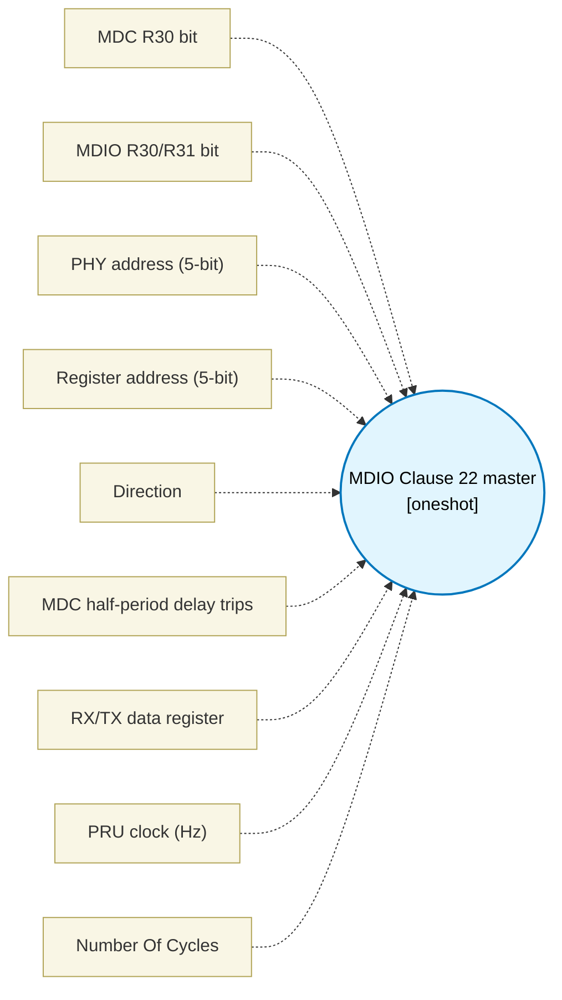

# MDIO Clause 22 master (`mdio_master_block`) — Design Document

> Generated by `build_block_docs.js` from `.metadata/sysconfig/.meta/pru_blocks/pru_io_blocks/mdio_master_block.syscfg.js`. Do not edit by hand; re-run `node build_block_docs.js`.

## Purpose

Bit-banged MDIO Clause 22 master (STA) for Ethernet PHY management.

Wire contract per IEEE 802.3 Clause 22 only: 32-bit preamble of 1s, ST=01, OP (01=write, 10=read), 5-bit PHYAD, 5-bit REGAD, turn-around (master 10 on write; master released and PHY drives 0 on read), 16-bit data MSB first. MDC half period is HALF_TRIPS delay-loop trips (2 PRU cycles each plus a fixed per-phase cost); validation requires MDC high and low >= 160 ns and period >= 400 ns (the 2.5 MHz Clause 22 ceiling) at the configured PRU clock.

Vendor MDIO behaviours (TI ICSS doorbells, register layouts, driver sequencing) are intentionally NOT part of this block.

Uses only TEMP_REG1 and TEMP_REG2 (2-TEMP_REG pattern). In read mode the 16-bit result is written to the data register (dataRegister) and is also exposed on output1 (RES), so it can be wired to a downstream block; write data is taken from the WRDATA argument register. dataRegister must be a full register token R<n> (e.g. R4): the read copies the 32-bit result with one mov, so a sub-register token such as R4.b0 or R4.w0 truncates the sample or leaves the register's upper bytes stale; the allocator reserves the whole register either way.

## Block Diagram




## Classification

- **Block id:** `mdio_master_block`
- **Category:** I/O & Protocol
- **Execution model (inferred):** `oneshot`
- **Macro / opcode:** `m_mdio_xfer`
- **Data ports:** 0 in / 0 out · **Cycles:** `1`

## Parameter schema

| Parameter | Display name | Default | Options |
|---|---|---|---|
| `mdcBit` | MDC R30 bit | `0` | `0`, `1`, `2`, `3`, `4`, `5`, `6`, `7`, `8`, `9`, `10`, `11`, `12`, `13`, `14`, `15`, `16`, `17`, `18`, `19` |
| `mdioBit` | MDIO R30/R31 bit | `1` | `0`, `1`, `2`, `3`, `4`, `5`, `6`, `7`, `8`, `9`, `10`, `11`, `12`, `13`, `14`, `15`, `16`, `17`, `18`, `19` |
| `phyAddr` | PHY address (5-bit) | `0` | — |
| `regAddr` | Register address (5-bit) | `0` | — |
| `rw` | Direction | `write` | `read`, `write` |
| `halfTrips` | MDC half-period delay trips | `50` | — |
| `dataRegister` | RX/TX data register | `R4` | — |
| `clkHz` | PRU clock (Hz) | `200000000` | — |
| `noOfCycles` | Number Of Cycles | `1` | — |

## Ports

| Port | Type |
|---|---|
| `prev` | `IO_PREV` |
| `next` | `IO_NEXT` |

## Validation rules

- mdcBit and mdioBit must differ
- phyAddr must be 0..31 (5-bit Clause 22 PHYAD)
- regAddr must be 0..31 (5-bit Clause 22 REGAD)
- halfTrips=<value> exceeds the 2.5 MHz Clause 22 MDC ceiling

## Generated macro (`.xdt` equivalent)

```asm
m_mdio_xfer .macro RES, MDC_BIT, MDIO_BIT, HALF_TRIPS, PHY_ADDR, REG_ADDR, IS_READ, WRDATA_REG
    ; MDIO Clause 22 master - IEEE 802.3 wire contract only
    ; 2-TEMP_REG pattern: TEMP_REG1 shifts the frame, TEMP_REG2 is bit counter/delay
    clr   R30, R30, MDC_BIT
    set   R30, R30, MDIO_BIT
    ; ---- preamble: 32 clocked 1 bits (IEEE 802.3 22.2.4.5.1) ----
    ldi32 TEMP_REG1, 0xFFFFFFFF
    ldi   TEMP_REG2.b0, 32
md_pre?:
    lsr   TEMP_REG2.w2, TEMP_REG1, 31
    lsl   TEMP_REG2.w2, TEMP_REG2.w2, MDIO_BIT
    clr   R30, R30, MDIO_BIT
    or    R30, R30, TEMP_REG2.w2
    ldi   TEMP_REG2.w2, HALF_TRIPS
md_pre_lo?:
    sub   TEMP_REG2.w2, TEMP_REG2.w2, 1
    qbne  md_pre_lo?, TEMP_REG2.w2, 0
    set   R30, R30, MDC_BIT
    ldi   TEMP_REG2.w2, HALF_TRIPS
md_pre_hi?:
    sub   TEMP_REG2.w2, TEMP_REG2.w2, 1
    qbne  md_pre_hi?, TEMP_REG2.w2, 0
    clr   R30, R30, MDC_BIT
    lsl   TEMP_REG1, TEMP_REG1, 1
    sub   TEMP_REG2.b0, TEMP_REG2.b0, 1
    qbne  md_pre?, TEMP_REG2.b0, 0
    ; ---- header: ST=01 OP PHYAD REGAD, 14 bits MSB first ----
    .if IS_READ == 1
    ldi32 TEMP_REG1, ((0x1000 | (2 << 10) | (PHY_ADDR << 5) | REG_ADDR) << 18)
    .else
    ldi32 TEMP_REG1, ((0x1000 | (1 << 10) | (PHY_ADDR << 5) | REG_ADDR) << 18)
    .endif
    ldi   TEMP_REG2.b0, 14
md_hdr?:
    lsr   TEMP_REG2.w2, TEMP_REG1, 31
    lsl   TEMP_REG2.w2, TEMP_REG2.w2, MDIO_BIT
    clr   R30, R30, MDIO_BIT
    or    R30, R30, TEMP_REG2.w2
    ldi   TEMP_REG2.w2, HALF_TRIPS
md_hdr_lo?:
    sub   TEMP_REG2.w2, TEMP_REG2.w2, 1
    qbne  md_hdr_lo?, TEMP_REG2.w2, 0
    set   R30, R30, MDC_BIT
    ldi   TEMP_REG2.w2, HALF_TRIPS
md_hdr_hi?:
    sub   TEMP_REG2.w2, TEMP_REG2.w2, 1
    qbne  md_hdr_hi?, TEMP_REG2.w2, 0
    clr   R30, R30, MDC_BIT
    lsl   TEMP_REG1, TEMP_REG1, 1
    sub   TEMP_REG2.b0, TEMP_REG2.b0, 1
    qbne  md_hdr?, TEMP_REG2.b0, 0
    .if IS_READ == 1
    ; ---- read: release MDIO (1) for TA bit 1 and TA bit 2, PHY drives 0 ----
    set   R30, R30, MDIO_BIT
    ldi   TEMP_REG2.w2, HALF_TRIPS
md_ta1_lo?:
    sub   TEMP_REG2.w2, TEMP_REG2.w2, 1
    qbne  md_ta1_lo?, TEMP_REG2.w2, 0
    set   R30, R30, MDC_BIT
    ldi   TEMP_REG2.w2, HALF_TRIPS
md_ta1_hi?:
    sub   TEMP_REG2.w2, TEMP_REG2.w2, 1
    qbne  md_ta1_hi?, TEMP_REG2.w2, 0
    clr   R30, R30, MDC_BIT
    ldi   TEMP_REG2.w2, HALF_TRIPS
md_ta2_lo?:
    sub   TEMP_REG2.w2, TEMP_REG2.w2, 1
    qbne  md_ta2_lo?, TEMP_REG2.w2, 0
    set   R30, R30, MDC_BIT
    ldi   TEMP_REG2.w2, HALF_TRIPS
md_ta2_hi?:
    sub   TEMP_REG2.w2, TEMP_REG2.w2, 1
    qbne  md_ta2_hi?, TEMP_REG2.w2, 0
    clr   R30, R30, MDC_BIT
    ; ---- sample 16 data bits from R31 on rising MDC ----
    ldi32 RES, 0
    ldi   TEMP_REG2.b0, 16
md_rd?:
    lsl   RES, RES, 1
    ldi   TEMP_REG2.w2, HALF_TRIPS
md_rd_lo?:
    sub   TEMP_REG2.w2, TEMP_REG2.w2, 1
    qbne  md_rd_lo?, TEMP_REG2.w2, 0
    set   R30, R30, MDC_BIT
    ldi   TEMP_REG2.w2, HALF_TRIPS
md_rd_hi?:
    sub   TEMP_REG2.w2, TEMP_REG2.w2, 1
    qbne  md_rd_hi?, TEMP_REG2.w2, 0
    lsr   TEMP_REG2.w2, R31, MDIO_BIT
    and   TEMP_REG2.w2, TEMP_REG2.w2, 1
    or    RES, RES, TEMP_REG2.w2
    clr   R30, R30, MDC_BIT
    sub   TEMP_REG2.b0, TEMP_REG2.b0, 1
    qbne  md_rd?, TEMP_REG2.b0, 0
    ; read result: RES is output1, WRDATA_REG is the data register (dataRegister)
    mov   WRDATA_REG, RES
    .else
    ; ---- write: TA=10 then 16 data bits, shifted as 18 bits ----
    ldi32 TEMP_REG2, 0x80000000
    lsl   TEMP_REG1, WRDATA_REG, 14
    or    TEMP_REG1, TEMP_REG1, TEMP_REG2
    ldi   TEMP_REG2.b0, 18
md_wr?:
    lsr   TEMP_REG2.w2, TEMP_REG1, 31
    lsl   TEMP_REG2.w2, TEMP_REG2.w2, MDIO_BIT
    clr   R30, R30, MDIO_BIT
    or    R30, R30, TEMP_REG2.w2
    ldi   TEMP_REG2.w2, HALF_TRIPS
md_wr_lo?:
    sub   TEMP_REG2.w2, TEMP_REG2.w2, 1
    qbne  md_wr_lo?, TEMP_REG2.w2, 0
    set   R30, R30, MDC_BIT
    ldi   TEMP_REG2.w2, HALF_TRIPS
md_wr_hi?:
    sub   TEMP_REG2.w2, TEMP_REG2.w2, 1
    qbne  md_wr_hi?, TEMP_REG2.w2, 0
    clr   R30, R30, MDC_BIT
    lsl   TEMP_REG1, TEMP_REG1, 1
    sub   TEMP_REG2.b0, TEMP_REG2.b0, 1
    qbne  md_wr?, TEMP_REG2.b0, 0
    .endif
    ; idle: MDC low, MDIO released high
    clr   R30, R30, MDC_BIT
    set   R30, R30, MDIO_BIT
    .endm
```

## Device portability

> **Source of truth:** `.metadata/sysconfig/.meta/pru_blocks/common/pru_device_caps.js` (TRM SPRUIM2J §6.4.1.1 / SPRUJB6 §7.3.1.1). Regenerated by `node build_block_docs.js` — do not edit by hand.

- **Required widget(s):** _(none)_
- **Validator:** `pru_blocks_static_module` raises a SysConfig **ERROR** naming both widget and device when a required widget is absent.

| Device (SoC) | Supported |
|---|---|
| `am243x` | ✅ |
| `am261x` | ✅ |
| `am263px` | ✅ |
| `am263x` | ✅ |
| `am64x` | ✅ |

## Outstanding TODO / VERIFY items

- None flagged in source.
