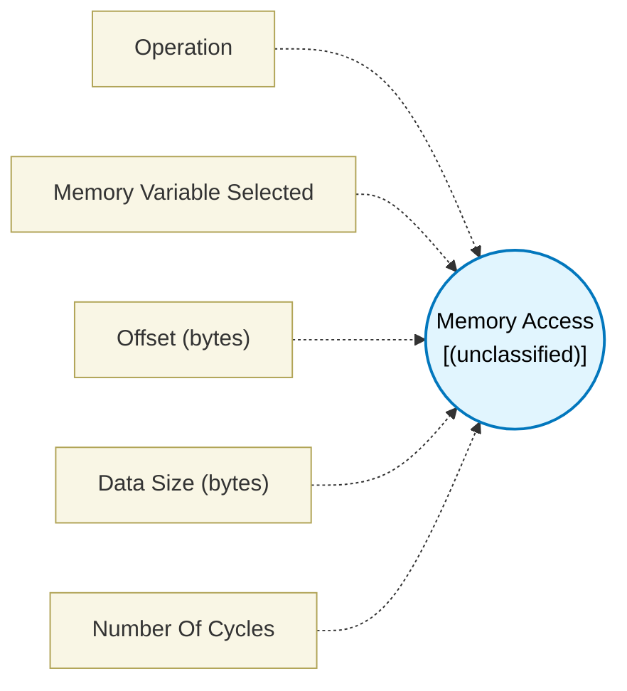

# Memory Access (`memory_access_block`) — Design Document

> Generated by `build_block_docs.js` from `.metadata/sysconfig/.meta/pru_blocks/utils/memory_access_block.syscfg.js`. Do not edit by hand; re-run `node build_block_docs.js`.

## Purpose


## Memory Access Block

### Purpose
Read from or write to PRU memory using symbols defined by Memory Variable blocks. Uses LBBO (Load) or SBBO (Store) instructions with automatic address calculation and bounds checking.

### How It Works
1. **Select Operation**: Choose Read (LBBO) or Write (SBBO)
2. **Configure Memory Variable**: A Memory Variable block is automatically created and nested below — configure its label name, size, and memory location
3. **Configure Offset**: Set the byte offset from the symbol's base address (0 to buffer size)
4. **Set Data Size**: Choose how many bytes to access (1 to 112 bytes)
5. **Execute**: PRU calculates the absolute address (symbol + offset) and executes LBBO/SBBO instruction

### Memory Symbol Addressing
The block uses symbols defined by **Memory Variable** blocks:
- A Memory Variable is auto-created and nested under each Memory Access block
- If multiple Memory Variable blocks exist, select which one to access via the dropdown
- Multiple Memory Access blocks can share the same buffer by pointing to the same label name
- The linker automatically resolves the symbol address at link time
- Offset is validated against the buffer size to prevent overflow

### Generated Assembly

**Read Operation (LBBO)**:
```assembly
LDI32 R28, (symbol + offset)  ; Calculate absolute address
LBBO &R_output, R28, 0, byte_count  ; Load data from memory
```

**Write Operation (SBBO)**:
```assembly
LDI32 R28, (symbol + offset)  ; Calculate absolute address
SBBO &R_input, R28, 0, byte_count   ; Store data to memory
```

### Configuration Parameters

#### Operation
- **Read (Load from Memory)**: Uses LBBO instruction, has output port
- **Write (Store to Memory)**: Uses SBBO instruction, has input port for data

#### Select Memory Symbol
- Choose a symbol from the dropdown of available Memory Variable blocks
- Shows symbol name and size (e.g., "buffer (64 bytes)")
- The linker resolves the symbol address automatically

#### Offset (bytes)
- Byte offset from the start of the memory symbol
- Range: 0 to (buffer size - data size)
- Validated to ensure offset + data size doesn't exceed buffer bounds
- Example: offset=8 accesses bytes 8-11 (for 4-byte read)

#### Data Size (bytes)
- Number of bytes to read or write
- Range: 1 to 112 bytes
- For sizes >= 4 bytes, data must be register-aligned
- Default: 4 bytes

### Technical Details (Additional Information)

**Performance**: 3 PRU cycles total
- LDI32: 2 cycles (load 32-bit address)
- LBBO/SBBO: 1 cycle (+ memory access latency)

**Register Usage**:
- Uses TEMP_REG1 (R28) internally for address calculation

### Usage Examples

#### Example 1: Read from Memory Reserve buffer
```
[Memory Variable: rxBuffer, 128 bytes, DMEM]
[Memory Access] → [Process Data]
Config: Operation=Read, Symbol=rxBuffer, Offset=0, Data Size=4 bytes
Result: Reads 4 bytes from rxBuffer[0-3]
```

#### Example 2: Write to Shared Memory (PRU to ARM communication)
```
[Memory Variable: sharedData, 256 bytes, SMEM]
[Data Source] → [Memory Access]
Config: Operation=Write, Symbol=sharedData, Offset=0x10, Data Size=4 bytes
Result: Writes 4 bytes to sharedData[16-19]
```

#### Example 3: Array Element Access
```
[Memory Variable: dataBuffer, 256 bytes, DMEM]
[Memory Access] → [Process]
Config: Operation=Read, Symbol=dataBuffer, Offset=32, Data Size=4 bytes
Result: Reads 4 bytes from dataBuffer[32-35] (8th element in 4-byte array)
```

#### Example 4: Store Result to Reserved Memory
```
[Memory Variable: resultBuffer, 64 bytes, DMEM]
[Calculation] → [Memory Access]
Config: Operation=Write, Symbol=resultBuffer, Offset=0, Data Size=4 bytes
Result: Writes 4 bytes to resultBuffer[0-3]
```

#### Example 5: Multi-byte Transfer
```
[Memory Variable: largeBuffer, 512 bytes, SMEM]
[Data Source] → [Memory Access]
Config: Operation=Write, Symbol=largeBuffer, Offset=0, Data Size=16 bytes
Result: Writes 16 bytes to largeBuffer[0-15] using multiple registers
```

### Ports

**Read Mode**:
- Input: offset (only in Register Input mode)
- Output: data (loaded value)

**Write Mode**:
- Input 1: data (value to store)
- Input 2: offset (only in Register Input mode)

### Two buffers: use explicit Memory Variable instances

Each Memory Access block's nested memVar is ONE shared object. Setting labelName through one block renames it for every block sharing it, so the second assignment silently wins and the first buffer is never reserved:

\`\`\`javascript
// WRONG: both blocks end up on out_buf, in_buf is never reserved
rd.memVar.labelName = "in_buf";
wr.memVar.labelName = "out_buf";
\`\`\`

Create one Memory Variable instance per buffer and assign it by reference:

\`\`\`javascript
const memory_reserve = scripting.addModule("/pru_blocks/utils/memory_variable_block", {}, false);
const in_buf = memory_reserve.addInstance();
in_buf.$name = "In_Buf";
in_buf.labelName = "in_buf";
in_buf.sizeInBytes = 64;
const out_buf = memory_reserve.addInstance();
out_buf.$name = "Out_Buf";
out_buf.labelName = "out_buf";
out_buf.sizeInBytes = 64;
rd.memVar = in_buf;
wr.memVar = out_buf;
\`\`\`

The block raises a validation warning when two Memory Access blocks share one memVar.

### Important Notes

1. **Symbol Resolution**: The linker resolves the actual memory address at link time. The symbol points to the memory location defined by the Memory Variable block.

2. **Bounds Checking**: The block validates that offset + data size doesn't exceed the buffer size. If validation fails, an error is shown in SysConfig.

3. **TEMP_REG1 Usage**: The block uses R28 (TEMP_REG1) internally for address calculation. This register is reserved and should not be used by other blocks during execution.

4. **Memory Location**: The symbol's memory location (DMEM or SMEM) is determined by the Memory Variable block configuration:
- DMEM (Local): Fast access, 8KB per PRU, private to each core
- SMEM (Shared): Shared between PRUs and ARM, 64KB total, use for inter-core communication

### Terminology

- **LBBO**: Load Byte Burst Operation - PRU instruction for direct memory read
- **SBBO**: Store Byte Burst Operation - PRU instruction for direct memory write
- **DMEM**: Data Memory - PRU local RAM
- **Symbol**: Named memory location defined by Memory Variable block
- **.usect**: Assembler directive used by Memory Reserve to allocate memory

---

## Block Diagram




## Classification

- **Block id:** `memory_access_block`
- **Category:** Utilities
- **Execution model (inferred):** `(unclassified)`
- **Macro / opcode:** `m_memory_load`
- **Data ports:** 0 in / 1 out · **Cycles:** `3`

## Parameter schema

| Parameter | Display name | Default | Options |
|---|---|---|---|
| `operationMode` | Operation | `read` | `read`, `write` |
| `symbolSelect` | Memory Variable Selected | `` | — |
| `offsetValue` | Offset (bytes) | `0` | — |
| `dataSize` | Data Size (bytes) | `4` | — |
| `noOfCycles` | Number Of Cycles | `3` | — |

## Ports

| Port | Type |
|---|---|
| `output1` | `output32` |
| `prev` | `PREV` |
| `next` | `NEXT` |

## Validation rules

- Data input must be connected for write operation
- Please select a memory symbol to access
- Data size must be between 1 and 8 bytes
- Offset must be a positive value
- Memory access exceeds buffer size. Offset (<value>) + Data Size (<value>) = <value> bytes, but buffer is only <value> bytes

## Generated macro (`.xdt` equivalent)

```asm
m_memory_load	.macro dataReg, baseAddress, offset, count
	; Memory Load (LBBO)
	;   dataReg     - Destination register to store loaded data
	;   baseAddress - Base address (symbol or hex address)
	;   offset      - Byte offset from base address
	;   count       - Number of bytes to load (1, 2, or 4)
	LDI32   TEMP_REG1, baseAddress + offset
	LBBO    &dataReg, TEMP_REG1, 0, count
 .endm
```

## Device portability

> **Source of truth:** `.metadata/sysconfig/.meta/pru_blocks/common/pru_device_caps.js` (TRM SPRUIM2J §6.4.1.1 / SPRUJB6 §7.3.1.1). Regenerated by `node build_block_docs.js` — do not edit by hand.

- **Required widget(s):** _(none)_
- **Validator:** `pru_blocks_static_module` raises a SysConfig **ERROR** naming both widget and device when a required widget is absent.

| Device (SoC) | Supported |
|---|---|
| `am243x` | ✅ |
| `am261x` | ✅ |
| `am263px` | ✅ |
| `am263x` | ✅ |
| `am64x` | ✅ |

## Outstanding TODO / VERIFY items

- None flagged in source.
