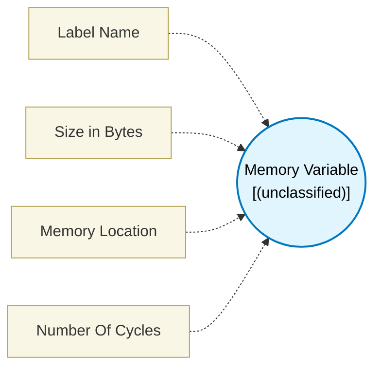

# Memory Variable (`memory_variable_block`) — Design Document

> Generated by `build_block_docs.js` on 2026-10-21 from `.metadata/sysconfig/.meta/pru_blocks/utils/memory_variable_block.syscfg.js`. Do not edit by hand; re-run `node build_block_docs.js`.

## Purpose


## Memory Variable Block

### Purpose
Reserves uninitialized memory space in a named section using the `.usect` directive. This is useful for declaring buffers, arrays, or any memory that doesn't need initialization at compile time.

### How It Works
1. **No Runtime Code**: This block only generates a memory reservation directive - no executable code
2. **Uninitialized**: The reserved memory has no initial contents (undefined values at startup)
3. **Named Section**: Memory is placed in a user-specified section (default: .bss)
4. **Linker Placement**: The linker determines the actual memory address based on the linker command file

### Configuration

**Label Name**
- The symbol name that points to the first byte of reserved memory
- Must start with a letter or underscore
- Can contain letters, numbers, and underscores
- Example: `my_buffer`, `_data_array`, `rxBuffer1`

**Size in Bytes**
- Number of bytes to reserve (1 to 8192)
- Example: 256 for a 256-byte buffer

**Memory Location**
- Choose where to allocate the memory:
- **DMEM (Local)**: Allocated in local PRU Data RAM (8 KB, fast access)
- **SMEM (Shared)**: Allocated in Shared RAM (64 KB, accessible by all PRUs and ARM cores)
- Default: DMEM (Local)

**Alignment** (Optional)
- Ensures the memory starts on a specific boundary
- Fixed to 4 bytes (word-aligned) for optimal PRU access
- Example: 4 for 4-byte (word) alignment

### Generated Assembly
```assembly
; Example in DMEM (Local)
myBuffer    .usect ".udmem", 256, 4

; Example in SMEM (Shared)
sharedData  .usect ".usmem", 512, 4
```

### .usect Directive Syntax
```
symbol .usect "section name", size in bytes[, alignment]
```

- **symbol**: Label pointing to first byte of reserved space
- **section name**: Name of uninitialized section (in quotes)
- **size in bytes**: Number of bytes to reserve
- **alignment**: Optional boundary alignment (power of 2)

### Usage Examples

**Example 1: Local Buffer in DMEM**
```
Label: rxBuffer
Size: 128 bytes
Memory Location: DMEM (Local)

Generated: rxBuffer .usect ".udmem", 128, 4
```

**Example 2: Shared Buffer in SMEM**
```
Label: sharedData
Size: 512 bytes
Memory Location: SMEM (Shared)

Generated: sharedData .usect ".usmem", 512, 4
```

**Example 3: Large Shared Buffer**
```
Label: ipcBuffer
Size: 2048 bytes
Memory Location: SMEM (Shared)

Generated: ipcBuffer .usect ".usmem", 2048, 4
```

### Accessing Reserved Memory

To access the reserved memory in your PRU code:
```assembly
; Load address of reserved memory into register
LDI32   R0, myBuffer

; Write a byte to the buffer
SBBO    &R1, R0, 0, 1

; Read 4 bytes from offset 8
LBBO    &R2, R0, 8, 4
```

### Differences from Lookup Table Block

| Feature | Memory Variable | Lookup Table |
|---------|---------------|--------------|
| Initialization | Uninitialized | Initialized with data |
| Directive | .usect | .data section |
| Use Case | Runtime buffers | Pre-computed values |
| Content | Undefined at start | User-defined values |

### Memory Considerations
- PRU DMEM is 8KB per core - plan your memory usage accordingly
- Multiple Memory Variable blocks can be used for different buffers
- The linker places all .bss sections together unless you use custom sections
- For initialized data, use the Lookup Table block instead

### Terminology
- **.usect**: Assembler directive to reserve Uninitialized SECTion space
- **.bss**: Block Started by Symbol - standard section for uninitialized data
- **Alignment**: Memory boundary constraint (addresses divisible by alignment value)
- **DMEM**: PRU Data Memory - 8KB local RAM in each PRU core

---

## Block Diagram




## Classification

- **Block id:** `memory_variable_block`
- **Category:** Utilities
- **Execution model (inferred):** `(unclassified)`
- **Macro / opcode:** _(none)_
- **Data ports:** 0 in / 0 out · **Cycles:** `0`

## Parameter schema

| Parameter | Display name | Default | Options |
|---|---|---|---|
| `labelName` | Label Name | `buffer` | — |
| `sizeInBytes` | Size in Bytes | `64` | — |
| `memoryLocation` | Memory Location | `dmem` | `dmem`, `smem` |
| `noOfCycles` | Number Of Cycles | `0` | — |

## Ports

| Port | Type |
|---|---|
| `prev` | `PREV` |
| `next` | `NEXT` |

## Validation rules

- Label name cannot be empty
- Label name must start with a letter or underscore and contain only letters, numbers, and underscores
- Size must be between 1 and 8192 bytes
- Alignment must be a power of 2 (1, 2, 4, 8, 16, etc.) or 0 for no alignment

## Generated macro (`.xdt` equivalent)

```asm
; Memory reserved via .usect directive
```

## Device portability

> **Source of truth:** `.metadata/sysconfig/.meta/pru_blocks/common/pru_device_caps.js` (TRM SPRUIM2J §6.4.1.1 / SPRUJB6 §7.3.1.1). Regenerated by `node build_block_docs.js` — do not edit by hand.

- **Required widget(s):** _(none)_
- **Validator:** `pru_blocks_static_module` raises a SysConfig **ERROR** naming both widget and device when a required widget is absent.

| Device (SoC) | Supported |
|---|---|
| `am243x` | ✅ |
| `am261x` | ✅ |
| `am263px` | ✅ |
| `am263x` | ✅ |
| `am64x` | ✅ |

## Outstanding TODO / VERIFY items

- None flagged in source.
