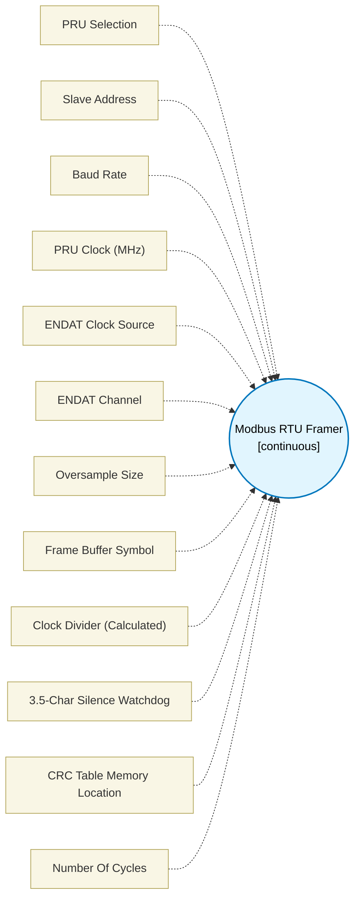

# Modbus RTU Framer (`modbus_rtu_framer`) — Design Document

> Generated by `build_block_docs.js` from `.metadata/sysconfig/.meta/pru_blocks/application_specific/modbus_rtu_framer.syscfg.js`. Do not edit by hand; re-run `node build_block_docs.js`.

## Purpose


## Modbus RTU Framer (RX delimiting with measured 3.5-character silence)

### Purpose
Receives one Modbus RTU frame over the PRU-ICSS ENDAT UART character layer
(the same hardware the `uart_tx` / `uart_rx` blocks drive) and delimits it by
**measuring the 3.5-character-time inter-frame silence in PRU cycles**. The
block then validates the frame with CRC-16 (Modbus parameters) and filters the
slave address.

### The determinism feature
RTU frames are delimited by 3.5 character-times of silence. A frame boundary
missed because an interrupt was late is a corrupted transaction. This block
measures the gap with a 3-cycle countdown watchdog that is restarted on every
received character; the boundary is declared only when the full interval of
measured silence elapses. The threshold is computed at generation time
(`silenceTicks`, shown in the block table) from the configured baud and PRU
clock.

**Honest scope of the advantage:** a hardware UART plus a well-fed software
timer works fine at 9.6–19.2 kbaud, where 3.5 characters is milliseconds. The
PRU case strengthens at 115.2 kbaud and above, and on a loaded R5F where
timer interrupts jitter. This block claims no universal advantage.

### How it works
1. **Character layer init** — identical ENDAT programming sequence to the
   `uart_rx` block (global reinit, GPCFG peripheral mode, RXCFG clock +
   oversampling, CHx_CFG0 frame format, RX enable). Character reception uses
   the same per-bit valid-flag polling as `uart_rx`. Response transmission is
   owned by `uart_tx` block instances downstream — this block is the RX
   delimiting half.
2. **Reception** — bytes are appended to a 256-byte frame buffer in DMEM
   (reserved by a paired Memory Variable block using `bufferSymbol`).
3. **Silence watchdog** — 3 cycles per iteration; 3.5 char times = 38.5 bit
   times (11-bit RTU characters). Idle line (no frame started) keeps
   listening.
4. **CRC-16** — table-driven reflected 0xA001 / init 0xFFFF, over the
   length−2 payload. Shifts, XORs and LBBO only: the PRU has no MULL, and none
   is needed. `crc_block` was checked first: its CRC16 path is MSB-first
   non-reflected and cannot produce Modbus CRC values, so this block ships
   its own reflected table through the same lutName mechanism.
5. **Address filter** — frame accepted if byte 0 equals `slaveAddress` or 0
   (broadcast).

### Result register (output1, 4 bytes)
| Field | Meaning |
|-------|---------|
| b0 | status: 0 = OK, 1 = CRC error, 2 = address mismatch, 3 = frame too short (< 4 bytes) |
| b1 | frame length in bytes (address + PDU + 2 CRC bytes) |
| w2 | computed CRC-16 (little-endian in b2/b3, matching on-wire order) |

Frames longer than 255 bytes drop the excess bytes; the truncation then fails
CRC and reports status 1. The block **blocks** until a frame is delimited
(it waits for silence), exactly like `uart_rx` waits for a character.

### Dependencies and seams (stated honestly)
- **RS-485 direction control does not exist yet.** This block does not depend
  on it and does not touch a direction pin. Seam: drive the transceiver DE/RE
  pin from PRU GPO blocks around response transmission when that hardware is
  present.
- **Frame buffer:** add a Memory Variable block with `labelName` =
  `bufferSymbol`, 256 bytes, `.udmem`. The linker resolves the label.
- **CRC table:** emitted automatically (512 bytes) via the block's lutName in
  `.initdmem`; multiple framer instances each emit their own table.
- **Pre-response gap:** the Modbus requirement to wait 3.5 character times
  before transmitting a response can be met with a Delay block configured
  from the same `silenceTicks` value.

### Timing
- Watchdog granularity: 3 PRU cycles (poll + decrement + branch).
- Example defaults (200 MHz PRU, 115200 baud): bit = 1736 cycles, silence =
  66,736 cycles = 22246 watchdog iterations ≈ 333.7 µs measured at
  cycle granularity.
- CRC: ~13 cycles per byte (two LDI32 bases, LBBO, shift/XOR update).
- The block's `noOfCycles` reports only the deterministic init portion; the
  reception/wait phase is inherently blocking (like `uart_rx`).

### Register budget
TEMP_REG1 / TEMP_REG2 only (2-TEMP allocator pattern) plus the allocated
frame result register. No MULL anywhere; all scaling is done at generation
time or with shifts.

### What is NOT claimed
- No pru-simulator co-simulation of this block yet — the evidence gate for
  this revision is a clean clpru assembly of the generated macro (see
  `scripts/verify_modbus_build.js`) plus a JS-side check of the generated
  CRC table against the bitwise reference.
- No TX-side framing (CRC append + gap enforcement) inside this block; build
  it from uart_tx + crc arithmetic downstream, or wait for a TX framer.

## How to Configure (For AI/Scripting)

### Adding an Instance

```javascript
const modbus = scripting.addModule("/pru_blocks/application_specific/modbus_rtu_framer", {}, false);
const framer1 = modbus.addInstance();
```

### Configuration Parameters

| Parameter | Type | Valid Values | Default | Description |
|-----------|------|--------------|---------|-------------|
| slaveAddress | Integer | 0-247 | 1 | This station's Modbus address (0 accepts broadcast) |
| baudRate | Integer | >0, clock-divisible | 115200 | Baud rate; ENDAT clock must divide by baud*oversample |
| pruClockMhz | Integer | 192, 200 | 200 | PRU core clock used for the silence measurement |
| clockSource | Integer | 0, 1 | 0 | ENDAT RX clock: 0 = 192 MHz UART_CLK, 1 = 200 MHz CORE_CLK (must match paired uart blocks) |
| channel | Integer | 0, 1, 2 | 2 | ENDAT channel (must match paired uart blocks) |
| oversampleSize | Integer | 0, 1, 3, 7 | 7 | Oversample encoding (0=1x, 1=2x, 3=4x, 7=8x — same encoding as uart_rx: 7 means 8x) |
| bufferSymbol | String | identifier | "modbus_rtu_frame_buf" | Label of the 256-byte .udmem frame buffer (Memory Variable block) |
| lutMemoryLocation | String | "dmem", "smem" | "dmem" | Where the 512-byte CRC table is placed |

### Required companion blocks
1. **Memory Variable** with `labelName` = `bufferSymbol`, `sizeInBytes` = 256,
   section `.udmem` — the frame buffer this macro writes via SBBO.
2. **uart_tx instances** for the response path (character layer TX).
3. **Loop block** if you want continuous frame reception.

### Example

```javascript
framer1.$name = "MODBUS_FRAMER_0";
framer1.slaveAddress = 17;
framer1.baudRate = 115200;
framer1.pruClockMhz = 200;
framer1.clockSource = 0;
framer1.channel = 2;
framer1.oversampleSize = 7;          // 8x oversampling
framer1.bufferSymbol = "modbus_rx_frame_buf";
```

### Connecting

```javascript
// Result register (status/length/CRC) to downstream consumers
scripting.connect(framer1, "output1", status_consumer, "input1");
// Control flow
scripting.connect(prev_block, "next", framer1, "prev");
scripting.connect(framer1, "next", next_block, "prev");
```

### Important Notes
1. The macro declaration takes ONLY substitution symbols; all numeric config
   is passed at the call site or baked into the body (clpru [E0004] rejects
   numeric literals in .macro parameter positions).
2. `channel`, `clockSource`, `oversampleSize` must match the paired
   uart_tx/uart_rx instances — they describe the same hardware.
3. The block blocks until a frame is delimited by measured silence.
4. Read the frame PDU from the buffer via Memory Access blocks using
   `bufferSymbol` after checking status == 0.


## Block Diagram




## Classification

- **Block id:** `modbus_rtu_framer`
- **Category:** Application-Specific
- **Execution model (inferred):** `continuous`
- **Macro / opcode:** _(none)_
- **Data ports:** 0 in / 1 out · **Cycles:** `40`

## Parameter schema

| Parameter | Display name | Default | Options |
|---|---|---|---|
| `pruSelect` | PRU Selection | `NaN` | `0`, `1` |
| `slaveAddress` | Slave Address | `1` | — |
| `baudRate` | Baud Rate | `115200` | — |
| `pruClockMhz` | PRU Clock (MHz) | `200` | `192`, `200` |
| `clockSource` | ENDAT Clock Source | `0` | `0`, `1` |
| `channel` | ENDAT Channel | `2` | `0`, `1`, `2` |
| `oversampleSize` | Oversample Size | `7` | `0`, `1`, `3`, `7` |
| `bufferSymbol` | Frame Buffer Symbol | `modbus_rtu_frame_buf` | — |
| `clockDivider` | Clock Divider (Calculated) | `0` | — |
| `silenceTicksDisplay` | 3.5-Char Silence Watchdog | `N/A` | — |
| `lutMemoryLocation` | CRC Table Memory Location | `dmem` | `dmem`, `smem` |
| `noOfCycles` | Number Of Cycles | `40` | — |

## Ports

| Port | Type |
|---|---|
| `output1` | `output32` |
| `prev` | `PREV` |
| `next` | `NEXT` |

## Validation rules

- Baud rate must be positive.
- Modbus slave address must be 0-247 (0 = broadcast).
- Buffer symbol must be a valid assembler identifier.
- PRU clock must be 192 or 200 MHz.
- Nearest ENDAT divider (

## Generated macro (`.xdt` equivalent)

```asm
; ========== ICSS CFG register definitions (auto-generated, guarded) ==========
    .if !$isdefed("ICSS_CFG")
    .asg    c4,     ICSS_CFG
    .endif
    .if !$isdefed("ICSS_CFG_GPCFG1")
ICSS_CFG_GPCFG1                 .set    0x000C
    .endif
    .if !$isdefed("ICSS_CFG_PRU1_ENDAT_RXCFG")
ICSS_CFG_PRU1_ENDAT_RXCFG       .set    0x00100
    .endif
    .if !$isdefed("ICSS_CFG_PRU1_ENDAT_CH0_CFG0")
ICSS_CFG_PRU1_ENDAT_CH0_CFG0    .set    0x00108
    .endif
    .if !$isdefed("ICSS_CFG_PRU1_ENDAT_CH1_CFG0")
ICSS_CFG_PRU1_ENDAT_CH1_CFG0    .set    0x00110
    .endif
    .if !$isdefed("ICSS_CFG_PRU1_ENDAT_CH2_CFG0")
ICSS_CFG_PRU1_ENDAT_CH2_CFG0    .set    0x00118
    .endif
; ============================================================================
	.macro  frameReg, slaveAddr, silenceTicks, clockDiv, bufSymbol, lutSymbol
	; Parameters (ALL substitution symbols — never numeric literals here, clpru [E0004]):
	;   frameReg     - allocated result register: b0=status, b1=length, w2=CRC-16
	;   slaveAddr    - this station's Modbus address (0 also accepted = broadcast)
	;   silenceTicks - 3.5-char-time silence threshold in watchdog iterations (3 cycles each)
	;   clockDiv     - ENDAT RX clock divider matching the paired uart_rx/uart_tx config
	;   bufSymbol    - label of the 256-byte frame buffer (Memory Variable block, .udmem)
	;   lutSymbol    - label of the 256-entry reflected CRC-16 lookup table (.initdmem)
	; Register budget: TEMP_REG1/TEMP_REG2 only, plus frameReg.
    ; ===== character layer init (same ENDAT sequence the uart_rx block emits) =====
    ; TRM sequence: assert tx_global_reinit, wait for busy clear, de-assert rx_en
    set     r31, r31, 19
mb_wait_reinit?:
    qbbs    mb_wait_reinit?, r31, 21
    ldi     r30.b3, 0x00
    ldi32   TEMP_REG1, 0x04000000
    ldi     TEMP_REG2.w0, ICSS_CFG_GPCFG1
    sbco    &TEMP_REG1, ICSS_CFG, TEMP_REG2.w0, 4
    ldi     TEMP_REG1.w0, 0   ; oversample bits[2:0] (same encoding as uart_rx)
    ldi     TEMP_REG1.w2, clockDiv
    ldi     TEMP_REG2.w0, ICSS_CFG_PRU1_ENDAT_RXCFG
    sbco    &TEMP_REG1, ICSS_CFG, TEMP_REG2.w0, 4
    ldi     TEMP_REG1.w0, 0
    ldi     TEMP_REG1.w2, 10   ; frame size in bits [27:16]
    set     TEMP_REG1, TEMP_REG1, 31   ; bitSwap = LSB first (standard UART)
    ldi     TEMP_REG2.w0, ICSS_CFG_PRU1_ENDAT_CH2_CFG0
    sbco    &TEMP_REG1, ICSS_CFG, TEMP_REG2.w0, 4
    ldi     r30.b3, 0x04   ; enable RX on channel 2

    ; ===== Modbus RTU delimiting: measured 3.5-character-time silence =====
    ldi     frameReg.b0, 0
    ldi     frameReg.b1, 0
mb_wait_char?:
    ldi32   TEMP_REG1, silenceTicks
mb_gap_loop?:
    qbbs    mb_char_rx?, r31, 26   ; new character bit ready? (restart watchdog)
    sub     TEMP_REG1, TEMP_REG1, 1
    qbne    mb_gap_loop?, TEMP_REG1, 0
    ; watchdog hit zero: silenceTicks iterations x 3 cycles of measured silence
    qbeq    mb_wait_char?, frameReg.b1, 0   ; idle line (no frame yet): keep listening
    qba     mb_frame_check?              ; frame boundary declared here
mb_char_rx?:
    ; receive one 10-bit UART character (uart_rx-compatible bit loop)
    ldi     TEMP_REG1, 0
    ldi     TEMP_REG2.b0, 0
mb_bit_loop?:
    qbbc    mb_bit_loop?, r31, 26
    mov     TEMP_REG2.b1, r31.b2
    set     r31, r31, 26
    qbbs    mb_got_one?, TEMP_REG2.b1, 4
    lsr     TEMP_REG1, TEMP_REG1, 1
    qba     mb_next_bit?
mb_got_one?:
    lsr     TEMP_REG1, TEMP_REG1, 1
    set     TEMP_REG1, TEMP_REG1, 31
mb_next_bit?:
    add     TEMP_REG2.b0, TEMP_REG2.b0, 1
    qbne    mb_bit_loop?, TEMP_REG2.b0, 10
    ldi     TEMP_REG2.w0, 22
    lsr     TEMP_REG1, TEMP_REG1, TEMP_REG2.w0
    lsr     TEMP_REG1, TEMP_REG1, 1     ; drop start bit
    ldi     TEMP_REG2, 1
    lsl     TEMP_REG2, TEMP_REG2, 8
    sub     TEMP_REG2, TEMP_REG2, 1
    and     TEMP_REG1, TEMP_REG1, TEMP_REG2
    ; append byte to frame buffer; frames beyond 255 bytes drop the excess
    ; (truncation then fails the CRC check and reports status 1)
    qbgt    mb_no_store?, frameReg.b1, 254
    ldi32   TEMP_REG2, bufSymbol
    sbbo    &TEMP_REG1, TEMP_REG2, frameReg.b1, 1
    add     frameReg.b1, frameReg.b1, 1
mb_no_store?:
    qba     mb_wait_char?               ; restart the silence watchdog

mb_frame_check?:
    qble    mb_status_short?, frameReg.b1, 3   ; need addr+fnc+CRC2
    ; ---- CRC-16 (Modbus: reflected 0xA001, init 0xFFFF) over length-2 bytes ----
    ; No MULL on PRU: table lookup + shifts + XOR only.
    ; CRC lives in frameReg.b2 (low) / .b3 (high); .b0 is the buffer pointer.
    ldi     frameReg.b2, 0xFF
    ldi     frameReg.b3, 0xFF
    ldi     frameReg.b0, 0
    sub     TEMP_REG2.b2, frameReg.b1, 2
mb_crc_next?:
    qbeq    mb_crc_done?, TEMP_REG2.b2, 0
    ldi32   TEMP_REG1, bufSymbol
    lbbo    &TEMP_REG2.b1, TEMP_REG1, frameReg.b0, 1
    xor     TEMP_REG2.b0, frameReg.b2, TEMP_REG2.b1
    ldi32   TEMP_REG1, lutSymbol
    lbbo    &TEMP_REG2.w0, TEMP_REG1, TEMP_REG2.b0, 2
    mov     frameReg.b2, frameReg.b3   ; crc >>= 8
    ldi     frameReg.b3, 0
    xor     frameReg.b2, frameReg.b2, TEMP_REG2.b0
    xor     frameReg.b3, frameReg.b3, TEMP_REG2.b1
    add     frameReg.b0, frameReg.b0, 1
    sub     TEMP_REG2.b2, TEMP_REG2.b2, 1
    qba     mb_crc_next?
mb_crc_done?:
    ldi32   TEMP_REG1, bufSymbol
    lbbo    &TEMP_REG2.b0, TEMP_REG1, frameReg.b0, 2   ; received CRC, little-endian
    xor     TEMP_REG2.b0, TEMP_REG2.b0, frameReg.b2
    xor     TEMP_REG2.b1, TEMP_REG2.b1, frameReg.b3
    or      TEMP_REG2.b0, TEMP_REG2.b0, TEMP_REG2.b1
    qbeq    mb_addr_ok?, TEMP_REG2.b0, 0
    qba     mb_status_crc?
mb_addr_ok?:
    ldi     frameReg.b0, 0
    lbbo    &TEMP_REG2.b0, TEMP_REG1, frameReg.b0, 1
    qbeq    mb_status_ok?, TEMP_REG2.b0, slaveAddr
    qbeq    mb_status_ok?, TEMP_REG2.b0, 0   ; broadcast
    qba     mb_status_addr?
mb_status_ok?:
    ldi     frameReg.b0, 0
    qba     mb_done?
mb_status_crc?:
    ldi     frameReg.b0, 1
    qba     mb_done?
mb_status_addr?:
    ldi     frameReg.b0, 2
    qba     mb_done?
mb_status_short?:
    ldi     frameReg.b0, 3
mb_done?:
    ; RX is left enabled: this block is normally placed inside a Loop block
    ; so the next frame is delimited immediately after this one.

 .endm
```

## Device portability

> **Source of truth:** `.metadata/sysconfig/.meta/pru_blocks/common/pru_device_caps.js` (TRM SPRUIM2J §6.4.1.1 / SPRUJB6 §7.3.1.1). Regenerated by `node build_block_docs.js` — do not edit by hand.

- **Required widget(s):** _(none)_
- **Validator:** `pru_blocks_static_module` raises a SysConfig **ERROR** naming both widget and device when a required widget is absent.

| Device (SoC) | Supported |
|---|---|
| `am243x` | ✅ |
| `am261x` | ✅ |
| `am263px` | ✅ |
| `am263x` | ✅ |
| `am64x` | ✅ |

## Outstanding TODO / VERIFY items

- None flagged in source.
