# Multi-Axis Motion Controller (`multi_axis_motion_block`) — Design Document

> Generated by `build_block_docs.js` from `.metadata/sysconfig/.meta/pru_blocks/pru_io_blocks/multi_axis_motion_block.syscfg.js`. Do not edit by hand; re-run `node build_block_docs.js`.

## Purpose

Drives up to 4 stepper axes (Step+Dir+Enable on R30) from one fixed-length scheduler tick. Each axis is a 32-bit phase accumulator; a carry is one step. With Synchronized Start every axis steps on the same first tick, and all step pins of a tick rise and fall in single 32-bit R30 writes, so pulse width is identical on every axis. An asserted E-Stop input clears every pin the block drives, latches status bit 7 and halts. Constant speed only: the acceleration, home-switch, limit-switch and DMEM-base fields are reserved and ignored, and there is no IEP timebase, command-queue input or underrun detection. State is held in R18..R25.

## Block Diagram

```mermaid
flowchart LR
  classDef config fill:#f9f6e5,stroke:#b1a457,stroke-width:1px,color:#333;
  classDef core fill:#e1f5fe,stroke:#0277bd,stroke-width:2px,color:#000;
  CORE(("Multi-Axis Motion Controller\n[oneshot]")):::core
  CFG0["Number of Axes"]:::config -.-> CORE
  CFG1["Axis 0 - Step Pin (GPO)"]:::config -.-> CORE
  CFG2["Axis 0 - Dir Pin (GPO)"]:::config -.-> CORE
  CFG3["Axis 0 - Enable Pin (GPO)"]:::config -.-> CORE
  CFG4["Axis 0 - Home Switch (Reserved)"]:::config -.-> CORE
  CFG5["Axis 0 - Limit+ (Reserved)"]:::config -.-> CORE
  CFG6["Axis 0 - Limit- (Reserved)"]:::config -.-> CORE
  CFG7["Axis 0 - Target Steps"]:::config -.-> CORE
  CFG8["Axis 0 - Speed (Steps/s)"]:::config -.-> CORE
  CFG9["Axis 0 - Acceleration (Reserved)"]:::config -.-> CORE
  CFG10["Axis 0 - Initial Direction"]:::config -.-> CORE
  CFG11["Axis 1 - Step Pin (GPO)"]:::config -.-> CORE
  CFG12["Axis 1 - Dir Pin (GPO)"]:::config -.-> CORE
  CFG13["Axis 1 - Enable Pin (GPO)"]:::config -.-> CORE
  CFG14["Axis 1 - Home Switch (Reserved)"]:::config -.-> CORE
  CFG15["Axis 1 - Limit+ (Reserved)"]:::config -.-> CORE
  CFG16["Axis 1 - Limit- (Reserved)"]:::config -.-> CORE
  CFG17["Axis 1 - Target Steps"]:::config -.-> CORE
  CFG18["Axis 1 - Speed (Steps/s)"]:::config -.-> CORE
  CFG19["Axis 1 - Acceleration (Reserved)"]:::config -.-> CORE
  CFG20["Axis 1 - Initial Direction"]:::config -.-> CORE
  CFG21["Axis 2 - Step Pin (GPO)"]:::config -.-> CORE
  CFG22["Axis 2 - Dir Pin (GPO)"]:::config -.-> CORE
  CFG23["Axis 2 - Enable Pin (GPO)"]:::config -.-> CORE
  CFG24["Axis 2 - Home Switch (Reserved)"]:::config -.-> CORE
  CFG25["Axis 2 - Limit+ (Reserved)"]:::config -.-> CORE
  CFG26["Axis 2 - Limit- (Reserved)"]:::config -.-> CORE
  CFG27["Axis 2 - Target Steps"]:::config -.-> CORE
  CFG28["Axis 2 - Speed (Steps/s)"]:::config -.-> CORE
  CFG29["Axis 2 - Acceleration (Reserved)"]:::config -.-> CORE
  CFG30["Axis 2 - Initial Direction"]:::config -.-> CORE
  CFG31["Axis 3 - Step Pin (GPO)"]:::config -.-> CORE
  CFG32["Axis 3 - Dir Pin (GPO)"]:::config -.-> CORE
  CFG33["Axis 3 - Enable Pin (GPO)"]:::config -.-> CORE
  CFG34["Axis 3 - Home Switch (Reserved)"]:::config -.-> CORE
  CFG35["Axis 3 - Limit+ (Reserved)"]:::config -.-> CORE
  CFG36["Axis 3 - Limit- (Reserved)"]:::config -.-> CORE
  CFG37["Axis 3 - Target Steps"]:::config -.-> CORE
  CFG38["Axis 3 - Speed (Steps/s)"]:::config -.-> CORE
  CFG39["Axis 3 - Acceleration (Reserved)"]:::config -.-> CORE
  CFG40["Axis 3 - Initial Direction"]:::config -.-> CORE
  CFG41["E-Stop Input (GPI, Active High)"]:::config -.-> CORE
  CFG42["Synchronized Start"]:::config -.-> CORE
  CFG43["PRU Clock (Hz)"]:::config -.-> CORE
  CFG44["DMEM State Table Base (Hex)"]:::config -.-> CORE
  CFG45["Step Pulse Width (PRU Cycles)"]:::config -.-> CORE
  CFG46["Number Of Cycles"]:::config -.-> CORE
```




## Classification

- **Block id:** `multi_axis_motion_block`
- **Category:** I/O & Protocol
- **Execution model (inferred):** `oneshot`
- **Macro / opcode:** `m_multi_axis_motion_run`
- **Data ports:** 0 in / 1 out · **Cycles:** `50`

## Parameter schema

| Parameter | Display name | Default | Options |
|---|---|---|---|
| `numAxes` | Number of Axes | `2` | `1`, `2`, `3`, `4` |
| `stepPin0` | Axis 0 - Step Pin (GPO) | `0` | `0`, `1`, `2`, `3`, `4`, `5`, `6`, `7`, `8`, `9`, `10`, `11`, `12`, `13`, `14`, `15`, `16`, `17`, `18`, `19` |
| `dirPin0` | Axis 0 - Dir Pin (GPO) | `1` | `0`, `1`, `2`, `3`, `4`, `5`, `6`, `7`, `8`, `9`, `10`, `11`, `12`, `13`, `14`, `15`, `16`, `17`, `18`, `19` |
| `enablePin0` | Axis 0 - Enable Pin (GPO) | `2` | `0`, `1`, `2`, `3`, `4`, `5`, `6`, `7`, `8`, `9`, `10`, `11`, `12`, `13`, `14`, `15`, `16`, `17`, `18`, `19` |
| `homeSwPin0` | Axis 0 - Home Switch (Reserved) | `0` | `0`, `1`, `2`, `3`, `4`, `5`, `6`, `7`, `8`, `9`, `10`, `11`, `12`, `13`, `14`, `15`, `16`, `17`, `18`, `19` |
| `limitPPin0` | Axis 0 - Limit+ (Reserved) | `1` | `0`, `1`, `2`, `3`, `4`, `5`, `6`, `7`, `8`, `9`, `10`, `11`, `12`, `13`, `14`, `15`, `16`, `17`, `18`, `19` |
| `limitNPin0` | Axis 0 - Limit- (Reserved) | `2` | `0`, `1`, `2`, `3`, `4`, `5`, `6`, `7`, `8`, `9`, `10`, `11`, `12`, `13`, `14`, `15`, `16`, `17`, `18`, `19` |
| `targetSteps0` | Axis 0 - Target Steps | `1000` | — |
| `maxSpeedSps0` | Axis 0 - Speed (Steps/s) | `1000` | — |
| `accel0` | Axis 0 - Acceleration (Reserved) | `5000` | — |
| `initDir0` | Axis 0 - Initial Direction | `1` | `0`, `1` |
| `stepPin1` | Axis 1 - Step Pin (GPO) | `3` | `0`, `1`, `2`, `3`, `4`, `5`, `6`, `7`, `8`, `9`, `10`, `11`, `12`, `13`, `14`, `15`, `16`, `17`, `18`, `19` |
| `dirPin1` | Axis 1 - Dir Pin (GPO) | `4` | `0`, `1`, `2`, `3`, `4`, `5`, `6`, `7`, `8`, `9`, `10`, `11`, `12`, `13`, `14`, `15`, `16`, `17`, `18`, `19` |
| `enablePin1` | Axis 1 - Enable Pin (GPO) | `5` | `0`, `1`, `2`, `3`, `4`, `5`, `6`, `7`, `8`, `9`, `10`, `11`, `12`, `13`, `14`, `15`, `16`, `17`, `18`, `19` |
| `homeSwPin1` | Axis 1 - Home Switch (Reserved) | `3` | `0`, `1`, `2`, `3`, `4`, `5`, `6`, `7`, `8`, `9`, `10`, `11`, `12`, `13`, `14`, `15`, `16`, `17`, `18`, `19` |
| `limitPPin1` | Axis 1 - Limit+ (Reserved) | `4` | `0`, `1`, `2`, `3`, `4`, `5`, `6`, `7`, `8`, `9`, `10`, `11`, `12`, `13`, `14`, `15`, `16`, `17`, `18`, `19` |
| `limitNPin1` | Axis 1 - Limit- (Reserved) | `5` | `0`, `1`, `2`, `3`, `4`, `5`, `6`, `7`, `8`, `9`, `10`, `11`, `12`, `13`, `14`, `15`, `16`, `17`, `18`, `19` |
| `targetSteps1` | Axis 1 - Target Steps | `1000` | — |
| `maxSpeedSps1` | Axis 1 - Speed (Steps/s) | `1000` | — |
| `accel1` | Axis 1 - Acceleration (Reserved) | `5000` | — |
| `initDir1` | Axis 1 - Initial Direction | `1` | `0`, `1` |
| `stepPin2` | Axis 2 - Step Pin (GPO) | `6` | `0`, `1`, `2`, `3`, `4`, `5`, `6`, `7`, `8`, `9`, `10`, `11`, `12`, `13`, `14`, `15`, `16`, `17`, `18`, `19` |
| `dirPin2` | Axis 2 - Dir Pin (GPO) | `7` | `0`, `1`, `2`, `3`, `4`, `5`, `6`, `7`, `8`, `9`, `10`, `11`, `12`, `13`, `14`, `15`, `16`, `17`, `18`, `19` |
| `enablePin2` | Axis 2 - Enable Pin (GPO) | `8` | `0`, `1`, `2`, `3`, `4`, `5`, `6`, `7`, `8`, `9`, `10`, `11`, `12`, `13`, `14`, `15`, `16`, `17`, `18`, `19` |
| `homeSwPin2` | Axis 2 - Home Switch (Reserved) | `6` | `0`, `1`, `2`, `3`, `4`, `5`, `6`, `7`, `8`, `9`, `10`, `11`, `12`, `13`, `14`, `15`, `16`, `17`, `18`, `19` |
| `limitPPin2` | Axis 2 - Limit+ (Reserved) | `7` | `0`, `1`, `2`, `3`, `4`, `5`, `6`, `7`, `8`, `9`, `10`, `11`, `12`, `13`, `14`, `15`, `16`, `17`, `18`, `19` |
| `limitNPin2` | Axis 2 - Limit- (Reserved) | `8` | `0`, `1`, `2`, `3`, `4`, `5`, `6`, `7`, `8`, `9`, `10`, `11`, `12`, `13`, `14`, `15`, `16`, `17`, `18`, `19` |
| `targetSteps2` | Axis 2 - Target Steps | `1000` | — |
| `maxSpeedSps2` | Axis 2 - Speed (Steps/s) | `1000` | — |
| `accel2` | Axis 2 - Acceleration (Reserved) | `5000` | — |
| `initDir2` | Axis 2 - Initial Direction | `1` | `0`, `1` |
| `stepPin3` | Axis 3 - Step Pin (GPO) | `9` | `0`, `1`, `2`, `3`, `4`, `5`, `6`, `7`, `8`, `9`, `10`, `11`, `12`, `13`, `14`, `15`, `16`, `17`, `18`, `19` |
| `dirPin3` | Axis 3 - Dir Pin (GPO) | `10` | `0`, `1`, `2`, `3`, `4`, `5`, `6`, `7`, `8`, `9`, `10`, `11`, `12`, `13`, `14`, `15`, `16`, `17`, `18`, `19` |
| `enablePin3` | Axis 3 - Enable Pin (GPO) | `11` | `0`, `1`, `2`, `3`, `4`, `5`, `6`, `7`, `8`, `9`, `10`, `11`, `12`, `13`, `14`, `15`, `16`, `17`, `18`, `19` |
| `homeSwPin3` | Axis 3 - Home Switch (Reserved) | `9` | `0`, `1`, `2`, `3`, `4`, `5`, `6`, `7`, `8`, `9`, `10`, `11`, `12`, `13`, `14`, `15`, `16`, `17`, `18`, `19` |
| `limitPPin3` | Axis 3 - Limit+ (Reserved) | `10` | `0`, `1`, `2`, `3`, `4`, `5`, `6`, `7`, `8`, `9`, `10`, `11`, `12`, `13`, `14`, `15`, `16`, `17`, `18`, `19` |
| `limitNPin3` | Axis 3 - Limit- (Reserved) | `11` | `0`, `1`, `2`, `3`, `4`, `5`, `6`, `7`, `8`, `9`, `10`, `11`, `12`, `13`, `14`, `15`, `16`, `17`, `18`, `19` |
| `targetSteps3` | Axis 3 - Target Steps | `1000` | — |
| `maxSpeedSps3` | Axis 3 - Speed (Steps/s) | `1000` | — |
| `accel3` | Axis 3 - Acceleration (Reserved) | `5000` | — |
| `initDir3` | Axis 3 - Initial Direction | `1` | `0`, `1` |
| `eStopPin` | E-Stop Input (GPI, Active High) | `15` | `0`, `1`, `2`, `3`, `4`, `5`, `6`, `7`, `8`, `9`, `10`, `11`, `12`, `13`, `14`, `15`, `16`, `17`, `18`, `19` |
| `syncEnable` | Synchronized Start | `true` | — |
| `clkHz` | PRU Clock (Hz) | `200000000` | — |
| `dmemBase` | DMEM State Table Base (Hex) | `0x0100` | — |
| `pulseWidthCycles` | Step Pulse Width (PRU Cycles) | `10` | — |
| `noOfCycles` | Number Of Cycles | `50` | — |

## Ports

| Port | Type |
|---|---|
| `output1` | `output32` |
| `prev` | `IO_PREV` |
| `next` | `IO_NEXT` |

## Validation rules

- Pin GPO<value> used by <value> and <value> on axis <value>
- clkHz must be > 0
- numAxes must be 1..4
- targetSteps<value> must be 0..16777215
- maxSpeedSps<value> must be 1..200000
- accel<value> must be 1..10000000
- pulseWidthCycles must be 2..100
- dmemBase must be 0x0000..0x1FFF
- maxSpeedSps<value>=${inst[

## Generated macro (`.xdt` equivalent)

```asm
m_multi_axis_motion_run .macro RES, NUM_AXES, ESTOP_PIN, PULSE_K, PULSE_NOPS, SYNC, INV_STEP_MASK, INV_ALL_MASK, STEP0, DIR0, EN0, INC0, TGT0, FWD0, STEP1, DIR1, EN1, INC1, TGT1, FWD1, STEP2, DIR2, EN2, INC2, TGT2, FWD2, STEP3, DIR3, EN3, INC3, TGT3, FWD3
    ; Fixed-tick multi-axis step/dir generator. Per-axis state: acc = R18+2a, remaining = R19+2a
    zero  &RES, 1
    ; --- per-axis state, direction and enable ---
    .if NUM_AXES >= 1
    .if SYNC == 1
    ldi32 R18, INC0
    rsb   R18, R18, 0                ; acc = 2^32 - inc: carries on the very first tick
    .else
    ldi32 R18, 0
    .endif
    ldi32 R19, TGT0
    .if FWD0 == 1
    set   R30, R30, DIR0
    .else
    clr   R30, R30, DIR0
    .endif
    set   R30, R30, EN0
    .endif
    .if NUM_AXES >= 2
    .if SYNC == 1
    ldi32 R20, INC1
    rsb   R20, R20, 0                ; acc = 2^32 - inc: carries on the very first tick
    .else
    ldi32 R20, 0
    .endif
    ldi32 R21, TGT1
    .if FWD1 == 1
    set   R30, R30, DIR1
    .else
    clr   R30, R30, DIR1
    .endif
    set   R30, R30, EN1
    .endif
    .if NUM_AXES >= 3
    .if SYNC == 1
    ldi32 R22, INC2
    rsb   R22, R22, 0                ; acc = 2^32 - inc: carries on the very first tick
    .else
    ldi32 R22, 0
    .endif
    ldi32 R23, TGT2
    .if FWD2 == 1
    set   R30, R30, DIR2
    .else
    clr   R30, R30, DIR2
    .endif
    set   R30, R30, EN2
    .endif
    .if NUM_AXES >= 4
    .if SYNC == 1
    ldi32 R24, INC3
    rsb   R24, R24, 0                ; acc = 2^32 - inc: carries on the very first tick
    .else
    ldi32 R24, 0
    .endif
    ldi32 R25, TGT3
    .if FWD3 == 1
    set   R30, R30, DIR3
    .else
    clr   R30, R30, DIR3
    .endif
    set   R30, R30, EN3
    .endif
    ; --- DIR/EN settle before the first step ---
    ldi   TEMP_REG3.w0, 20
ma_settle?:
    sub   TEMP_REG3.w0, TEMP_REG3.w0, 1
    qbne  ma_settle?, TEMP_REG3.w0, 0
    ldi32 TEMP_REG4, INV_STEP_MASK
    ; --- scheduler tick: identical instruction sequence every pass ---
ma_tick?:
    ldi   TEMP_REG1, 0
    qbbs  ma_estop?, R31, ESTOP_PIN
    .if NUM_AXES >= 1
    ldi32 TEMP_REG3, INC0
    ldi   TEMP_REG2, 0
    add   R18, R18, TEMP_REG3        ; carry out = one step
    adc   TEMP_REG2, TEMP_REG2, 0
    min   TEMP_REG2, TEMP_REG2, R19      ; no step once the target is reached
    sub   R19, R19, TEMP_REG2
    lsl   TEMP_REG2, TEMP_REG2, STEP0
    or    TEMP_REG1, TEMP_REG1, TEMP_REG2
    .endif
    .if NUM_AXES >= 2
    ldi32 TEMP_REG3, INC1
    ldi   TEMP_REG2, 0
    add   R20, R20, TEMP_REG3        ; carry out = one step
    adc   TEMP_REG2, TEMP_REG2, 0
    min   TEMP_REG2, TEMP_REG2, R21      ; no step once the target is reached
    sub   R21, R21, TEMP_REG2
    lsl   TEMP_REG2, TEMP_REG2, STEP1
    or    TEMP_REG1, TEMP_REG1, TEMP_REG2
    .endif
    .if NUM_AXES >= 3
    ldi32 TEMP_REG3, INC2
    ldi   TEMP_REG2, 0
    add   R22, R22, TEMP_REG3        ; carry out = one step
    adc   TEMP_REG2, TEMP_REG2, 0
    min   TEMP_REG2, TEMP_REG2, R23      ; no step once the target is reached
    sub   R23, R23, TEMP_REG2
    lsl   TEMP_REG2, TEMP_REG2, STEP2
    or    TEMP_REG1, TEMP_REG1, TEMP_REG2
    .endif
    .if NUM_AXES >= 4
    ldi32 TEMP_REG3, INC3
    ldi   TEMP_REG2, 0
    add   R24, R24, TEMP_REG3        ; carry out = one step
    adc   TEMP_REG2, TEMP_REG2, 0
    min   TEMP_REG2, TEMP_REG2, R25      ; no step once the target is reached
    sub   R25, R25, TEMP_REG2
    lsl   TEMP_REG2, TEMP_REG2, STEP3
    or    TEMP_REG1, TEMP_REG1, TEMP_REG2
    .endif
    or    R30, R30, TEMP_REG1                ; broadside: all axes step on the same cycle
    .if PULSE_K > 0
    ldi   TEMP_REG3.w0, PULSE_K
ma_pw?:
    sub   TEMP_REG3.w0, TEMP_REG3.w0, 1
    qbne  ma_pw?, TEMP_REG3.w0, 0
    .endif
    .if PULSE_NOPS > 0
    mov   TEMP_REG3, TEMP_REG3
    .endif
    .if PULSE_NOPS > 1
    mov   TEMP_REG3, TEMP_REG3
    .endif
    and   R30, R30, TEMP_REG4                ; broadside: all step pins fall together
    mov   TEMP_REG2, R19
    .if NUM_AXES >= 2
    or    TEMP_REG2, TEMP_REG2, R21
    .endif
    .if NUM_AXES >= 3
    or    TEMP_REG2, TEMP_REG2, R23
    .endif
    .if NUM_AXES >= 4
    or    TEMP_REG2, TEMP_REG2, R25
    .endif
    qbne  ma_tick?, TEMP_REG2, 0
    qba   ma_done?
ma_estop?:
    ; Emergency stop: clear every pin this block drives, latch status bit 7, halt
    ldi32 TEMP_REG2, INV_ALL_MASK
    and   R30, R30, TEMP_REG2
    set   RES, RES, 7
    halt
ma_done?:
    .endm
```

## Device portability

> **Source of truth:** `.metadata/sysconfig/.meta/pru_blocks/common/pru_device_caps.js` (TRM SPRUIM2J §6.4.1.1 / SPRUJB6 §7.3.1.1). Regenerated by `node build_block_docs.js` — do not edit by hand.

- **Required widget(s):** _(none)_
- **Validator:** `pru_blocks_static_module` raises a SysConfig **ERROR** naming both widget and device when a required widget is absent.

| Device (SoC) | Supported |
|---|---|
| `am243x` | ✅ |
| `am261x` | ✅ |
| `am263px` | ✅ |
| `am263x` | ✅ |
| `am64x` | ✅ |

## Outstanding TODO / VERIFY items

- None flagged in source.
