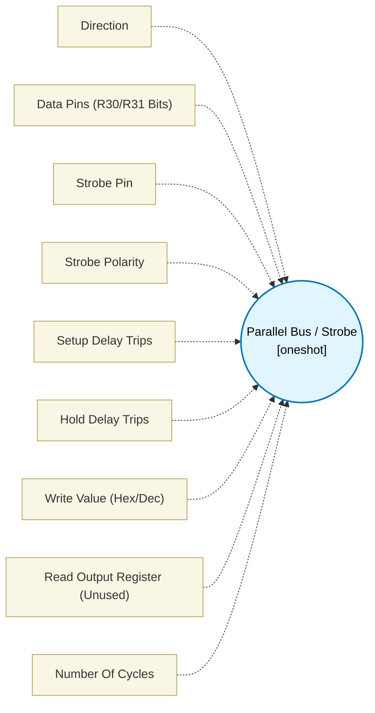

# Parallel Bus / Strobe (`parallel_bus_block`) — Design Document

> Generated by `build_block_docs.js` from `.metadata/sysconfig/.meta/pru_blocks/pru_io_blocks/parallel_bus_block.syscfg.js`. Do not edit by hand; re-run `node build_block_docs.js`.

## Purpose

Drives or samples a CONTIGUOUS field of data pins with a single strobe pulse. Setup and hold are loop-trip counts (integer 0..65535): a delay of N trips lasts 2 + 2N PRU cycles, and 0 emits no delay at all. Behaviour change: the loops used to collapse to one cycle regardless of the configured count; the default of 2 trips now gives a 6-cycle setup and a 6-cycle hold.

## Block Diagram




## Classification

- **Block id:** `parallel_bus_block`
- **Category:** I/O & Protocol
- **Execution model (inferred):** `oneshot`
- **Macro / opcode:** `m_parallel_bus_run`
- **Data ports:** 0 in / 0 out · **Cycles:** `1`

## Parameter schema

| Parameter | Display name | Default | Options |
|---|---|---|---|
| `direction` | Direction | `write` | `write`, `read` |
| `dataPinsStr` | Data Pins (R30/R31 Bits) | `12,13,14,15,16,17,18,19` | — |
| `strobePin` | Strobe Pin | `20` | — |
| `strobePolarity` | Strobe Polarity | `active-low` | `active-low`, `active-high` |
| `setupCycles` | Setup Delay Trips | `2` | — |
| `holdCycles` | Hold Delay Trips | `2` | — |
| `busValue` | Write Value (Hex/Dec) | `0xA5` | — |
| `dataRegister` | Read Output Register (Unused) | `R1` | — |
| `noOfCycles` | Number Of Cycles | `1` | — |

## Ports

| Port | Type |
|---|---|
| `prev` | `IO_PREV` |
| `next` | `IO_NEXT` |

## Validation rules

- <value> delay trips must be an integer from 0 to <value> (got <value>)
- Invalid data pins
- dataPins must be contiguous (got <value>)
- strobePin must not overlap dataPins

## Generated macro (`.xdt` equivalent)

```asm
m_parallel_bus_run .macro RES, BASE, WIDTH, MASK, STROBE_PIN, STROBE_POL_INV, SETUP, HOLD, VAL, IS_READ, DATA_REG
    .if IS_READ == 1
    .if STROBE_POL_INV == 1
    clr   R30, R30, STROBE_PIN
    .else
    set   R30, R30, STROBE_PIN
    .endif
    .if SETUP > 0
    ldi32 TEMP_REG1, SETUP
pb_s?:
    sub   TEMP_REG1, TEMP_REG1, 1
    qbne  pb_s?, TEMP_REG1, 0
    .endif
    ldi32 TEMP_REG2, MASK
    ; Reduce in a full register, then move the low byte
    ; to RES (the allocator-sized output, often a .b piece). The
    ; old code wrote DATA_REG (a config string, not the output),
    ; so chained blocks read a stale register. DATA_REG is now
    ; unused (kept so existing instances still assemble). Buses wider than
    ; 8 bits store their low byte; widen output1Size for more.
    and   TEMP_REG3, R31, TEMP_REG2
    lsr   TEMP_REG3, TEMP_REG3, BASE
    and   RES, TEMP_REG3, 255
    .if HOLD > 0
    ldi32 TEMP_REG1, HOLD
pb_h?:
    sub   TEMP_REG1, TEMP_REG1, 1
    qbne  pb_h?, TEMP_REG1, 0
    .endif
    .if STROBE_POL_INV == 1
    set   R30, R30, STROBE_PIN
    .else
    clr   R30, R30, STROBE_PIN
    .endif
    .else
    ldi32 TEMP_REG1, MASK
    not   TEMP_REG2, TEMP_REG1
    and   R30, R30, TEMP_REG2
    ldi32 TEMP_REG1, VAL
    lsl   TEMP_REG1, TEMP_REG1, BASE
    or    R30, R30, TEMP_REG1
    .if STROBE_POL_INV == 1
    set   R30, R30, STROBE_PIN
    .else
    clr   R30, R30, STROBE_PIN
    .endif
    .if SETUP > 0
    ldi32 TEMP_REG1, SETUP
pb_ws?:
    sub   TEMP_REG1, TEMP_REG1, 1
    qbne  pb_ws?, TEMP_REG1, 0
    .endif
    .if STROBE_POL_INV == 1
    clr   R30, R30, STROBE_PIN
    .else
    set   R30, R30, STROBE_PIN
    .endif
    .if HOLD > 0
    ldi32 TEMP_REG1, HOLD
pb_wh?:
    sub   TEMP_REG1, TEMP_REG1, 1
    qbne  pb_wh?, TEMP_REG1, 0
    .endif
    .if STROBE_POL_INV == 1
    set   R30, R30, STROBE_PIN
    .else
    clr   R30, R30, STROBE_PIN
    .endif
    .endif
    .endm
```

## Device portability

> **Source of truth:** `.metadata/sysconfig/.meta/pru_blocks/common/pru_device_caps.js` (TRM SPRUIM2J §6.4.1.1 / SPRUJB6 §7.3.1.1). Regenerated by `node build_block_docs.js` — do not edit by hand.

- **Required widget(s):** _(none)_
- **Validator:** `pru_blocks_static_module` raises a SysConfig **ERROR** naming both widget and device when a required widget is absent.

| Device (SoC) | Supported |
|---|---|
| `am243x` | ✅ |
| `am261x` | ✅ |
| `am263px` | ✅ |
| `am263x` | ✅ |
| `am64x` | ✅ |

## Outstanding TODO / VERIFY items

- None flagged in source.
