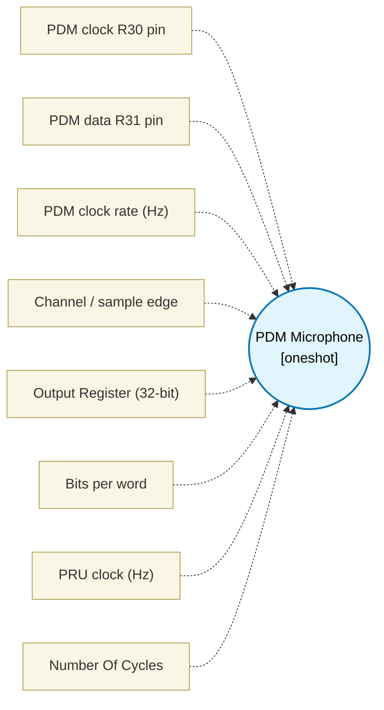

# PDM Microphone (`pdm_block`) — Design Document

> Generated by `build_block_docs.js` on 2026-10-21 from `.metadata/sysconfig/.meta/pru_blocks/pru_io_blocks/pdm_block.syscfg.js`. Do not edit by hand; re-run `node build_block_docs.js`.

## Purpose

Generates a jitter-free clock and samples on the correct edge every period. The clock period is round(clkHz / clkRateHz) PRU cycles (98 at 2.048 MHz and 200 MHz, 64 at 3.125 MHz), high for floor(period / 2) cycles; the delay counts are each half's length minus the fixed instruction overhead and the sample is branch-free, so the period does not depend on the data. After the last bit the shifted-in word (the first sample is the MSB, right-aligned in 'Bits per word', at most 32) is copied to output1 (4 bytes) as well as left in the Output Register. The block takes 3 + bits * period PRU cycles (Number Of Cycles). Fastest clock: about clkHz / 18 (mono / left), clkHz / 21 (right).

## Block Diagram




## Classification

- **Block id:** `pdm_block`
- **Category:** I/O & Protocol
- **Execution model (inferred):** `oneshot`
- **Macro / opcode:** `m_pdm_run`
- **Data ports:** 0 in / 0 out · **Cycles:** `1`

## Parameter schema

| Parameter | Display name | Default | Options |
|---|---|---|---|
| `clkPin` | PDM clock R30 pin | `11` | `0`, `1`, `2`, `3`, `4`, `5`, `6`, `7`, `8`, `9`, `10`, `11`, `12`, `13`, `14`, `15`, `16`, `17`, `18`, `19` |
| `dataPin` | PDM data R31 pin | `12` | `0`, `1`, `2`, `3`, `4`, `5`, `6`, `7`, `8`, `9`, `10`, `11`, `12`, `13`, `14`, `15`, `16`, `17`, `18`, `19` |
| `clkRateHz` | PDM clock rate (Hz) | `2048000` | — |
| `channel` | Channel / sample edge | `mono` | `mono`, `stereoLeft`, `stereoRight` |
| `dataRegister` | Output Register (32-bit) | `R5` | — |
| `numBits` | Bits per word | `32` | — |
| `clkHz` | PRU clock (Hz) | `200000000` | — |
| `noOfCycles` | Number Of Cycles | `1` | — |

## Ports

| Port | Type |
|---|---|
| `output1` | `output32` |
| `prev` | `IO_PREV` |
| `next` | `IO_NEXT` |

## Validation rules

- clkPin and dataPin must differ
- clkRateHz must be > 0
- clkHz must be > 0
- numBits must be an integer from 1 to 32 (the word is shifted into one 32-bit register)
- clkRateHz <value> too high for clkHz <value>: the clock period is <value> cycles but the
- clkRateHz <value> too low for clkHz <value>: delay loop count exceeds 32 bits

## Generated macro (`.xdt` equivalent)

```asm
m_pdm_run .macro RES, CLK_PIN, DATA_PIN, NH, PH, NL, PL, SAMPLE_HIGH, DATA_REG, NUM_BITS
    ldi   DATA_REG, 0
    ldi   TEMP_REG2.b0, NUM_BITS
pd_b?:
    set   R30, R30, CLK_PIN
    .if PH == 1
    nop
    .endif
    ldi32 TEMP_REG1, NH
pd_h?:
    sub   TEMP_REG1, TEMP_REG1, 1
    qbne  pd_h?, TEMP_REG1, 0
    .if SAMPLE_HIGH
    lsl   DATA_REG, DATA_REG, 1
    lsr   TEMP_REG1, R31, DATA_PIN
    and   TEMP_REG1, TEMP_REG1, 1
    or    DATA_REG, DATA_REG, TEMP_REG1
    .endif
    clr   R30, R30, CLK_PIN
    .if PL == 1
    nop
    .endif
    ldi32 TEMP_REG1, NL
pd_l?:
    sub   TEMP_REG1, TEMP_REG1, 1
    qbne  pd_l?, TEMP_REG1, 0
    .if SAMPLE_HIGH = 0
    lsl   DATA_REG, DATA_REG, 1
    lsr   TEMP_REG1, R31, DATA_PIN
    and   TEMP_REG1, TEMP_REG1, 1
    or    DATA_REG, DATA_REG, TEMP_REG1
    .endif
    sub   TEMP_REG2.b0, TEMP_REG2.b0, 1
    qbne  pd_b?, TEMP_REG2.b0, 0
    mov   RES, DATA_REG
    .endm
```

## Device portability

> **Source of truth:** `.metadata/sysconfig/.meta/pru_blocks/common/pru_device_caps.js` (TRM SPRUIM2J §6.4.1.1 / SPRUJB6 §7.3.1.1). Regenerated by `node build_block_docs.js` — do not edit by hand.

- **Required widget(s):** _(none)_
- **Validator:** `pru_blocks_static_module` raises a SysConfig **ERROR** naming both widget and device when a required widget is absent.

| Device (SoC) | Supported |
|---|---|
| `am243x` | ✅ |
| `am261x` | ✅ |
| `am263px` | ✅ |
| `am263x` | ✅ |
| `am64x` | ✅ |

## Outstanding TODO / VERIFY items

- None flagged in source.
