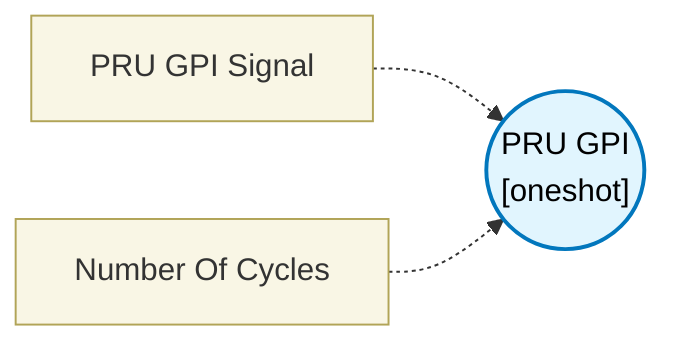

# PRU GPI (`pru_gpi_block`) — Design Document

> Generated by `build_block_docs.js` from `.metadata/sysconfig/.meta/pru_blocks/pru_io_blocks/pru_gpi_block.syscfg.js`. Do not edit by hand; re-run `node build_block_docs.js`.

## Purpose


## PRU GPI Block (General Purpose Input)

### Purpose
Reads digital input signals from PRU input pins and outputs the pin state to the next block.

### How It Works
1. **Select Pin**: Choose which PRU input pin to read (PRU_GPI_0 through PRU_GPI_19)
2. **Read Operation**: Generates an AND instruction to mask and read the specific bit from R31 register
3. **Output**: Provides the pin value (0 or 1) to the next block

### Configuration
- **PRU GPI Signal**: Select the input pin number (0-19)
  - Each pin maps to a specific bit in the R31 register
  - PRU_GPI_0 = bit 0, PRU_GPI_1 = bit 1, etc.

### Technical Details (Additional Information)
**Generated Assembly**:
- ZERO &result, 4                       ; Clear destination register (1 cycle)
- SET  result, result, pin_number       ; Create single-bit mask (1 cycle)
- AND  result, R31, result              ; Mask the specific bit (1 cycle)

**Performance**: 3 PRU cycles

**Register**: R31 is the PRU's input register
- Read-only register
- Reflects current state of PRU input pins
- Updated automatically by hardware

### Pin Mapping
The PRU_GPI pins map to physical device pins based on your board's pin mux configuration. Check your device's technical reference manual for exact pin mappings.

### Usage Examples

**Example 1: Reading a button state**
```
PRU GPI Block configured for PRU_GPI_5
  ↓ (outputs button state: 1=pressed, 0=released)
Next block processes button state
```

**Example 2: Reading multiple sensors**
```
PRU GPI (pin 0) → Sensor 1 state
PRU GPI (pin 1) → Sensor 2 state
PRU GPI (pin 2) → Sensor 3 state
```

**Example 3: Monitoring a UART RX line**
```
PRU GPI (pin 14) → UART RX signal state → Process in custom code
```

### Simulating Input Data

To test PRU GPI without hardware, use the **Simulation Settings** module to simulate pin state changes on R31:

**Simulation Setup:**
1. **Open Simulation Settings**: Navigate to the Simulation Settings module
2. **Select R31 Pin**: In "Select R31 (Input) Signals", select the pin configured for GPI
3. **Configure Input Mode**: Choose Timestamp Mode or Pattern Mode
4. **Define Pin States**: Enter when the pin should be HIGH (1) or LOW (0)

**Example - Simulating button press on PRU_GPI_5:**
```
R31 Bit 5 - Timestamp Mode:
  Input Cycles: [0, 100, 200, 300]
  Input Values: [0, 1, 1, 0]

  Interpretation:
  - Cycles 0-99: Button released (0)
  - Cycles 100-199: Button pressed (1)
  - Cycles 200-299: Button still pressed (1)
  - Cycles 300+: Button released (0)
```

**Example - Simulating PWM signal on PRU_GPI_3:**
```
R31 Bit 3 - Pattern Mode:
  Pattern: 1111110000111111000011111100001111110000

  Simulates a 60% duty cycle PWM signal
```

**Example - Simulating sensor transitions:**
```
R31 Bit 10 - Timestamp Mode:
  Input Cycles: [50, 150, 250, 350, 450]
  Input Values: [1, 0, 1, 0, 1]

  Simulates sensor detecting presence at specific time intervals
```

**Viewing Results:**
- Monitor the output value from the GPI block
- Verify the masked bit value matches expected R31 state
- Check that transitions occur at the configured cycle times
- Use waveform view to visualize input signal timing

### Terminology
- **GPI**: General Purpose Input
- **R31**: PRU input register (32-bit, read-only)
- **Bit masking**: Using AND operation to isolate a specific bit
- **Pin mux**: Pin multiplexer - configures physical pins for different functions
- **Pull-up/Pull-down**: Resistor that sets default pin state when not driven
- **Debouncing**: Filtering technique to remove noise from mechanical switches
- **Floating**: Unconnected pin that can randomly read 0 or 1

---


## Block Diagram




## Classification

- **Block id:** `pru_gpi_block`
- **Category:** I/O & Protocol
- **Execution model (inferred):** `oneshot`
- **Macro / opcode:** `AND`
- **Data ports:** 0 in / 0 out · **Cycles:** `3`

## Parameter schema

| Parameter | Display name | Default | Options |
|---|---|---|---|
| `constant1` | PRU GPI Signal | `R31, 1 << 0` | `R31, 1 << 0`, `R31, 1 << 1`, `R31, 1 << 2`, `R31, 1 << 3`, `R31, 1 << 4`, `R31, 1 << 5`, `R31, 1 << 6`, `R31, 1 << 7`, `R31, 1 << 8`, `R31, 1 << 9`, `R31, 1 << 10`, `R31, 1 << 11`, `R31, 1 << 12`, `R31, 1 << 13`, `R31, 1 << 14`, `R31, 1 << 15`, `R31, 1 << 16`, `R31, 1 << 17`, `R31, 1 << 18`, `R31, 1 << 19` |
| `noOfCycles` | Number Of Cycles | `3` | — |

## Ports

| Port | Type |
|---|---|
| `prev` | `IO_PREV` |
| `next` | `IO_NEXT` |

## Validation rules

- _(no explicit validate() rules)_

## Generated macro (`.xdt` equivalent)

_(inline opcode `AND` emitted by the shared generator)_

## Device portability

> **Source of truth:** `.metadata/sysconfig/.meta/pru_blocks/common/pru_device_caps.js` (TRM SPRUIM2J §6.4.1.1 / SPRUJB6 §7.3.1.1). Regenerated by `node build_block_docs.js` — do not edit by hand.

- **Required widget(s):** _(none)_
- **Validator:** `pru_blocks_static_module` raises a SysConfig **ERROR** naming both widget and device when a required widget is absent.

| Device (SoC) | Supported |
|---|---|
| `am243x` | ✅ |
| `am261x` | ✅ |
| `am263px` | ✅ |
| `am263x` | ✅ |
| `am64x` | ✅ |

## Outstanding TODO / VERIFY items

- None flagged in source.
