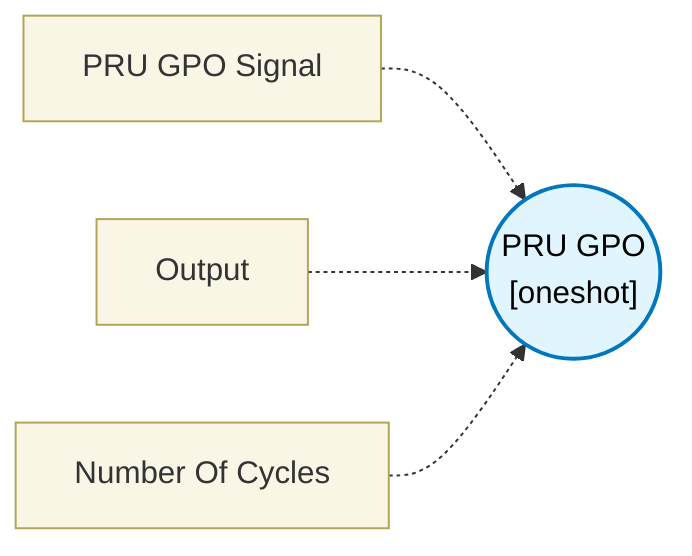

# PRU GPO (`pru_gpo_block`) — Design Document

> Generated by `build_block_docs.js` on 2026-10-21 from `.metadata/sysconfig/.meta/pru_blocks/pru_io_blocks/pru_gpo_block.syscfg.js`. Do not edit by hand; re-run `node build_block_docs.js`.

## Purpose


## PRU GPO Block (General Purpose Output)

### Purpose
Sets or clears digital output signals on PRU output pins. This is a terminating block that directly controls physical pin states.

### How It Works
1. **Select Pin**: Choose which PRU output pin to control (PRU_GPO_0 through PRU_GPO_19)
2. **Select Operation**: Choose SET (HIGH) or CLEAR (LOW)
3. **Execute**: Generates SET/CLR instruction to change the pin state immediately

### Configuration
- **PRU GPO Signal**: Select the output pin number (0-19)
- Each pin maps to a specific bit in the R30 register
- PRU_GPO_0 = bit 0, PRU_GPO_1 = bit 1, etc.
- **Output Operation**:
- **SET SIGNAL**: Sets the pin HIGH (logic 1)
- **CLEAR SIGNAL**: Sets the pin LOW (logic 0)

### Technical Details (Additional Information)
**Generated Assembly**:
- SET R30, pin_number      ; Set pin HIGH (1 cycle)
- ; OR
- CLR R30, pin_number      ; Set pin LOW (1 cycle)

**Performance**: 1 PRU cycle

**Register**: R30 is the PRU's output register
- Write-only register
- Controls state of PRU output pins
- Changes take effect immediately

### Usage Notes
- This is a **terminating block** - it has no output connections
- Multiple GPO blocks can control different pins independently
- Pin states persist until explicitly changed
- Physical pin behavior depends on pin mux configuration

### Pin Mapping
The PRU_GPO pins map to physical device pins based on your board's pin mux configuration. Check your device's technical reference manual for exact pin mappings.

### Usage Examples

**Example 1: Controlling an LED**
```
[Some condition check] → PRU GPO (pin 5, SET)
						Turns LED ON

[Another condition] → PRU GPO (pin 5, CLR)
					Turns LED OFF
```

**Example 2: Generating a chip select signal**
```
Start of SPI transaction:
PRU GPO (CS pin, CLR) → Assert CS (active low)

[SPI data transfer blocks]

End of SPI transaction:
PRU GPO (CS pin, SET) → Deassert CS (return to idle high)
```

**Example 3: Creating a pulse/strobe signal**
```
PRU GPO (pin 10, SET)  → Set pulse HIGH
[Delay block]
PRU GPO (pin 10, CLR)  → Set pulse LOW

Generates a pulse of configurable width
```

**Example 4: Multi-bit parallel output**
```
PRU GPO (pin 0, SET/CLR)  → Bit 0 of parallel bus
PRU GPO (pin 1, SET/CLR)  → Bit 1 of parallel bus
PRU GPO (pin 2, SET/CLR)  → Bit 2 of parallel bus
PRU GPO (pin 3, SET/CLR)  → Bit 3 of parallel bus

Creates a 4-bit parallel output port
```

**Example 5: Status/debug indicators**
```
[Error detected] → PRU GPO (error LED pin, SET)
[Normal operation] → PRU GPO (error LED pin, CLR)
[Busy processing] → PRU GPO (busy LED pin, SET)
[Idle] → PRU GPO (busy LED pin, CLR)
```

**Example 6: GPIO bit-banging protocols**
```
I2C Clock (SCL):
PRU GPO (SCL pin, SET/CLR) at appropriate times

I2C Data (SDA):
PRU GPO (SDA pin, SET/CLR) for data transmission
(Note: Need to switch to input mode for reading)
```

### Terminology
- **GPO**: General Purpose Output
- **R30**: PRU output register (32-bit, write-only)
- **SET**: Instruction that sets a bit to 1 (HIGH)
- **CLR**: Instruction that clears a bit to 0 (LOW)
- **Pin mux**: Pin multiplexer - configures physical pins for different functions
- **Terminating block**: Block with no output connections to other blocks
- **Bit-banging**: Software-controlled pin toggling to implement protocols
- **Current drive**: Maximum current a pin can source or sink
- **Open-drain**: Output configuration requiring external pull-up resistor
- **Logic level**: Voltage representing HIGH (1) or LOW (0) state
- **Pull-up/Pull-down**: Resistor that sets default pin state when not actively driven

---


## Block Diagram




## Classification

- **Block id:** `pru_gpo_block`
- **Category:** I/O & Protocol
- **Execution model (inferred):** `oneshot`
- **Macro / opcode:** `SET`
- **Data ports:** 0 in / 0 out · **Cycles:** `1`

## Parameter schema

| Parameter | Display name | Default | Options |
|---|---|---|---|
| `constant1` | PRU GPO Signal | `R30, 0` | `R30, 0`, `R30, 1`, `R30, 2`, `R30, 3`, `R30, 4`, `R30, 5`, `R30, 6`, `R30, 7`, `R30, 8`, `R30, 9`, `R30, 10`, `R30, 11`, `R30, 12`, `R30, 13`, `R30, 14`, `R30, 15`, `R30, 16`, `R30, 17`, `R30, 18`, `R30, 19` |
| `opCode` | Output | `SET` | `SET`, `CLR` |
| `noOfCycles` | Number Of Cycles | `1` | — |

## Ports

| Port | Type |
|---|---|
| `prev` | `IO_PREV` |
| `next` | `IO_NEXT` |

## Validation rules

- _(no explicit validate() rules)_

## Generated macro (`.xdt` equivalent)

_(inline opcode `SET` emitted by the shared generator)_

## Device portability

> **Source of truth:** `.metadata/sysconfig/.meta/pru_blocks/common/pru_device_caps.js` (TRM SPRUIM2J §6.4.1.1 / SPRUJB6 §7.3.1.1). Regenerated by `node build_block_docs.js` — do not edit by hand.

- **Required widget(s):** _(none)_
- **Validator:** `pru_blocks_static_module` raises a SysConfig **ERROR** naming both widget and device when a required widget is absent.

| Device (SoC) | Supported |
|---|---|
| `am243x` | ✅ |
| `am261x` | ✅ |
| `am263px` | ✅ |
| `am263x` | ✅ |
| `am64x` | ✅ |

## Outstanding TODO / VERIFY items

- None flagged in source.
