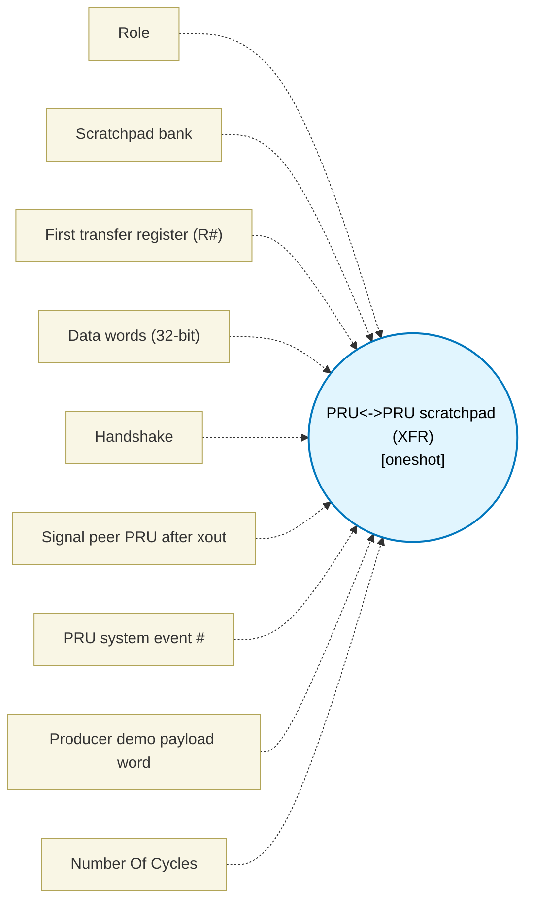

# PRU<->PRU scratchpad (XFR) (`pru_spad_block`) — Design Document

> Generated by `build_block_docs.js` from `.metadata/sysconfig/.meta/pru_blocks/pru_io_blocks/pru_spad_block.syscfg.js`. Do not edit by hand; re-run `node build_block_docs.js`.

## Purpose

The PRU-ICSS scratchpad is 3 banks of 30 x 32-bit registers, shared by both PRU cores.

## Block Diagram




## Classification

- **Block id:** `pru_spad_block`
- **Category:** I/O & Protocol
- **Execution model (inferred):** `oneshot`
- **Macro / opcode:** `m_pru_spad_run`
- **Data ports:** 0 in / 0 out · **Cycles:** `1`

## Parameter schema

| Parameter | Display name | Default | Options |
|---|---|---|---|
| `role` | Role | `producer` | `producer`, `consumer` |
| `bank` | Scratchpad bank | `0` | `0`, `1`, `2` |
| `baseReg` | First transfer register (R#) | `5` | — |
| `wordCount` | Data words (32-bit) | `4` | — |
| `handshake` | Handshake | `seq` | `none`, `seq` |
| `signalEvent` | Signal peer PRU after xout | `false` | — |
| `pruEvent` | PRU system event # | `18` | — |
| `demoValue` | Producer demo payload word | `0` | — |
| `noOfCycles` | Number Of Cycles | `1` | — |

## Ports

| Port | Type |
|---|---|
| `prev` | `IO_PREV` |
| `next` | `IO_NEXT` |

## Validation rules

- baseReg must be 0..29
- wordCount must be 1..30
- pruEvent must be a system event 16..31 (SPRUIM2J Table 6-67: event-generate channels 0..15)
- transfer exceeds the 30-word scratchpad bank
- transfer window runs into reserved registers

## Generated macro (`.xdt` equivalent)

```asm
m_pru_spad_run .macro RES, IS_PRODUCER, HAS_SEQ, BANK_DEV, BASE_REG, XFER_BYTES, SIGNAL_EVENT, DEMO_VAL
    .if IS_PRODUCER == 1
    ; Not fully macroizable dynamically because XOUT takes &Rn syntax natively.
    ; The register allocator must substitute this safely if required, but XFR handles &R# syntax.
    .endif
    .endm
```

## Device portability

> **Source of truth:** `.metadata/sysconfig/.meta/pru_blocks/common/pru_device_caps.js` (TRM SPRUIM2J §6.4.1.1 / SPRUJB6 §7.3.1.1). Regenerated by `node build_block_docs.js` — do not edit by hand.

- **Required widget(s):** _(none)_
- **Validator:** `pru_blocks_static_module` raises a SysConfig **ERROR** naming both widget and device when a required widget is absent.

| Device (SoC) | Supported |
|---|---|
| `am243x` | ✅ |
| `am261x` | ✅ |
| `am263px` | ✅ |
| `am263x` | ✅ |
| `am64x` | ✅ |

## Outstanding TODO / VERIFY items

- None flagged in source.
