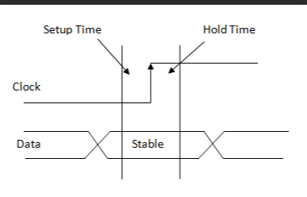
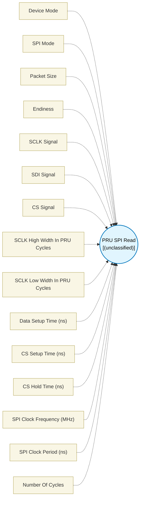

# PRU SPI Read (`pru_spi_read`) — Design Document

> Generated by `build_block_docs.js` from `.metadata/sysconfig/.meta/pru_blocks/pru_io_blocks/pru_spi_read.syscfg.js`. Do not edit by hand; re-run `node build_block_docs.js`.

## Purpose


## PRU SPI Read Block

### Purpose
Implements SPI (Serial Peripheral Interface) protocol to read data in both Controller and Peripheral modes using bit-banging on PRU GPIO pins.

### How It Works

**Controller Mode:**
1. **Configure Pins**: Select SCLK (clock output), SDI (data input), and CS (chip select output) pins
2. **Set Timing**: Configure clock pulse widths, setup/hold times, and packet size
3. **Execute**: Generates bit-banged SPI read sequence with proper timing
4. **Output**: Provides received data to the next block

**Peripheral Mode:**
1. **Configure Pins**: Select SCLK (clock input), SDI (data input), and CS (chip select input) pins
2. **Set Mode**: Configure SPI mode (MODE0-3), packet size, and CS filter cycles
3. **Execute**: Waits for CS assertion and controller clock, then reads data
4. **Output**: Provides received data to the next block

### SPI Protocol
SPI is a synchronous serial communication protocol with:
- **SCLK (Serial Clock)**: Clock signal (Controller generates, Peripheral follows)
- **SDI (Serial Data In)**: Data line from device to PRU
- **CS (Chip Select)**: Activates the peripheral device (active low)
- **Modes**: Determines clock polarity (CPOL) and phase (CPHA)

### Configuration Parameters

**Device Mode**: Select Controller or Peripheral operation mode

**SPI Mode**: Select MODE0-3 based on clock polarity and phase
- **MODE0** (CPOL=0, CPHA=0): Clock idles low, data sampled on rising edge, shifted on falling edge
- **MODE1** (CPOL=0, CPHA=1): Clock idles low, data sampled on falling edge, shifted on rising edge
- **MODE2** (CPOL=1, CPHA=0): Clock idles high, data sampled on falling edge, shifted on rising edge
- **MODE3** (CPOL=1, CPHA=1): Clock idles high, data sampled on rising edge, shifted on falling edge

**Packet Size**: Number of bits to read (8-32)
- 8 bits = 1 byte (most common)
- 16 bits = 2 bytes
- 32 bits = 4 bytes (maximum)

**Endianness**: Bit order
- **Most significant bit first** (MSB): Standard SPI, bit 7 → bit 0
- **Least significant bit first** (LSB): Bit 0 → bit 7

**CS Signal**: Select PRU_GPO (Controller) or PRU_GPI (Peripheral) pin for chip select

**SCLK Signal**: Select PRU_GPO (Controller) or PRU_GPI (Peripheral) pin for clock

**SDI Signal**: Select PRU_GPI pin for data input

### Clock Timing (Controller Mode Only)
- **SCLK High Width**: PRU cycles clock stays HIGH
- **SCLK Low Width**: PRU cycles clock stays LOW
- **Cycle Period**: Depends on PRU Clock Frequency (should be configured from R5F core and update same frequency in Simulation Settings to use while simulation)
- 200 MHz: 1 cycle = 5ns
- 250 MHz: 1 cycle = 4ns
- 333.333 MHz: 1 cycle = 3ns
- **Example** (at 333.333 MHz): High=7, Low=7 → 14 cycles per bit → ~23.8MHz SPI clock
- **Example** (at 200 MHz): High=7, Low=7 → 14 cycles per bit → ~14.3MHz SPI clock
- The **SPI Clock Frequency** field below automatically calculates the actual frequency based on your configured PRU clock
- Peripheral mode follows controller's clock timing

### Maximum Achievable Frequency
Different SPI modes have different minimum SCLK width requirements due to timing overhead.
Cycles per bit: **(2+d1) + (5+d2)**

**Theoretical Maximum (d1=0, d2=0 — controller overhead only):**
- **MODE0**: Min High=4, Min Low=3 → 200 MHz = 28.57 MHz | 333 MHz = 47.57 MHz (Total: 7 cycles)
- **MODE1**: Min High=1, Min Low=6 → 200 MHz = 28.57 MHz | 333 MHz = 47.57 MHz (Total: 7 cycles)
- **MODE2**: Min High=3, Min Low=4 → 200 MHz = 28.57 MHz | 333 MHz = 47.57 MHz (Total: 7 cycles)
- **MODE3**: Min High=6, Min Low=1 → 200 MHz = 28.57 MHz | 333 MHz = 47.57 MHz (Total: 7 cycles)

**Practical Maximum (d1=10, d2=7 — recommended for reliable operation):**
- All modes: Min High+Low = 24 cycles → **200 MHz = 8.33 MHz** | **333 MHz = 13.88 MHz**

**Note**: Theoretical maximums assume ideal peripheral response. Practical values (d1=10, d2=7) are recommended for reliable operation and are validated against the open-pru SPI slave macros. Actual maximum frequency depends on peripheral device specifications, signal integrity, and PCB layout. Always verify with oscilloscope and increase pulse widths if data corruption occurs.

### Setup and Hold Times (Controller Mode Only)



- **CS Setup Time**: Time delay (in nanoseconds) after CS assertion before starting SPI transaction. This ensures the peripheral device is ready before data transfer begins.
- **CS Hold Time**: Time delay (in nanoseconds) after the last bit is transferred before CS deassertion. This ensures the peripheral device has latched the data properly.
- **Data Setup Time**: Minimum time (in nanoseconds) MISO data must be stable before the sampling clock edge. Nops are inserted before the sampling edge. Automatically converted to PRU cycles internally using Math.ceil.

**Note**: CS Setup Time, CS Hold Time, and Data Setup Time are all specified in **nanoseconds** and automatically converted to PRU cycles based on the PRU Clock Frequency configured in **Simulation Settings**. Ensure the PRU Clock Frequency matches your hardware configuration for accurate timing.

### Peripheral Mode Parameters
- **CS Filter Cycles**: Number of consecutive cycles CS must be stable to be considered valid. This provides glitch rejection for noisy CS signals.

### Technical Details (Additional Information)

**Performance**:
- **Result initialization:** The destination register is cleared once before sampling, so packets shorter than 32 bits are zero-extended. This adds one cycle to the transaction overhead.
- Cycles per bit ≈ (high_width + low_width + data_setup_time + overhead)
- Total cycles ≈ CS_setup + (packet_size × cycles_per_bit) + CS_hold

### SPI Communication
**Typical SPI Transaction**:
1. Controller asserts CS (waits CS Setup Time)
2. Controller generates clock on SCLK
3. On each clock edge, peripheral outputs one bit on SDI
4. PRU samples SDI after Data Setup Time and stores the bit
5. Repeat for all bits in packet
6. Controller waits CS Hold Time, then deasserts CS

### Usage Notes
- No hardware SPI - uses GPIO bit-banging for flexibility
- Clock timing directly controls SPI speed
- Setup and hold times should match peripheral device datasheet requirements
- Ensure peripheral device supports the configured SPI mode and speed
- Physical pins must be configured via pin mux

### Simulating Input Data

To test SPI Read without hardware, use the **Simulation Settings** module to simulate the SDI (Serial Data In) signal:

1. **Open Simulation Settings**: Navigate to the Simulation Settings module
2. **Select GPI Pin**: In "Select R31 (Input) Signals", select the pin configured as SDI Signal
3. **Configure Input Mode**: Choose Timestamp Mode or Pattern Mode
4. **Define Data Pattern**: Enter the bit values the PRU should receive

**Example - Simulating 0xA5 (10100101) with MODE1:**
```
Input Mode: Timestamp
Input Cycles: [100, 107, 114, 121, 128, 135, 142, 149]
Input Values: [1, 0, 1, 0, 0, 1, 0, 1]
```

**Timing Calculation:**
- CS Setup Time determines when the first clock edge occurs
- For SCLK high=7, low=7: each bit period = 14 cycles
- MODE1 samples on falling edge: set data before the falling edge
- Align your input transitions with the expected sample points

**Viewing Results:**
- The simulation waveform shows both SCLK (output) and SDI (input)
- Verify that data transitions align with the correct clock edges
- Check the received data register value in the **PRU register allocation summary** view under **SIMULATION RESULTS**

---

### How to Verify Simulation Results

After running simulation:

1. Open the **PRU register allocation summary** view
2. Look for the **SIMULATION RESULTS** section at the bottom
3. Find your SPI Read block and verify the simulated value

---

### Tips for Creating Custom Patterns

1. **Always observe your actual waveform first**: Your actual SCLK timing depends on:
- Where the SPI Read block is placed in your flow
- Blocks executed before it (they consume cycles)
- Your specific timing configuration

2. **Start with all 1s or all 0s**: Set `Input Cycles: [1]`, `Input Values: [1]` or `[0]` with Repeat Last Bit enabled to verify you can receive constant data

3. **Identify exact sample points from waveform**:
- Run simulation with the above constant pattern
- Look at the SCLK waveform to see when clock edges occur
- Note the cycle numbers of the sampling edges for your mode:
	- MODE0: Rising edges
	- MODE1: Falling edges
	- MODE2: Falling edges
	- MODE3: Rising edges

4. **Set SDI transitions BEFORE sample points**: Once you know when sampling occurs (e.g., cycles 50, 60, 70...), set your SDI transitions a few cycles earlier (e.g., cycles 48, 58, 68...)

5. **Use the mode's sampling edge**:
- MODE0/MODE2: Sample on the first clock edge after the idle state changes
- MODE1/MODE3: Sample on the second clock edge

6. **Verify incrementally**: If the full byte isn't working, test one bit at a time to identify timing issues

### Terminology
- **SPI**: Serial Peripheral Interface - synchronous serial protocol
- **Bit-banging**: Software-controlled pin toggling to implement protocols
- **SCLK**: Serial Clock - timing signal for synchronization
- **SDI**: Serial Data In - data from peripheral to controller
- **CS**: Chip Select - enables/disables peripheral device
- **MSB/LSB**: Most/Least Significant Bit - bit order
- **Endianness**: Order of bit/byte transmission
- **CPOL**: Clock Polarity - idle state of clock (0=LOW, 1=HIGH)
- **CPHA**: Clock Phase - which edge shifts data (0=first edge, 1=second edge)
- **Setup Time**: Minimum time data must be stable before clock edge
- **Hold Time**: Minimum time data must remain stable after clock edge
- **CS Setup Time**: Time between CS assertion and first clock edge
- **CS Hold Time**: Time between last clock edge and CS deassertion

---

## Block Diagram




## Classification

- **Block id:** `pru_spi_read`
- **Category:** I/O & Protocol
- **Execution model (inferred):** `(unclassified)`
- **Macro / opcode:** `m_read_packet_spi_mode1_msb_gpo_sclk`
- **Data ports:** 0 in / 0 out · **Cycles:** `1`

## Parameter schema

| Parameter | Display name | Default | Options |
|---|---|---|---|
| `Device Mode` | Device Mode | `controller` | `controller`, `peripheral` |
| `SPI Mode` | SPI Mode | `MODE1` | `MODE0`, `MODE1`, `MODE2`, `MODE3` |
| `packetSize` | Packet Size | `8` | — |
| `Endiness` | — | `least significant bit first` | `most significant bit first`, `least significant bit first` |
| `SCLK Signal` | SCLK Signal | `0` | — |
| `SDI Signal` | — | `1` | `0`, `1`, `2`, `3`, `4`, `5`, `6`, `7`, `8`, `9`, `10`, `11`, `12`, `13`, `14`, `15`, `16`, `17`, `18`, `19` |
| `CS Signal` | CS Signal | `2` | — |
| `sclk high pulse width (in PRU cycles)` | SCLK High Width In PRU Cycles | `7` | — |
| `sclk low pulse width (in PRU cycles)` | SCLK Low Width In PRU Cycles | `7` | — |
| `Data Setup Time` | Data Setup Time (ns) | `0` | — |
| `CS Setup Time` | CS Setup Time (ns) | `35` | — |
| `CS Hold Time` | CS Hold Time (ns) | `10` | — |
| `spiFrequency` | SPI Clock Frequency (MHz) | `N/A` | — |
| `spiPeriod` | SPI Clock Period (ns) | `N/A` | — |
| `noOfCycles` | Number Of Cycles | `1` | — |

## Ports

| Port | Type |
|---|---|
| `prev` | `PREV` |
| `next` | `NEXT` |

## Validation rules

- Illegal SCLK pin value, please select from the dropdown options
- Illegal CS pin value, please select from the dropdown options
- CS Signal and SCLK Signal cannot use the same pin
- CS Signal and SDI Signal cannot use the same pin
- SCLK Signal and SDI Signal cannot use the same pin
- MODE0: SCLK High Width must be at least 4 cycles (overhead compensation for delay_component1)
- MODE0: SCLK Low Width must be at least <value> cycles (3 cycles overhead + <value> cycles Data Setup Time)
- MODE1: SCLK High Width must be at least <value> cycles (2 cycles overhead + <value> cycles Data Setup Time)
- MODE1: SCLK Low Width must be at least 5 cycles (overhead compensation for delay_component2)
- MODE2: SCLK Low Width must be at least 4 cycles (overhead compensation for delay_component1)
- MODE2: SCLK High Width must be at least <value> cycles (3 cycles overhead + <value> cycles Data Setup Time)
- MODE3: SCLK Low Width must be at least <value> cycles (2 cycles overhead + <value> cycles Data Setup Time)
- MODE3: SCLK High Width must be at least 5 cycles (overhead compensation for delay_component2)

## Generated macro (`.xdt` equivalent)

```asm
m_read_packet_spi_mode1_msb_gpo_sclk	.macro  dataReg, PACKETSIZE, bitId, SCLK_PIN, SDI_PIN, DELAY_COMPEN_1, DELAY_COMPEN_2, CS_PIN, CS_SETUP_TIME, CS_HOLD_TIME, DATA_SETUP_TIME
	; Parameters:
	;   dataReg           - Register to store received data
	;   PACKETSIZE        - Number of bits in the packet (8-32)
	;   bitId             - Register to track current bit position
	;   SCLK_PIN          - Serial clock output pin number (GPO)
	;   SDI_PIN           - Serial data input pin number (GPI)
	;   DELAY_COMPEN_1    - High pulse delay compensation (PRU cycles)
	;   DELAY_COMPEN_2    - Low pulse delay compensation (PRU cycles)
	;   CS_PIN            - Chip select output pin number (GPO)
	;   CS_SETUP_TIME     - Setup time after CS assertion (PRU cycles; the block converts its nanosecond setting, rounding up)
	;   CS_HOLD_TIME      - Hold time before CS deassertion (PRU cycles; the block converts its nanosecond setting, rounding up)
	;   DATA_SETUP_TIME   - Data setup time after clock edge (PRU cycles)
	clr r30, r30,   CS_PIN
	.loop   CS_SETUP_TIME
	nop
	.endloop
	ldi     dataReg, 0
	ldi     bitId, PACKETSIZE
READ_BIT_LOOP?:
	set r30, r30,   SCLK_PIN
	sub     bitId, bitId, 1
	.loop   DATA_SETUP_TIME
	nop
	.endloop
	.loop   DELAY_COMPEN_1
	nop
	.endloop
	clr r30, r30,   SCLK_PIN
	qbbc    BIT_ENTRY_0?, r31, SDI_PIN
	set     dataReg, dataReg, bitId
	qba     SKIP_BIT_ENTRY_0?
BIT_ENTRY_0?:
	clr     dataReg, dataReg, bitId
	nop
SKIP_BIT_ENTRY_0?:
	.loop   DELAY_COMPEN_2
	nop
	.endloop
	qbne    READ_BIT_LOOP?, bitId, 0
	.loop   CS_HOLD_TIME
	nop
	.endloop
	set r30, r30,   CS_PIN
 .endm
```

## Device portability

> **Source of truth:** `.metadata/sysconfig/.meta/pru_blocks/common/pru_device_caps.js` (TRM SPRUIM2J §6.4.1.1 / SPRUJB6 §7.3.1.1). Regenerated by `node build_block_docs.js` — do not edit by hand.

- **Required widget(s):** _(none)_
- **Validator:** `pru_blocks_static_module` raises a SysConfig **ERROR** naming both widget and device when a required widget is absent.

| Device (SoC) | Supported |
|---|---|
| `am243x` | ✅ |
| `am261x` | ✅ |
| `am263px` | ✅ |
| `am263x` | ✅ |
| `am64x` | ✅ |

## Outstanding TODO / VERIFY items

- None flagged in source.
