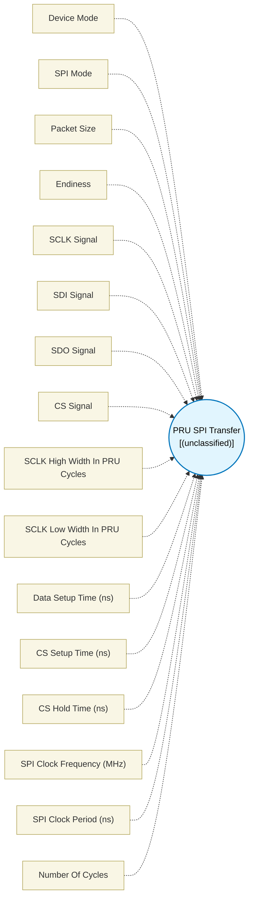

# PRU SPI Transfer (`pru_spi_transfer`) — Design Document

> Generated by `build_block_docs.js` from `.metadata/sysconfig/.meta/pru_blocks/pru_io_blocks/pru_spi_transfer.syscfg.js`. Do not edit by hand; re-run `node build_block_docs.js`.

## Purpose


## PRU SPI Transfer Block

### Purpose
Implements full-duplex SPI (Serial Peripheral Interface) transfer operation in both Controller and Peripheral modes using bit-banging on PRU GPIO pins. This block simultaneously sends and receives data in a single transaction.

### How It Works

**Controller Mode:**
1. **Connect Input**: Connect data source to input port (data to transmit)
2. **Configure Pins**: Select SCLK (clock output), SDI (data input), SDO (data output), and CS (chip select output) pins
3. **Set Timing**: Configure clock pulse widths, setup/hold times, and packet size
4. **Execute**: Generates bit-banged SPI transfer sequence with concurrent read and write
5. **Output**: Provides received data to the next block

**Peripheral Mode:**
1. **Connect Input**: Connect data source to input port (data to transmit)
2. **Configure Pins**: Select SCLK (clock input), SDI (data input), SDO (data output), and CS (chip select input) pins
3. **Set Mode**: Configure SPI mode (MODE0-3), packet size, and CS filter cycles
4. **Execute**: Waits for CS assertion and controller clock, then simultaneously reads and writes data
5. **Output**: Provides received data to the next block

### SPI Protocol
SPI is a synchronous serial communication protocol with:
- **SCLK (Serial Clock)**: Clock signal (Controller generates, Peripheral follows)
- **SDI (Serial Data In)**: Data line from device to PRU
- **SDO (Serial Data Out)**: Data line from PRU to device
- **CS (Chip Select)**: Activates the peripheral device (active low)
- **Modes**: Determines clock polarity (CPOL) and phase (CPHA)

### Configuration Parameters

**Device Mode**: Select Controller or Peripheral operation mode

**SPI Mode**: Select MODE0-3 based on clock polarity and phase
- **MODE0** (CPOL=0, CPHA=0): Clock idles low, data sampled on rising edge, shifted on falling edge
- **MODE1** (CPOL=0, CPHA=1): Clock idles low, data sampled on falling edge, shifted on rising edge
- **MODE2** (CPOL=1, CPHA=0): Clock idles high, data sampled on falling edge, shifted on rising edge
- **MODE3** (CPOL=1, CPHA=1): Clock idles high, data sampled on rising edge, shifted on falling edge

**Packet Size**: Number of bits to transfer (8-32)
- 8 bits = 1 byte (most common)
- 16 bits = 2 bytes
- 32 bits = 4 bytes (maximum)

**Endianness**: Bit order
- **Most significant bit first** (MSB): Standard SPI, bit 7 → bit 0
- **Least significant bit first** (LSB): Bit 0 → bit 7

**CS Signal**: Select PRU_GPO (Controller) or PRU_GPI (Peripheral) pin for chip select

**SCLK Signal**: Select PRU_GPO (Controller) or PRU_GPI (Peripheral) pin for clock

**SDI Signal**: Select PRU_GPI pin for data input (receive from device)

**SDO Signal**: Select PRU_GPO pin for data output (transmit to device)

### Clock Timing (Controller Mode Only)
- **SCLK High Width**: PRU cycles clock stays HIGH
- **SCLK Low Width**: PRU cycles clock stays LOW
- **Cycle Period**: Depends on PRU Clock Frequency(should be configured from R5F core and update same frequency in Simulation Settings to use while simulation)
- 200 MHz: 1 cycle = 5ns
- 250 MHz: 1 cycle = 4ns
- 333.333 MHz: 1 cycle = 3ns
- **Example** (at 333.333 MHz): High=13, Low=13 → 26 cycles per bit → ~12.8MHz SPI clock
- **Example** (at 200 MHz): High=13, Low=13 → 26 cycles per bit → ~7.69MHz SPI clock
- The **SPI Clock Frequency** field below automatically calculates the actual frequency based on your configured PRU clock
- Peripheral mode follows controller's clock timing
- **Important**: Timing margins must be sufficient for peripheral response time. Increase pulse widths if data transfer is unreliable.

### Maximum Achievable Frequency
Different SPI modes have different minimum SCLK width requirements due to timing overhead.
Cycles per bit: **(4+d1) + (6+d2)**

**Theoretical Maximum (d1=0, d2=0 — controller overhead only):**
- **MODE0**: Min High=4, Min Low=6 → 200 MHz = 20.00 MHz | 333 MHz = 33.30 MHz (Total: 10 cycles)
- **MODE1**: Min High=2, Min Low=6 → 200 MHz = 25.00 MHz | 333 MHz = 41.63 MHz (Total: 8 cycles)
- **MODE2**: Min High=6, Min Low=4 → 200 MHz = 20.00 MHz | 333 MHz = 33.30 MHz (Total: 10 cycles)
- **MODE3**: Min High=6, Min Low=2 → 200 MHz = 25.00 MHz | 333 MHz = 41.63 MHz (Total: 8 cycles)

**Practical Maximum (d1=9, d2=7 — validated for PRU-to-PRU loopback):**
- All modes: Min High=13, Min Low=13 → **200 MHz = 7.69 MHz** | **333 MHz = 12.80 MHz**

**Note**: Theoretical maximums assume ideal hardware peripheral response. For full-duplex PRU-to-PRU loopback using the SPI slave macros, use the practical values (d1=9, d2=7) which are validated against the open-pru SPI slave macros. The practical limit exists because the software-polled slave needs ~13 cycles minimum in both the high and low phases to detect edges and process data. Actual maximum frequency depends on peripheral device specifications, signal integrity, and PCB layout. If receiving corrupted data, increase SCLK pulse widths beyond these minimums.

### Setup and Hold Times (Controller Mode Only)


- **CS Setup Time**: Time delay (in nanoseconds) after CS assertion before starting SPI transaction. This ensures the peripheral device is ready before data transfer begins.
- **CS Hold Time**: Time delay (in nanoseconds) after the last bit is transferred before CS deassertion. This ensures the peripheral device has latched the data properly.
- **Data Setup Time**: Minimum time (in nanoseconds) data must be stable before the sampling clock edge. Automatically converted to PRU cycles internally using Math.ceil.

**Note**: CS Setup Time, CS Hold Time, and Data Setup Time are all specified in **nanoseconds** and automatically converted to PRU cycles based on the PRU Clock Frequency configured in **Simulation Settings**. Ensure the PRU Clock Frequency matches your hardware configuration for accurate timing.

### Peripheral Mode Parameters
- **CS Filter Cycles**: Number of consecutive cycles CS must be stable to be considered valid. This provides glitch rejection for noisy CS signals.

### Technical Details (Additional Information)

**Performance**:
- Cycles per bit ≈ (high_width + low_width + data_setup_time + overhead)
- Total cycles ≈ CS_setup + (packet_size × cycles_per_bit) + CS_hold
- Full-duplex: Same cycles as half-duplex, but transfers both directions simultaneously

### SPI Communication
**Typical SPI Full-Duplex Transfer**:
1. Controller asserts CS (waits CS Setup Time)
2. Controller outputs data bit on SDO and generates clock edge
3. On the sampling clock edge:
- Peripheral samples controller's data on SDI
- Controller samples peripheral's data on SDI (concurrently)
4. Repeat for all bits in packet
5. Controller waits CS Hold Time, then deasserts CS

**Key Timing Consideration**:
In full-duplex mode, the peripheral must output its data quickly enough after detecting the shifting clock edge so the controller can sample it on the sampling edge. If timing is too tight, increase SCLK Low Width (MODE1/MODE3) or SCLK High Width (MODE0/MODE2) to give the peripheral more time to respond.

### Usage Notes
- No hardware SPI - uses GPIO bit-banging for flexibility
- Full-duplex transfers data in both directions simultaneously
- Clock timing directly controls SPI speed
- MODE2 and MODE3 initialize SCLK to HIGH (idle state) before asserting CS
- Setup and hold times should match peripheral device datasheet requirements
- Data input must be connected to this block for transmit data
- Output provides received data for further processing
- Ensure peripheral device supports the configured SPI mode and speed
- Physical pins must be configured via pin mux
- **Timing margins are critical**: If receiving incorrect data, increase SCLK pulse widths to give peripheral more response time

### Simulating Input Data

To test SPI Transfer without hardware, use the **Simulation Settings** module to simulate the SDI (Serial Data In) signal:

1. **Open Simulation Settings**: Navigate to the Simulation Settings module
2. **Select GPI Pin**: In "Select R31 (Input) Signals", select the pin configured as SDI Signal
3. **Configure Input Mode**: Choose Timestamp Mode or Pattern Mode
4. **Define Data Pattern**: Enter the bit values the PRU should receive from the simulated peripheral device

**Example - Simulating peripheral sending 0xC3 (11000011) with MODE3:**
```
Input Mode: Timestamp
Input Cycles: [120, 144, 168, 192, 216, 240, 264, 288]
Input Values: [1, 1, 0, 0, 0, 0, 1, 1]
```

### Terminology
- **SPI**: Serial Peripheral Interface - synchronous serial protocol
- **Bit-banging**: Software-controlled pin toggling to implement protocols
- **Full-duplex**: Simultaneous bidirectional data transfer
- **SCLK**: Serial Clock - timing signal for synchronization
- **SDI**: Serial Data In - data from peripheral to controller
- **SDO**: Serial Data Out - data from controller to peripheral
- **CS**: Chip Select - enables/disables peripheral device
- **MSB/LSB**: Most/Least Significant Bit - bit order
- **Endianness**: Order of bit/byte transmission
- **CPOL**: Clock Polarity - idle state of clock (0=LOW, 1=HIGH)
- **CPHA**: Clock Phase - which edge shifts data (0=first edge, 1=second edge)
- **Setup Time**: Minimum time data must be stable before clock edge
- **Hold Time**: Minimum time data must remain stable after clock edge
- **CS Setup Time**: Time between CS assertion and first clock edge
- **CS Hold Time**: Time between last clock edge and CS deassertion

---


## Block Diagram




## Classification

- **Block id:** `pru_spi_transfer`
- **Category:** I/O & Protocol
- **Execution model (inferred):** `(unclassified)`
- **Macro / opcode:** `m_transfer_packet_spi_mode3_msb_gpo_sclk`
- **Data ports:** 0 in / 0 out · **Cycles:** `1`

## Parameter schema

| Parameter | Display name | Default | Options |
|---|---|---|---|
| `Device Mode` | Device Mode | `controller` | `controller`, `peripheral` |
| `SPI Mode` | SPI Mode | `MODE3` | `MODE0`, `MODE1`, `MODE2`, `MODE3` |
| `packetSize` | Packet Size | `32` | — |
| `Endiness` | — | `most significant bit first` | `most significant bit first`, `least significant bit first` |
| `SCLK Signal` | SCLK Signal | `0` | — |
| `SDI Signal` | SDI Signal | `1` | `0`, `1`, `2`, `3`, `4`, `5`, `6`, `7`, `8`, `9`, `10`, `11`, `12`, `13`, `14`, `15`, `16`, `17`, `18`, `19` |
| `SDO Signal` | SDO Signal | `2` | `0`, `1`, `2`, `3`, `4`, `5`, `6`, `7`, `8`, `9`, `10`, `11`, `12`, `13`, `14`, `15`, `16`, `17`, `18`, `19` |
| `CS Signal` | CS Signal | `3` | — |
| `sclk high pulse width (in PRU cycles)` | SCLK High Width In PRU Cycles | `9` | — |
| `sclk low pulse width (in PRU cycles)` | SCLK Low Width In PRU Cycles | `7` | — |
| `Data Setup Time` | Data Setup Time (ns) | `0` | — |
| `CS Setup Time` | CS Setup Time (ns) | `35` | — |
| `CS Hold Time` | CS Hold Time (ns) | `10` | — |
| `spiFrequency` | SPI Clock Frequency (MHz) | `N/A` | — |
| `spiPeriod` | SPI Clock Period (ns) | `N/A` | — |
| `noOfCycles` | Number Of Cycles | `1` | — |

## Ports

| Port | Type |
|---|---|
| `prev` | `PREV` |
| `next` | `NEXT` |

## Validation rules

- Illegal SCLK pin value, please select from the dropdown options
- Illegal CS pin value, please select from the dropdown options
- CS Signal and SCLK Signal cannot use the same pin
- CS Signal and SDO Signal cannot use the same pin
- CS Signal and SDI Signal cannot use the same pin
- SCLK Signal and SDO Signal cannot use the same pin
- SCLK Signal and SDI Signal cannot use the same pin
- SDO Signal and SDI Signal cannot use the same pin
- MODE0: SCLK Low Width must be at least <value> cycles (6 cycles overhead + <value> cycles Data Setup Time)
- MODE0: SCLK High Width must be at least 4 cycles (overhead compensation)
- MODE1: SCLK High Width must be at least <value> cycles (4 cycles overhead + <value> cycles Data Setup Time)
- MODE1: SCLK Low Width must be at least 6 cycles (overhead compensation)
- MODE2: SCLK High Width must be at least <value> cycles (6 cycles overhead + <value> cycles Data Setup Time)
- MODE2: SCLK Low Width must be at least 4 cycles (overhead compensation)
- MODE3: SCLK Low Width must be at least <value> cycles (4 cycles overhead + <value> cycles Data Setup Time)
- MODE3: SCLK High Width must be at least 6 cycles (overhead compensation)

## Generated macro (`.xdt` equivalent)

```asm
m_transfer_packet_spi_mode3_msb_gpo_sclk	.macro  r_dataReg, s_dataReg, PACKETSIZE, bitId, SCLK_PIN, SDI_PIN, SDO_PIN, DELAY_COMPEN_1, DELAY_COMPEN_2, CS_PIN, CS_SETUP_TIME, CS_HOLD_TIME, DATA_SETUP_TIME
	; Parameters:
	;   r_dataReg         - Register to store received data (output)
	;   s_dataReg         - Register containing data to transmit (input)
	;   PACKETSIZE        - Number of bits in the packet (8-32)
	;   bitId             - Register to track current bit position
	;   SCLK_PIN          - Serial clock output pin number (GPO)
	;   SDI_PIN           - Serial data input pin number (GPI)
	;   SDO_PIN           - Serial data output pin number (GPO)
	;   DELAY_COMPEN_1    - High pulse delay compensation (PRU cycles)
	;   DELAY_COMPEN_2    - Low pulse delay compensation (PRU cycles)
	;   CS_PIN            - Chip select output pin number (GPO)
	;   CS_SETUP_TIME     - Setup time after CS assertion (PRU cycles; the block converts its nanosecond setting, rounding up)
	;   CS_HOLD_TIME      - Hold time before CS deassertion (PRU cycles; the block converts its nanosecond setting, rounding up)
	;   DATA_SETUP_TIME   - Data setup time after clock edge (PRU cycles)
	ldi     r_dataReg, 0
	set r30, r30,   SCLK_PIN
	clr r30, r30,   CS_PIN
	.loop   CS_SETUP_TIME
	nop
	.endloop
	ldi     bitId, PACKETSIZE - 1
READ_BIT_LOOP?:
	; MODE3 SHIFTING_EDGE: falling edge (CLR SCLK)
	clr r30, r30,   SCLK_PIN
	qbbc    data_low?, s_dataReg, bitId
	set r30, r30,   SDO_PIN
	qba     data_high?
data_low?:
	clr r30, r30,   SDO_PIN
	NOP
data_high?:
	.loop   DATA_SETUP_TIME
	nop
	.endloop
	.loop   DELAY_COMPEN_1
	nop
	.endloop
	; MODE3 SAMPLING_EDGE: rising edge (SET SCLK)
	set r30, r30,   SCLK_PIN
	qbbc    BIT_ENTRY_0?, r31, SDI_PIN
	set     r_dataReg, r_dataReg, bitId
	qba     SKIP_BIT_ENTRY_0?
BIT_ENTRY_0?:
	clr     r_dataReg, r_dataReg, bitId
	nop
SKIP_BIT_ENTRY_0?:
	.loop   DELAY_COMPEN_2
	nop
	.endloop
	sub     bitId, bitId, 1
	qbne    READ_BIT_LOOP?, bitId, 0xFF
	.loop   CS_HOLD_TIME
	nop
	.endloop
	set r30, r30,   CS_PIN
 .endm
```

## Device portability

> **Source of truth:** `.metadata/sysconfig/.meta/pru_blocks/common/pru_device_caps.js` (TRM SPRUIM2J §6.4.1.1 / SPRUJB6 §7.3.1.1). Regenerated by `node build_block_docs.js` — do not edit by hand.

- **Required widget(s):** _(none)_
- **Validator:** `pru_blocks_static_module` raises a SysConfig **ERROR** naming both widget and device when a required widget is absent.

| Device (SoC) | Supported |
|---|---|
| `am243x` | ✅ |
| `am261x` | ✅ |
| `am263px` | ✅ |
| `am263x` | ✅ |
| `am64x` | ✅ |

## Outstanding TODO / VERIFY items

- None flagged in source.
