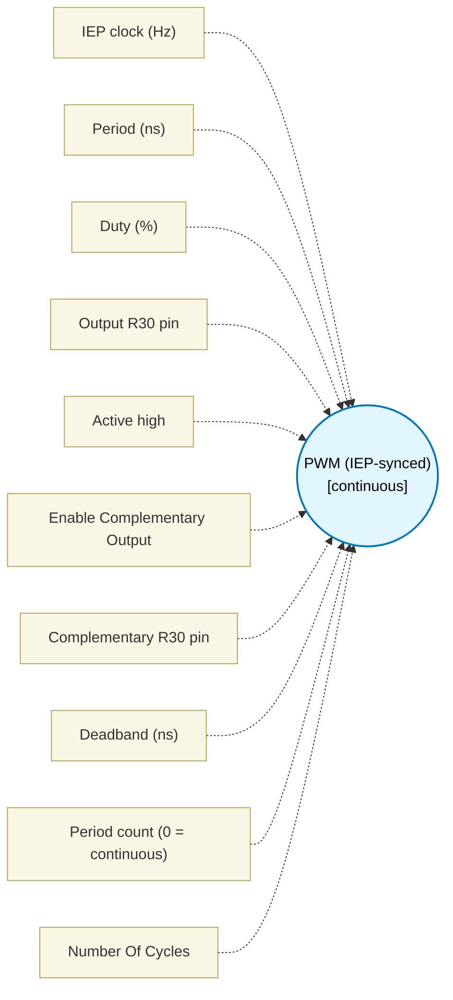

# PWM (IEP-synced) (`pwm_block`) — Design Document

> Generated by `build_block_docs.js` from `.metadata/sysconfig/.meta/pru_blocks/pru_io_blocks/pwm_block.syscfg.js`. Do not edit by hand; re-run `node build_block_docs.js`.

## Purpose

Emits a single-channel IEP-CMP PWM (CMP0=period, CMP1=duty) edge-aligned. By default it loops forever and has no next port. Set Period count to N (1..2147483647) to emit exactly N full periods and then fall through to the next block: the block gains a next port, compare events are disabled after the last period, and every period, the last included, runs the same macro as the continuous mode, so the edge timing is the same. It is not cycle-exact: each edge lands 0..3 cycles after its IEP compare event, because the block polls the IEP status with a 4-cycle loop. Derived from the macro text and checked in the TI pru-simulator (LBCO = 3 cycles, not verified on silicon): the steady period is P +/-3 cycles; the first period is P+7..P+10; the steady active width is D-8..D-2 (D-9..D-3 with the complementary output); the complement edge follows its main edge by exactly 1 cycle. These windows hold only when the duty count D is at least 11 and the low time P-D is at least 10 counts (P = period counts, D = duty counts).  The exit costs 4 cycles, all after the final period boundary (measured from the cycle at which the continuous mode would start period N+1 to the cycle counter on return, in the TI pru-simulator on the clpru ELF). Note: Deadband (ns) is accepted but not yet inserted between the main and complementary edges, in either mode.

## Block Diagram




## Classification

- **Block id:** `pwm_block`
- **Category:** I/O & Protocol
- **Execution model (inferred):** `continuous`
- **Macro / opcode:** `m_pwm_run`
- **Data ports:** 0 in / 0 out · **Cycles:** `1`

## Parameter schema

| Parameter | Display name | Default | Options |
|---|---|---|---|
| `clkHz` | IEP clock (Hz) | `200000000` | — |
| `periodNs` | Period (ns) | `5000` | — |
| `dutyPct` | Duty (%) | `25` | — |
| `pin` | Output R30 pin | `5` | `0`, `1`, `2`, `3`, `4`, `5`, `6`, `7`, `8`, `9`, `10`, `11`, `12`, `13`, `14`, `15`, `16`, `17`, `18`, `19` |
| `activeHigh` | Active high | `true` | — |
| `enableComplementary` | Enable Complementary Output | `false` | — |
| `compPin` | Complementary R30 pin | `6` | `0`, `1`, `2`, `3`, `4`, `5`, `6`, `7`, `8`, `9`, `10`, `11`, `12`, `13`, `14`, `15`, `16`, `17`, `18`, `19` |
| `deadbandNs` | Deadband (ns) | `100` | — |
| `periodCount` | Period count (0 = continuous) | `0` | — |
| `noOfCycles` | Number Of Cycles | `1` | — |

## Ports

| Port | Type |
|---|---|
| `prev` | `IO_PREV` |

## Validation rules

- periodNs must be > 0
- dutyPct must be 0..100
- clkHz must be > 0
- Complementary pin must be different
- periodCount must be 0..2147483647
- Counted mode needs at least 1 duty count, but Duty (<value>%) of Period (<value> ns) is <value> IEP counts at <value> Hz and the run would never end: raise dutyPct or periodNs, or set periodCount to 0

## Generated macro (`.xdt` equivalent)

```asm
m_pwm_run .macro RES, PIN, PERIOD_COUNTS, DUTY_COUNTS, ACTIVE_HIGH, EN_COMP, COMP_PIN, DEADBAND_COUNTS
    ; IEP setup. Per TRM SPRUIM2J 6.4.13 the counter only runs when
    ; GLOBAL_CFG[0] CNT_ENABLE is set, GLOBAL_CFG[7:4] DEFAULT_INC is the
    ; step size, and a compare only fires when its CMP_CFG[16:1] CMP_EN bit
    ; is set - CMP_EN starts at bit 1, so CMP0 is bit 1 and CMP1 is bit 2.
    ; Omitting these left the block waiting on a compare that never fired.
    ; Order matters. Enabling the counter or the compares before the
    ; compare values are installed leaves stale CMP0/CMP1 live against a
    ; running counter, which can fire an event and reset the period before
    ; this macro's values land - visible on re-invocation. TRM 6.4.13
    ; sequence: disable, program, clear status, then enable last.
    ldi32 TEMP_REG1, 0
    sbco  &TEMP_REG1, c26, 0x00, 4
    sbco  &TEMP_REG1, c26, 0x70, 4
    sbco  &TEMP_REG1, c26, 0x10, 4
    ldi32 TEMP_REG1, 0x3
    sbco  &TEMP_REG1, c26, 0x74, 4
    ldi32 TEMP_REG1, PERIOD_COUNTS
    sbco  &TEMP_REG1, c26, 0x78, 4
    ldi32 TEMP_REG1, DUTY_COUNTS
    ; 0x50 is CMP1_REG0. 0x4C is CMP0's UPPER half - the compare registers
    ; are 64-bit pairs (IEP_CMPj_REG0/REG1), so writing duty there corrupted
    ; CMP0 and left CMP1 unprogrammed.
    sbco  &TEMP_REG1, c26, 0x80, 4
    ldi32 TEMP_REG1, 0x7
    sbco  &TEMP_REG1, c26, 0x70, 4
    ldi32 TEMP_REG1, 0x11
    sbco  &TEMP_REG1, c26, 0x00, 4
pw_l?:
    .if ACTIVE_HIGH
    .if EN_COMP == 1
    clr   R30, R30, COMP_PIN
    .endif
    set   R30, R30, PIN
    .else
    .if EN_COMP == 1
    set   R30, R30, COMP_PIN
    .endif
    clr   R30, R30, PIN
    .endif
pw_wd?:
    lbco  &TEMP_REG1, c26, 0x74, 4
    qbbc  pw_wd?, TEMP_REG1, 1
    .if ACTIVE_HIGH
    clr   R30, R30, PIN
    .if EN_COMP == 1
    ; TODO: insert DEADBAND_COUNTS delay here before toggling comp pin
    set   R30, R30, COMP_PIN
    .endif
    .else
    set   R30, R30, PIN
    .if EN_COMP == 1
    ; TODO: insert DEADBAND_COUNTS delay here before toggling comp pin
    clr   R30, R30, COMP_PIN
    .endif
    .endif
    ldi32 TEMP_REG1, 2
    sbco  &TEMP_REG1, c26, 0x74, 4
pw_wp?:
    lbco  &TEMP_REG1, c26, 0x74, 4
    qbbc  pw_wp?, TEMP_REG1, 0
    ldi32 TEMP_REG1, 1
    sbco  &TEMP_REG1, c26, 0x74, 4
    qba   pw_l?
    .endm
```

## Device portability

> **Source of truth:** `.metadata/sysconfig/.meta/pru_blocks/common/pru_device_caps.js` (TRM SPRUIM2J §6.4.1.1 / SPRUJB6 §7.3.1.1). Regenerated by `node build_block_docs.js` — do not edit by hand.

- **Required widget(s):** _(none)_
- **Validator:** `pru_blocks_static_module` raises a SysConfig **ERROR** naming both widget and device when a required widget is absent.

| Device (SoC) | Supported |
|---|---|
| `am243x` | ✅ |
| `am261x` | ✅ |
| `am263px` | ✅ |
| `am263x` | ✅ |
| `am64x` | ✅ |

## Outstanding TODO / VERIFY items

- ⚠️ ; TODO: insert DEADBAND_COUNTS delay here before toggling comp pin,
- ⚠️ TODO: insert DEADBAND_COUNTS delay here before toggling comp pin
