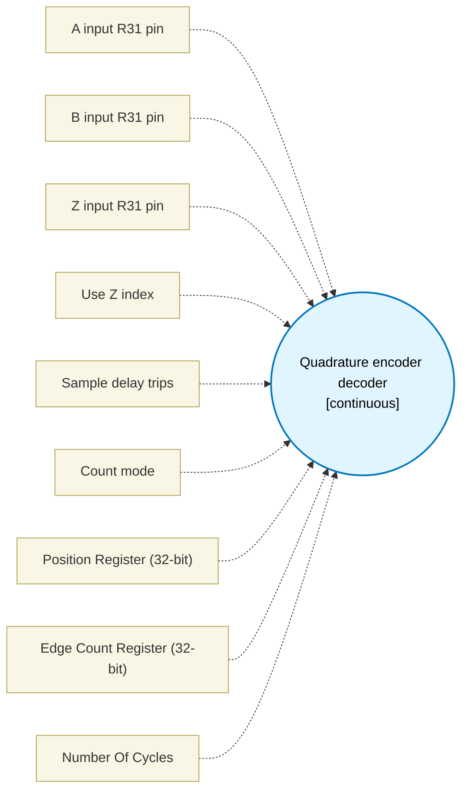

# Quadrature encoder decoder (`quadrature_block`) — Design Document

> Generated by `build_block_docs.js` from `.metadata/sysconfig/.meta/pru_blocks/pru_io_blocks/quadrature_block.syscfg.js`. Do not edit by hand; re-run `node build_block_docs.js`.

## Purpose

Emits a polling decoder with position and edge-count state in PRU registers.

## Block Diagram




## Classification

- **Block id:** `quadrature_block`
- **Category:** I/O & Protocol
- **Execution model (inferred):** `continuous`
- **Macro / opcode:** `m_quadrature_run`
- **Data ports:** 0 in / 0 out · **Cycles:** `1`

## Parameter schema

| Parameter | Display name | Default | Options |
|---|---|---|---|
| `aBit` | A input R31 pin | `0` | `0`, `1`, `2`, `3`, `4`, `5`, `6`, `7`, `8`, `9`, `10`, `11`, `12`, `13`, `14`, `15`, `16`, `17`, `18`, `19` |
| `bBit` | B input R31 pin | `1` | `0`, `1`, `2`, `3`, `4`, `5`, `6`, `7`, `8`, `9`, `10`, `11`, `12`, `13`, `14`, `15`, `16`, `17`, `18`, `19` |
| `zBit` | Z input R31 pin | `2` | `0`, `1`, `2`, `3`, `4`, `5`, `6`, `7`, `8`, `9`, `10`, `11`, `12`, `13`, `14`, `15`, `16`, `17`, `18`, `19` |
| `useIndex` | Use Z index | `false` | — |
| `sampleCycles` | Sample delay trips | `10` | — |
| `countMode` | Count mode | `x4` | `x1`, `x2`, `x4` |
| `posRegister` | Position Register (32-bit) | `R4` | — |
| `edgeRegister` | Edge Count Register (32-bit) | `R5` | — |
| `noOfCycles` | Number Of Cycles | `1` | — |

## Ports

| Port | Type |
|---|---|
| `prev` | `IO_PREV` |

## Validation rules

- aBit, bBit, and zBit must differ
- sampleCycles must be >= 1

## Generated macro (`.xdt` equivalent)

```asm
m_quadrature_run .macro RES, A_BIT, B_BIT, Z_BIT, USE_INDEX, COUNT_MODE, SAMPLE_TRIPS, POS_REG, EDGE_REG
    ldi32 POS_REG, 0
    ldi32 EDGE_REG, 0
    qbbs  qd_ia?, R31, A_BIT
    ldi32 TEMP_REG1, 0
    qba   qd_ib?
qd_ia?:
    ldi32 TEMP_REG1, 2
qd_ib?:
    qbbc  qd_l?, R31, B_BIT
    add   TEMP_REG1, TEMP_REG1, 1
qd_l?:
    ldi TEMP_REG2.w0, 0
    qbbc  qd_rb?, R31, A_BIT
    ldi TEMP_REG2.w0, 2
qd_rb?:
    qbbc  qd_hs?, R31, B_BIT
    add   TEMP_REG2.w0, TEMP_REG2.w0, 1
qd_hs?:
    qbeq  qd_sd?, TEMP_REG2.w0, TEMP_REG1
    lsl   TEMP_REG2.w2, TEMP_REG1, 2
    or    TEMP_REG2.w2, TEMP_REG2.w2, TEMP_REG2.w0
    .if COUNT_MODE == 4
    .else
    .if COUNT_MODE == 2
    and   TEMP_REG2.b3, TEMP_REG2.w2, 1
    qbeq  qd_sd?, TEMP_REG2.b3, 0
    .else
    qbeq  qd_sd?, TEMP_REG2.w2, 1
    qbeq  qd_sd?, TEMP_REG2.w2, 2
    qbeq  qd_sd?, TEMP_REG2.w2, 3
    .endif
    .endif
    qbeq  qd_fw?, TEMP_REG2.w2, 1
    qbeq  qd_fw?, TEMP_REG2.w2, 7
    qbeq  qd_fw?, TEMP_REG2.w2, 14
    qbeq  qd_fw?, TEMP_REG2.w2, 8
    qbeq  qd_rv?, TEMP_REG2.w2, 2
    qbeq  qd_rv?, TEMP_REG2.w2, 11
    qbeq  qd_rv?, TEMP_REG2.w2, 13
    qbeq  qd_rv?, TEMP_REG2.w2, 4
    qba   qd_ul?
qd_fw?:
    add   POS_REG, POS_REG, 1
    add   EDGE_REG, EDGE_REG, 1
    qba   qd_ul?
qd_rv?:
    sub   POS_REG, POS_REG, 1
    add   EDGE_REG, EDGE_REG, 1
qd_ul?:
    mov   TEMP_REG1, TEMP_REG2.w0
qd_sd?:
    .if USE_INDEX == 1
    qbbc  qd_ni?, R31, Z_BIT
    ldi32 POS_REG, 0
qd_ni?:
    .endif
    ldi TEMP_REG2.w0, SAMPLE_TRIPS
qd_dl?:
    sub   TEMP_REG2.w0, TEMP_REG2.w0, 1
    qbne  qd_dl?, TEMP_REG2.w0, 0
    qba   qd_l?
    .endm
```

## Device portability

> **Source of truth:** `.metadata/sysconfig/.meta/pru_blocks/common/pru_device_caps.js` (TRM SPRUIM2J §6.4.1.1 / SPRUJB6 §7.3.1.1). Regenerated by `node build_block_docs.js` — do not edit by hand.

- **Required widget(s):** _(none)_
- **Validator:** `pru_blocks_static_module` raises a SysConfig **ERROR** naming both widget and device when a required widget is absent.

| Device (SoC) | Supported |
|---|---|
| `am243x` | ✅ |
| `am261x` | ✅ |
| `am263px` | ✅ |
| `am263x` | ✅ |
| `am64x` | ✅ |

## Outstanding TODO / VERIFY items

- None flagged in source.
